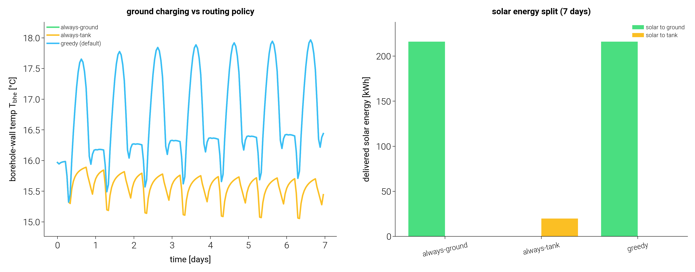

# Per-timestep solar routing — ground vs tank

`GSHPB_STC_routed` unifies the two solar scenarios (`GSHPB_STC_ground`,
`GSHPB_STC_tank`) into one model that routes the collected solar heat to the
borehole field **or** the storage tank **each timestep**, exclusively (never
both). The routing decision is a control input — a callable `solar_router`
evaluated every step — so it is a natural per-timestep **decision variable for an
MPC**.

## Why one model with a router

The two destinations enter the dynamic solve through different couplings, so a
single class gates each per step:

| route    | coupling                                   | effect                          |
| -------- | ------------------------------------------ | ------------------------------- |
| `tank`   | net `Q_STC` in the tank energy balance     | DHW preheat now                 |
| `ground` | solar heat subtracted from the HP ground load before borehole superposition | seasonal source charging (COP later) |
| `off`    | neither — reduces to the base GSHPB        | —                               |

Exclusivity is structural: the router returns a single destination, so ground and
tank are never charged on the same step. The chosen destination is still gated by
the collector-loop controller (outlet at least `dT_stc_off` above that sink, gain
above the pump power, below boiling, and on the tank route below the storage high
limit `T_stc_tank_max`, 85 °C, at which charging stops within the step; freeze
protection; lock-out of a collector that stagnated above `T_stc_lockout`, 130 °C),
falling back to `off` if the loop would not run.

```python
from tmhp import GSHPB_STC_routed, default_solar_router

# default greedy policy: tank when below setpoint, else ground
model = GSHPB_STC_routed(stc=stc, ref="R32", T_tank_w_lower_bound=60.0)

# or supply your own per-step decision (e.g. an MPC output)
model = GSHPB_STC_routed(stc=stc, solar_router=lambda *, T_tank_w, T_bhe, **_:
                         "tank" if T_tank_w < 60 else "ground")
```

The router signature exposes the step state an MPC would branch on
(`hour_of_day`, `T_tank_w`, `T_tank_lower`, `T_bhe`, `T0`); unused keys are
accepted so a custom router never breaks on signature drift.

## Experiment — three policies, 7-day diurnal run

`compare_routing_policies.py` runs the same 7-day schedule (diurnal sun + morning/
evening DHW draws) under three policies on a small 2×1 borehole field. The sun is
a constant 800 W/m² direct-normal plus 120 W/m² diffuse-horizontal from 07:00 to
18:00; the 6 m² collector (35° south, Seoul, equinox by default) sees it on its own
plane, with the sun position of each hour.



| policy        | solar→ground [kWh] | solar→tank [kWh] | T_bhe mean [°C] | T_bhe min [°C] | T_bhe end [°C] |
| ------------- | ------------------ | ---------------- | --------------- | -------------- | -------------- |
| always-ground | 216.1              | 0.0              | 16.7            | 15.3           | 16.4           |
| always-tank   | 0.0                | 18.4             | 15.6            | 15.1           | 15.4           |
| greedy        | 216.1              | 0.0              | 16.7            | 15.3           | 16.4           |

(Model of 2026-11-13: collector on its own plane with the ISO 9806 efficiency and
the 85 °C storage limit, #96 T3/T9, and the controller's 2 K restart band below
that limit, which takes always-tank from 19.9 to 18.4 kWh; the stagnation lock-out
holds the loop on 28 of the 168 hours without changing that sum. The table in the first version of this note
showed a borehole wall of −50 °C for the tank and greedy policies (ground and
brine far below freezing, outside any real operating range). That was an earlier
state of the model: the same script on main before the solar fixes (`f9a5828`)
already keeps the wall at 15–16 °C, so those rows are withdrawn, not updated. The same run on the model just before the solar
fixes gave always-ground 130.6 kWh to the ground, always-tank 74.5 kWh to a tank
that passed 100 °C, greedy 130.6 kWh to the ground, T_bhe 15.2–16.2 °C.)

Findings:

- **Routing is exclusive and correct.** The solar energy lands wholly in the
  chosen destination; no step charges both (verified in `test_stc_routed.py`).
- **The tank is a small sink for a 6 m² collector.** The 100 L tank, kept at
  60–65 °C by the heat pump, reaches the 85 °C storage limit within about two
  sunny hours; after that the loop stops (the collector stagnates) and
  `always-tank` collects only 18.4 kWh in 7 days against 216 kWh for
  `always-ground`.
- **The ground stays warm in this short run.** With the heat pump's extraction
  over a week, the 2×100 m field moves by about 1 K (15.1–16.7 °C wall
  temperature); ground charging lifts it about 1 K above the tank policies. The
  week is too short for the seasonal effect that ground charging is for.
- **The greedy default acts like always-ground here.** It routes to the tank only
  while the tank is below its lower set point (60 °C here) when the sun is up,
  which this schedule never produces; a policy that weighs the tank's limited
  storage against the ground's value needs a multi-step objective (an MPC).

## Scope / honesty

- **Reported metrics are the directly-measured, unambiguous ones** (solar split,
  T_bhe trajectory). HP electricity and `cop_sys` are not reported: the economic
  payoff of ground charging is seasonal and needs a longer run with a
  properly-sized field and a validated HP envelope — out of scope for this
  mechanism demo.
- **Inputs are synthetic.** A constant beam from 07:00 to 18:00 is not a clear
  day; real runs take DNI/DHI from weather data
  (`tmhp.weather.decompose_ghi_to_poa`) with the collector's `start_time` set
  to the data's first timestamp.
- Exergy of the solar contribution is not yet attributed in the routed model
  (energy is fully correct; `_postprocess` uses the base GSHPB exergy). The
  dedicated `GSHPB_STC_tank` does the tank-boundary exergy correction; folding a
  route-masked version into the routed model is a follow-up.

Run::

    OMP_NUM_THREADS=2 .venv/bin/python docs/solar_routing/compare_routing_policies.py
