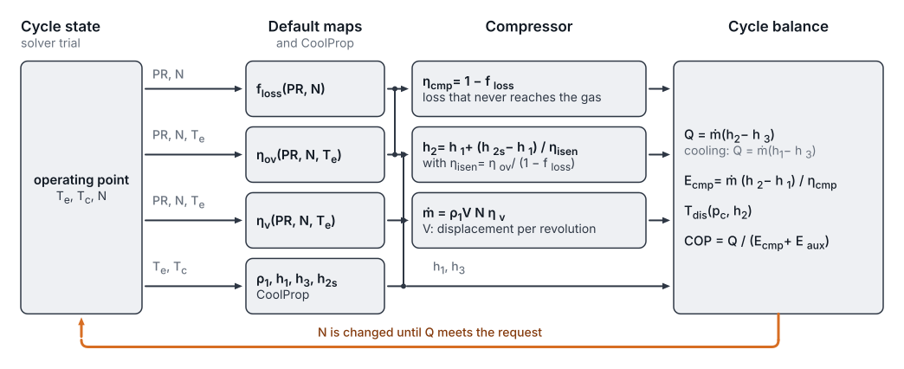
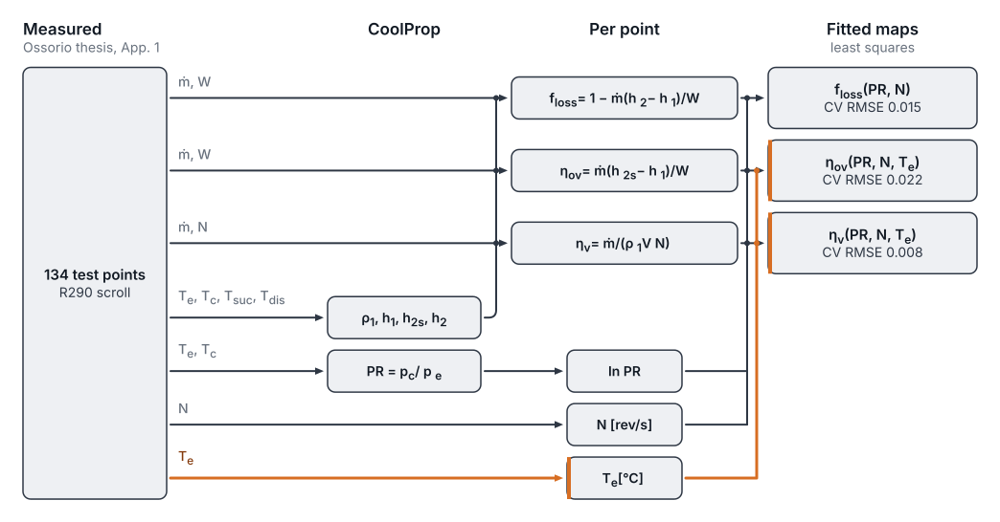

===========================
Compressor efficiency maps
===========================

Every cycle-resolved model in TMHP needs to know how well its compressor
works at the operating point it is trying: how much refrigerant the
compressor moves, how hot the gas leaves, and how much electricity it draws.
Unless you pass your own numbers, TMHP takes these from three default maps of
one measured compressor, version ``ossorio-r290-te-2026-11-21`` of
:mod:`tmhp.compressor_efficiency`. This page explains what the cycle takes
from the maps, where the maps come from, what form they have and why, and
where they stop being trustworthy. An interactive explorer lets you look at
the maps yourself, and the references lead back to the original measurements.

What the cycle takes from the compressor
========================================

The maps give three efficiencies of the compressor, each a function of the
pressure ratio :math:`r_p = P_\mathrm{cmp,out} / P_\mathrm{cmp,in}`, the shaft
speed :math:`N` [rev/s] and, for the first two, the evaporating saturation
temperature :math:`T_\mathrm{evap}` [°C]:

* :math:`\eta_v`, the **volumetric efficiency**: the fraction of the swept
  volume that is actually delivered.
* :math:`\eta_{ov}`, the **overall efficiency**: the isentropic compression
  work divided by the electrical input.
* :math:`f_{loss}`, the **loss fraction**: the share of the electrical input
  that never reaches the gas (motor and inverter losses and the heat the
  shell gives off).

The cycle uses them in three places. With :math:`V` the displacement per
revolution, :math:`\rho_\mathrm{in}` and :math:`h_\mathrm{in}` the density and
enthalpy at the compressor inlet, and :math:`h_{\mathrm{out},s}` the enthalpy
after an isentropic compression to the discharge pressure:

.. math::

    \dot m = \rho_\mathrm{in}\, V N\, \eta_v

    h_\mathrm{out} = h_\mathrm{in}
        + \frac{h_{\mathrm{out},s} - h_\mathrm{in}}{\eta_\mathrm{cmp,isen}}

    E_\mathrm{cmp} = \frac{\dot m\,(h_\mathrm{out} - h_\mathrm{in})}{\eta_\mathrm{cmp}}
        = \frac{\dot m\,(h_{\mathrm{out},s} - h_\mathrm{in})}{\eta_{ov}}

The mass flow :math:`\dot m` sets the duty, the discharge enthalpy
:math:`h_\mathrm{out}` sets the discharge temperature and the condenser duty,
and :math:`E_\mathrm{cmp}` is the electrical input. The library works with
three efficiencies of its own (``eta_cmp_vol``, ``eta_cmp_isen``, ``eta_cmp``),
and the maps are converted into them as

.. math::

    \eta_\mathrm{cmp,vol} = \eta_v,
    \qquad
    \eta_\mathrm{cmp} = 1 - f_{loss},
    \qquad
    \eta_\mathrm{cmp,isen} = \frac{\eta_{ov}}{1 - f_{loss}}

so :math:`\eta_\mathrm{cmp,isen}\,\eta_\mathrm{cmp} = \eta_{ov}`. That product
is why the two forms of :math:`E_\mathrm{cmp}` above are equal: the electrical
input depends on :math:`\eta_{ov}` alone, and :math:`f_{loss}` only decides how
the loss is split between the gas (a hotter discharge, a larger condenser
duty) and the surroundings. :math:`E_\mathrm{cmp}` is the power at the
**inverter input**: the maps were fitted on the power of compressor and
inverter together, and the library has no separate drive model
(:mod:`tmhp.compressor_efficiency`).

    How the cycle uses the three maps at the operating point the solver
    tries. The maps are evaluated at its :math:`r_p`, :math:`N` and
    :math:`T_\mathrm{evap}` (:math:`f_{loss}` at :math:`r_p` and :math:`N`).
    The speed :math:`N` is changed until the duty meets the request;
    :math:`T_\mathrm{evap}` and the condensing temperature come from the
    heat-exchanger closure, which is not drawn. The figure writes the
    pressure ratio as PR, :math:`T_\mathrm{evap}` as :math:`T_e`, and the
    inlet, discharge and isentropic-discharge states as 1, 2 and 2s.

Where the default maps come from
================================

The maps are fitted to a table of measurements, not to a performance-curve
equation and not to heat-pump catalogues. The table is Appendix 1
("Compressor Data 'scroll-R290'", PDF pp. 244–252) of Ossorio Santiago's
doctoral thesis (Ossorio Santiago, 2024): 134 measured points of a
46 cm³/rev R290 scroll compressor at 30, 50, 70, 90 and 110 rev/s, with a
suction superheat of about 10 K. They are the tests of Compressor A in
Ossorio & Navarro-Peris (2023). The electrical input in the table is that of
compressor and inverter together (the column "Wc + Winv"), and the maps use
it as it is. Ossorio et al. (2024) fitted their compact correlations to the
same tests and report 133 points; the thesis table has 134 rows, and TMHP
uses all of them.

From each measured point, with the refrigerant states computed by CoolProp
from the measured temperatures, the three efficiencies are

.. math::

    \eta_v = \frac{\dot m}{\rho_\mathrm{in}\, V N},
    \qquad
    \eta_{ov} = \frac{\dot m\,(h_{\mathrm{out},s} - h_\mathrm{in})}{W},
    \qquad
    f_{loss} = 1 - \frac{\dot m\,(h_\mathrm{out} - h_\mathrm{in})}{W}

with :math:`\dot m` the measured mass flow, :math:`W` the measured power of
compressor and inverter, and :math:`h_\mathrm{out}` from the measured
discharge temperature. The values of :math:`\eta_v` and :math:`\eta_{ov}`
agree with the author's tabulated ones to 0.005 and 0.008. Each map is then
fitted to the 134 values by least squares; the 10-fold cross-validated RMSE
is 0.0081 for :math:`\eta_v`, 0.0221 for :math:`\eta_{ov}` and 0.0149 for
:math:`f_{loss}`, in units of efficiency (coefficient archive README).

The result is the coefficient set named by ``COEFFICIENT_VERSION =
"ossorio-r290-te-2026-11-21"``. Its data, fit, scores and figures are kept in
the coefficient archive ``validation/coefficients/ossorio-r290-te-2026-11-21/``
(see `Code and data`_), and the constants in the library module are emitted
from it.

    How the 134 measured points become the maps. Upper rows: measured mass
    flow, power and speed, with the CoolProp states from the measured
    temperatures, give the three efficiencies of each point (the fit
    targets). Lower rows: the measured evaporating and condensing
    temperatures and the speed give the terms :math:`\ln r_p`, :math:`N`
    [rev/s] and :math:`T_\mathrm{evap}` [°C] (the axes). Least squares joins
    the two. The figure writes the pressure ratio as PR and
    :math:`T_\mathrm{evap}` as :math:`T_e`.

Map form and why
================

With :math:`l = \ln r_p`, the speed :math:`N` in rev/s and the evaporating
saturation temperature :math:`T_\mathrm{evap}` in °C, each map is a
polynomial with coefficients :math:`c_0 \ldots c_7` of its own:

.. math::

    \eta_v,\ \eta_{ov} = c_0 + c_1 l + c_2 l^2 + c_3 l^3
        + c_4 N + c_5 N^2 + c_6\, l N + c_7\, T_\mathrm{evap}

    f_{loss} = c_0 + c_1 l + c_2 l^2 + c_3 l^3
        + c_4 N + c_5 N^2 + c_6\, l N

:math:`N` and :math:`T_\mathrm{evap}` enter as they are, with no reference
speed and no scale: the speed is absolute, and nothing is read relative to the
rated speed of a machine. Writing the maps for :math:`N/70` or
:math:`T_\mathrm{evap}/10` would change only the coefficients, not the fitted
function. The axes were chosen among four candidates scored against the
134 points (`#218 <https://github.com/bet-lab/TMHP/issues/218>`_;
:doc:`/validation/defaults`, "The comparison that chose the axes").

The evaporating temperature is in :math:`\eta_v` and :math:`\eta_{ov}` because
the measurements depend on it. At one pressure ratio and speed, the measured
:math:`\eta_{ov}` and :math:`\eta_v` differ with :math:`T_\mathrm{evap}`, and a
map without the term leaves a residual that follows :math:`T_\mathrm{evap}`.
Adding the term lowers the cross-validated RMSE from 0.034 to 0.022 for
:math:`\eta_{ov}` and from 0.015 to 0.008 for :math:`\eta_v`. The effect is
not small: at :math:`r_p` = 3 and 70 rev/s the adopted map's :math:`\eta_{ov}`
rises from 0.62 to 0.69 between :math:`T_\mathrm{evap}` = −10 and 15 °C. The
correlation of Ossorio et al. (2024), evaluated at the same condition from its
published coefficients (coefficient archive README), rises from 0.60 to 0.70.
:math:`f_{loss}` has no such dependence: a :math:`T_\mathrm{evap}` term
changes its cross-validated RMSE only from 0.0149 to 0.0148, so it is left
out.

.. note::

    The :math:`r_p` terms of :math:`\eta_v` and :math:`f_{loss}` are scheduled
    to change (`#247 <https://github.com/bet-lab/TMHP/issues/247>`_). This page
    describes the maps the library ships now.

Interactive map explorer
========================

Move the evaporating-temperature slider and watch :math:`\eta_v` and
:math:`\eta_{ov}` shift while :math:`f_{loss}` stays put, then compare the
maps with the 134 measured points drawn at their measured coordinates; the
region outside the measured data is marked. The numbers shown are the raw map
values, before the range rule of the cycle (`Limits`_) is applied.

.. raw:: html
   :file: ../_static/html/compressor_map_widget.html

Limits
======

**Data domain.** The measured points span 30 to 110 rev/s and a convex hull
in pressure ratio and evaporating temperature that reaches :math:`r_p`
1.44 to 12.67 and :math:`T_\mathrm{evap}` −30.2 to 25.1 °C. Outside this
domain the maps are followed as they are: nothing is held, clamped or refused
there, and the result only carries the flag ``efficiency_extrapolated``
(:doc:`result-keys`). The flag is common at ordinary operating points, because
the models' speed floor is 15 rev/s: every point below 30 rev/s and every
point above 110 rev/s is outside the data.

**Range rule of the cycle.** Each of the three efficiencies the cycle uses
must lie in :math:`0 < \eta \le 1`. A value above one is set to one; a value
of zero or below, or a non-finite one, makes the operating point infeasible
(``InvalidCompressorEfficiency``). The rule acts on the default volumetric
map, which passes one at a low pressure ratio and a warm evaporator: 1.015 at
:math:`r_p` = 1.5, 70 rev/s and :math:`T_\mathrm{evap}` = 25 °C.

**One compressor for every machine.** The maps describe one R290 scroll, and
every default machine gets them, whatever its refrigerant, compressor type and
capacity. The refrigerant enters through the fluid properties, not through the
efficiencies. Applied without calibration, the defaults run low against the
manufacturer catalogues of the validation set (rated to EN 14511, whose test
conditions are in EN 14511-2, CEN, 2022a, or to AHRI 210/240): a COP bias of
−5.9 % for the ten air-to-water units and −12.1 % for the five air-to-air
units (:doc:`/validation/index`). How much of that bias comes from the
compressor was not separated. The part-load shape is checked separately
against EN 14825 declarations (CEN, 2022b; :doc:`/validation/part-load`).
Neither standard is a source of the compressor data.

Following a target machine
==========================

Calibrating the default maps to the catalogue of a target machine is planned
(`#189 <https://github.com/bet-lab/TMHP/issues/189>`_) and not part of the
library yet. Until then, the defaults are applied unchanged, and a caller who
has better numbers for one machine can pass their own efficiency (a number or
a function of the pressure ratio and the speed) for any of the three.

References
==========

CEN. (2022a). *EN 14511-2:2022 — Air conditioners, liquid chilling packages
and heat pumps … — Part 2: Test conditions*. European
Committee for Standardization.

CEN. (2022b). *EN 14825:2022 — Air conditioners, liquid chilling packages and
heat pumps, with electrically driven compressors, for space heating and
cooling, commercial and process cooling — Testing and rating at part load
conditions and calculation of seasonal performance*. European Committee for
Standardization.

Ossorio, R., & Navarro-Peris, E. (2023). Testing of variable-speed scroll
compressors and their inverters for the evaluation of compact energy
consumption models. *Applied Thermal Engineering*, 230, 120725.
https://doi.org/10.1016/j.applthermaleng.2023.120725 (open access:
https://riunet.upv.es/handle/10251/204963)

Ossorio, R., Marchante-Avellaneda, J., & Navarro-Peris, E. (2024).
Development of compact empirical models for variable-speed compressors for
the prediction of energy consumption, mass flow and discharge temperature.
*Applied Thermal Engineering*, 244, 122666.
https://doi.org/10.1016/j.applthermaleng.2024.122666 (open access:
https://riunet.upv.es/handle/10251/209349)

Ossorio Santiago, R. J. (2024). *Modelling of heat pumps working with
variable-speed compressors* [Doctoral thesis, Universitat Politècnica de
València]. https://doi.org/10.4995/Thesis/10251/203104 — the measured
points are in "Appendix 1: Compressor Data 'scroll-R290'", PDF pp. 244–252
(not the "Appendix 1: Electro-mechanical losses" of §3.10).

Code and data
-------------

* :mod:`tmhp.compressor_efficiency` — the maps, the data domain and the range
  rule (`source <https://github.com/bet-lab/TMHP/blob/main/src/tmhp/compressor_efficiency.py>`_).
* `Coefficient archive README
  <https://github.com/bet-lab/TMHP/blob/main/validation/coefficients/ossorio-r290-te-2026-11-21/README.md>`_
  — the data, the fit, its scores, the figures and how to reproduce them.
* `points.csv
  <https://github.com/bet-lab/TMHP/blob/main/validation/coefficients/ossorio-r290-te-2026-11-21/points.csv>`_
  — the 134 measured points with their three efficiencies, as fitted.
