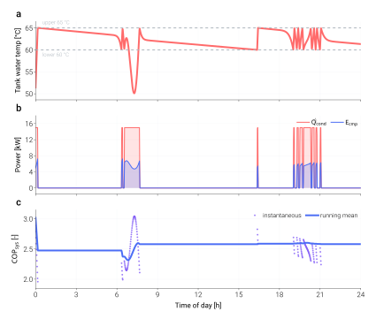

=============================
Your first dynamic simulation
=============================

For ASHPB, ``analyze_dynamic`` solves the same refrigerant cycle as
``analyze_steady`` at every time step, coupled to a tank-energy balance
and any active subsystems. This page walks through the simplest possible
call — 24 hours of operation against a constant outdoor temperature and
zero DHW draw — so you can see the shape of the per-step result before
adding realistic schedules in the
:doc:`tutorials <../tutorials/index>`.

Minimum viable example
======================

As in :doc:`quickstart`, this first dynamic example uses the ASHPB
reference class. Treat it as the smallest complete dynamic state
boundary — not as a limit on TMHP's source mediums or demand sides.

.. code-block:: python

   import numpy as np

   from tmhp import AirSourceHeatPumpBoiler

   ashpb = AirSourceHeatPumpBoiler(ref="R32")

   simulation_period_sec = 24 * 3600       # 24 hours
   dt_s                  = 60              # 1-minute time step
   n_steps               = simulation_period_sec // dt_s

   dhw_usage_schedule = np.zeros(n_steps)  # m³/s per step (no draw)
   T0_schedule        = np.full(n_steps, 5.0)  # outdoor 5 °C, flat

   df = ashpb.analyze_dynamic(
       simulation_period_sec = simulation_period_sec,
       dt_s                  = dt_s,
       T_tank_w_init_C       = 50.0,
       dhw_usage_schedule    = dhw_usage_schedule,
       T0_schedule           = T0_schedule,
   )

What a real run looks like
==========================

The figure below is the same model driven for 24 hours with a
synthetic morning + evening DHW profile and a sinusoidal outdoor
temperature. The three stacked panels share a time axis so you can
read off the chain of cause and effect: a draw pulls down the tank
temperature, the compressor kicks in, the running-mean COP recovers
once the warm-up transient is past.

        panels — tank temperature with its upper/lower bounds,
        condenser heat rate and compressor electrical power, and
        instantaneous + running-mean system COP.
    :align: center
    :width: 100%

    24-hour run of the ASHPB reference case with two DHW draws
    (07:00 and 20:00) and a sinusoidal outdoor temperature. The model is
    built with ``ref="R32"`` and the defaults otherwise; the R32
    condensing-temperature limit stops the heat pump at 60 °C, so the
    tank runs between 55 and 60 °C. Generated by
    ``scripts/visualization/dynamic_24h_timeseries.py``.

What the result contains
========================

``analyze_dynamic`` returns a ``pandas.DataFrame`` with one row per
time step. The columns are the same units-bracketed keys you get from
``analyze_steady``, grouped roughly into:

- **Cycle state points** — ``P_ref_*`` pressures, ``T_ref_*``, ``h_ref_*``,
  ``s_ref_*`` at compressor / expander / evaporator / condenser nodes,
  compressor speed and efficiencies: values **while the compressor runs**.
- **Energy flows** — ``Q_ref_tank [W]``, ``Q_ref_ou [W]``,
  ``E_cmp [W]``, fan / pump auxiliary power, ``E_tot [W]``. These are
  **averages over the step**: the running cycle's rate times the fraction
  of the step the compressor ran, so ``df["E_cmp [W]"].sum() * dt_s`` is
  the energy used. Power of subsystems that do not follow the compressor
  (collector pump, UV lamp) is their own step average.
- **Flows** — refrigerant ``m_dot_ref [kg/s]`` and outdoor air
  ``dV_ou_a [m3/s]``: step averages. The ground / source loop flow
  ``dV_bhe_f [m3/s]``: the loop's flow while it circulates. Tank and
  draw-off flows ``dV_tank_w_*``, ``dV_mix_*``: at the end-of-step tank
  temperature, as the tank balance uses them.
- **Temperatures** — ``T_tank_w [°C]`` at the end of the step; outdoor-air
  and refrigerant temperatures while the compressor runs; ground / source
  loop fluid ``T_bhe_f*`` averaged over the step (they follow the loop's
  load, which flows only part of the step), with
  ``T_bhe_f*_running [°C]`` the fluid while the compressor runs (NaN on a
  step it did not run).
- **Operation** — ``hp_is_on`` (the compressor ran at some point in the
  step), ``runtime_fraction [-]`` (the fraction it ran, 0-1),
  ``hp_starts [-]`` (compressor starts in the step) and
  ``failure_reason``.
- **Tank state** — ``T_tank_w [°C]`` at the end of the step,
  ``tank_level [-]``. A tank whose level varies
  (``tank_always_full=False`` or ``prevent_simultaneous_flow``) also
  reports ``dV_mix_w_out_unmet [m3/s]``: hot-water demand it could not
  supply because it had drained to its lowest level
  (``dV_mix_w_out [m3/s]`` is then the water delivered).
- **Hot-water service** — ``Q_dhw_request [W]``, the heat the draw
  schedule asks for (the scheduled flow at the service set point
  ``T_mix_w_out``, counted from the mains temperature), and
  ``Q_dhw_unmet [W]``, the part of it that was not delivered: the water
  left the mixing valve below the set point because the tank was colder
  than it, or a level-varying tank could not supply the flow. Both are 0
  on a step without a draw. See :ref:`hot-water-service`.
- **Figures of merit** — ``cop_ref [-]``, ``cop_sys [-]`` of the running
  cycle (``NaN`` on steps it did not run); equal to the step-average heat
  over the step-average compressor (and fan / source pump) power.
- **Exergy** (``X_* [W]`` flows, ``Xc_* [W]`` destruction) — averages over
  the step, so they add up like the energy flows and each component's
  balance closes on a partially run step. Source-side flows are evaluated
  at the running fluid state and multiplied by the run fraction (exergy is
  not linear in temperature). ``X_eff_* [-]`` are ratios of step averages.

You can pull any of these out by name once the run finishes:

.. code-block:: python

   # Daily system COP, skipping the first hour of warm-up: heat over
   # electricity. A plain mean of cop_sys would weight a step the
   # compressor ran for 10 s like one it ran throughout.
   df_steady = df.iloc[60:]
   cop_day = df_steady["Q_ref_tank [W]"].sum() / df_steady["E_tot [W]"].sum()
   print(f"Daily COP_sys: {cop_day:.2f}")

For the full column list, ``df.columns.tolist()`` after a short run is
the fastest reference.

.. _hot-water-service:

Was the hot water delivered?
----------------------------

A draw schedule is a request, not a guarantee. The mixing valve blends tank
water with mains water to the service set point (``T_mix_w_out``, 40 °C);
once the tank is colder than the set point the valve passes tank water
unmixed and the water arrives cold. Every boiler model and combination
reports this per step (``Q_dhw_request [W]``, ``Q_dhw_unmet [W]``), and
``analyze_dynamic`` ends with one ``tmhp.dhw.DHWUnmetWarning`` when a run
left demand unmet. The totals of a run:

.. code-block:: python

   from tmhp.dhw import summarize_dhw_service

   service = summarize_dhw_service(df, dt_s)
   print(f"unmet: {service['Q_dhw_unmet [kWh]']:.2f} kWh "
         f"of {service['Q_dhw_request [kWh]']:.2f} kWh "
         f"on {service['dhw_unmet_steps [-]']} steps")

``summarize_dhw_service`` returns the requested, delivered and unmet heat
[kWh], the unmet fraction, the number of draw steps and of steps left
short, and the coldest delivery;
``tmhp.simulation_summary.print_dhw_service_summary(df, dt_s)`` prints
them. A shortfall within 0.01 K of the set point counts as met. Unmet hot
water means the machine or the tank is too small for the draw profile, or
the thermostat band lets the tank fall too far before the compressor starts
— it is a result about the system, not a solver failure.

Common next moves
=================

- Pass real weather to ``T0_schedule`` (hourly data resampled to ``dt_s``)
  and a realistic DHW profile to ``dhw_usage_schedule``.
- Save the run to disk by passing
  ``result_save_csv_path="run.csv"``.
- For solar-coupled or PV/ESS variants, instantiate the corresponding
  subclass (``ASHPB_STC_preheat``, ``ASHPB_STC_tank``, ``ASHPB_PV_ESS``,
  or the GSHPB counterparts) and pass the additional schedules
  (``I_DN_schedule`` direct-normal and ``I_dH_schedule`` diffuse-horizontal
  irradiance, ``T_sup_w_schedule``) as
  documented under :doc:`../models/ashpb` and
  :doc:`../models/gshpb`.

.. _time-step-and-thermostat:

Time step and the thermostat
============================

The heat pump runs between the tank's lower and upper bounds
(``T_tank_w_lower_bound`` / ``T_tank_w_upper_bound``; 60 / 65 °C for
ASHPB). A 15 kW machine on the default 151 L tank fills that 5 K band in
about 3.5 minutes, so with any step longer than that the tank reaches a
bound part-way through a step. ``analyze_dynamic`` and ``step()``
follow the thermostat inside each step:

- The tank heat balance over the step is linearised in the tank
  temperature (draw-off, envelope loss and subsystem heat), and the
  switching events are found on its exact solution: the compressor
  stops when the tank reaches the upper bound and starts when it falls to
  the lower bound, possibly several times in one long step.
- The cycle is quasi-steady: it is solved once per step at the mean tank
  temperature of the compressor's run in that step, and the step reports
  the run-time fraction with the averaged heat and power.
- The tank update itself stays the implicit balance over the step, fed
  with that average heat, so the first-law balance closes for every
  ``dt_s``.

Results therefore converge as ``dt_s`` shrinks instead of drifting with
it. For the default ASHPB, a 24 h run with hot-water draws gives the same
daily heat input and electricity within about 2 % from 60 s to 900 s
steps, and never exceeds the upper bound. What a
long step still loses is the resolution of its inputs: a 30-minute draw
averaged over an hourly step is a gentler draw, so the tank dips less
and hourly results differ from minute results by the inputs, not by the
controller. A 1-minute step resolves typical hot-water draws; 10–15 min
steps (common co-simulation exchange intervals) are fine for daily or
annual energy.

The constructors refuse set points outside 0–100 °C, and the heat pump
never heats the tank past 100 °C even when a minimum run time (below)
holds it past the upper bound; the solar collector loops stop at their own
storage limit (``T_stc_tank_max``, 85 °C). If heat from another source takes
the tank above 100 °C anyway, a ``RuntimeWarning`` says so: the lumped
tank has no boiling or relief valve.

By default the compressor can start and stop at any moment. Real
compressors are held to a minimum run and rest time (typically 3–5
minutes); set ``min_on_time_s`` / ``min_off_time_s`` on the boiler to
apply them. A minimum run holds the compressor past the upper bound, so
the tank overshoots it by up to ``hp_capacity * min_on_time_s / C_tank``.

The three boilers also stop the compressor inside the step at their
*envelope stop*: the tank temperature at which the nameplate duty would
condense above ``T_cond_max`` (``T_cond_max − hp_capacity / UA_tank_hx``
at the condensing-limit pressure; 69.9 °C for the default R290 GSHPB and
WSHPB, 60 °C for an R32 ASHPB).
The set points are already capped there (see :doc:`../models/gshpb`), so
this matters when a minimum run time would carry the run past it (the
protection stop outranks the minimum run time: the default R290 machine
with ``min_on_time_s=1800`` peaked at 73.1, 75.4 and 77.4 °C with 60,
300 and 600 s steps and now stops at 69.9 °C with all three; an R32 ASHPB
peaked at 62.6 and 65.1 °C with 60 and 600 s steps, each run ending in a
``condensing_temp_above_max`` step, and now stops at 60 °C), and in a
``"stratified"`` or ``"hybrid"`` tank whose coil water is hotter than the
tank mean the thermostat reads (a coil in the top node): there the stop is
the run time at the nameplate duty after which the water around the coil
gets to the envelope stop, found on trial steps of the node model. While
the thermostat still calls at the stop, the compressor holds the water at
it (it runs the share of the step that delivers the heat the water loses,
one start), instead of failing step after step; a lumped tank called at
its envelope stop is held there against its losses the same way. Such a
step is a normal stop: ``failure_reason`` stays ``"none"`` and
``hp_stop_reason`` is ``"condensing_limit"``.

``hp_on_schedule`` limits when the heat pump may run, as windows
``[(start_h, end_h), ...]`` of the hour of day (``start_h <= hour <
end_h``). ``None`` (the default) is always; an empty list has no window,
so the heat pump never runs, as ``[(0, 0)]`` (GSHPB and WSHPB used to read
``[]`` as always).
