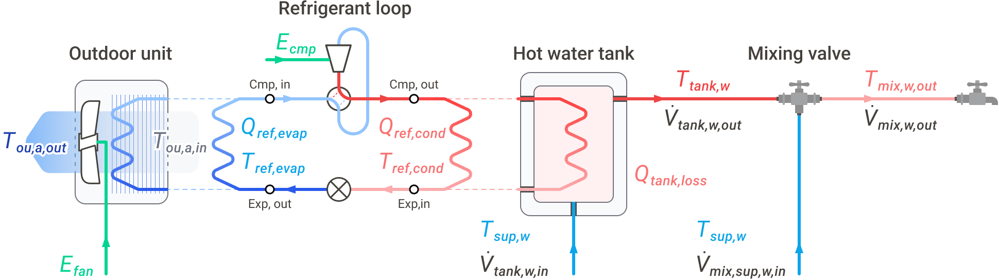
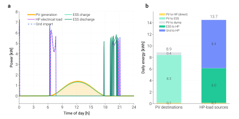

====================================
Air-source heat pump boiler (ASHPB)
====================================

.. |ashpb| raw:: html

   ASHPB

The ``ASHPB`` family pairs the shared refrigerant cycle with an
outdoor-coil source side and a DHW tank sink side. This is the
validated reference example used by the Getting Started flow.

Overview
========

|ashpb| solves the closed refrigerant cycle every step against an
outdoor coil (ε-NTU air-side) and a tank-coupled condenser. The
class is :class:`tmhp.AirSourceHeatPumpBoiler`. Three composed
variants extend it with subsystems:

- :class:`tmhp.ASHPB_STC_preheat` — STC heats the mains feed before it
  reaches the tank.
- :class:`tmhp.ASHPB_STC_tank` — a pumped collector loop charges the
  tank, with a storage high limit.
- :class:`tmhp.ASHPB_PV_ESS` — PV generation + battery storage routes
  electricity to the compressor and auxiliaries before drawing grid.

        refrigerant loop, hot-water tank, and mixing valve.
    :align: center
    :width: 100%

    Reference ASHPB instantiation. This physical wiring view is useful
    for the validated air-source DHW case, while the shared compressor /
    expander / heat-exchanger cycle core is reused by the other TMHP
    source and demand-side families.

Base usage
==========

.. code-block:: python

   from tmhp import AirSourceHeatPumpBoiler

   ashpb = AirSourceHeatPumpBoiler(ref="R32")

   # Steady-state snapshot
   result = ashpb.analyze_steady(
       T_tank_w=55.0,    # tank water [°C]
       T0=7.0,           # outdoor air [°C]
       Q_ref_tank=8_000, # target condenser duty [W]
   )

   # Time-stepping dynamic run — see Getting Started for full schedule
   # construction.
   # df = ashpb.analyze_dynamic(...)

In a dynamic run the compressor cycles between ``T_tank_w_lower_bound``
and ``T_tank_w_upper_bound`` (60 / 65 °C). The thermostat is followed
inside each step, so a step reports the fraction of it the compressor ran
(``runtime_fraction [-]``), its starts (``hp_starts [-]``) and heat and
power averaged over the step; ``min_on_time_s`` / ``min_off_time_s``
(default 0) hold the compressor to a minimum run and rest time. See
:ref:`time-step-and-thermostat`.

Default compressor efficiencies
===============================

A bare ``AirSourceHeatPumpBoiler`` evaluates three independent
second-order polynomials from :mod:`tmhp.compressor_efficiency`
(coefficient set ``BITZER-three-C3-absolute-N-2026-10-06``, a scroll-compressor
fit to manufacturer calculation data):

.. math::

   \eta = b_0 + b_1\,PR + b_2\,N + b_3\,PR^2 + b_4\,N^2 + b_5\,PR\,N

Here :math:`PR` is the pressure ratio and :math:`N` is the physical shaft
speed in rev/s (``rps``); there is no relative-speed normalisation. The
same form is used for the volumetric (``eta_cmp_vol``), isentropic
(``eta_cmp_isen``) and effective electromechanical (``eta_cmp``)
efficiencies, each with its own coefficients, which are listed in
``validation/coefficients/BITZER-three-C3-absolute-N-2026-10-06/coefficients.csv``
and in the tuple constants of the module. The design notes are in
``docs/notes/compressor-bitzer-defaults.md``.

.. warning::

   The fit covers pressure ratio 1.50–7.15 and shaft speed
   33.8–72.5 rev/s (the convex hull of 3,899 scroll data points). The
   model's operating range (``rps_min`` = 15 rev/s, ``rps_max`` up to
   ``max(min(2 × rps_rated, 120), 1.5 × rps_rated)``, ``PR_cycle_max`` = 11) reaches outside
   it. Outside the box the guarded fit holds the boundary value (high PR,
   high speed) or continues the boundary slope downward (low PR, low speed),
   and steady results report ``efficiency_extrapolated``. At PR above 7 the
   fitted isentropic efficiency is 0.37–0.45, which drives the computed
   discharge temperature of R32 to 200–290 °C. The discharge-temperature
   control holds ``T_dis_max`` by lowering the suction superheat and then
   letting the suction go wet down to ``x_suction_min`` (0.9); points it
   cannot hold -- R32 above roughly 220 °C dry -- are refused (see
   :doc:`/developer/reference-operating-limits`).

An explicitly supplied float or callable for the corresponding constructor
argument overrides these defaults. The earlier linear correlations
(``1.0 - 0.020 * (r_p - 1.0)`` and similar) survive only as
``tmhp.compressor_efficiency_legacy`` and in the
``equipment_presets`` module; they are not the default.

Source-side mechanics
=====================

ASHPB models its outdoor coil as a variable-speed fan coupled to an
ε-NTU heat exchanger. Fan electrical power follows an ASHRAE
90.1-style cubic-with-speed curve; coil ε is recomputed each step
from the resolved refrigerant mass flow.

Sink-side mechanics
===================

The sink is a single-node DHW tank (with optional stratification on
the ``_STC_tank`` variant). The tank energy balance is solved
implicitly per step with ``fsolve``, jointly with the refrigerant
cycle.

Composed variants
=================

.. tab-set::
   :class: composition-tabs

   .. tab-item:: Base

      The standalone ASHPB: outdoor coil ε-NTU evaporator, R32 cycle,
      DHW tank charge.

      .. code-block:: python

         from tmhp import AirSourceHeatPumpBoiler

         ashpb = AirSourceHeatPumpBoiler(ref="R32")
         result = ashpb.analyze_steady(
             T_tank_w=55.0,
             T0=7.0,
             Q_ref_tank=8_000,
         )

   .. tab-item:: + STC preheat

      Adds a flat-plate STC that preheats mains water entering the
      tank. Reduces the tank-charge duty the heat pump has to deliver.

      .. code-block:: python

         from tmhp import ASHPB_STC_preheat
         from tmhp.subsystems import SolarThermalCollector

         stc = SolarThermalCollector(A_stc=4.0, stc_tilt=35.0, stc_azimuth=180.0)
         model = ASHPB_STC_preheat(stc=stc, ref="R32")

   .. tab-item:: + STC tank loop

      A pumped collector loop draws tank water, heats it and returns it,
      under a differential controller with a storage high limit
      (``T_stc_tank_max``, 85 °C).

      .. code-block:: python

         from tmhp import ASHPB_STC_tank
         from tmhp.subsystems import SolarThermalCollector

         stc = SolarThermalCollector(A_stc=4.0, stc_tilt=35.0, stc_azimuth=180.0)
         model = ASHPB_STC_tank(stc=stc, ref="R32")

   .. tab-item:: + PV / ESS

      Photovoltaic generation + ESS preferentially feeds the
      compressor and auxiliaries.

      .. code-block:: python

         from tmhp import ASHPB_PV_ESS
         from tmhp.subsystems import EnergyStorageSystem, PhotovoltaicSystem

         model = ASHPB_PV_ESS(
             pv=PhotovoltaicSystem(),
             ess=EnergyStorageSystem(),
             ref="R32",
         )

Solar inputs and the collector model
------------------------------------

**Irradiance inputs.** ``I_DN_schedule`` is the **direct-normal**
irradiance (beam on a surface facing the sun) and ``I_dH_schedule`` the
**diffuse-horizontal** irradiance, step averages in W/m². They are not
added: the collector (and the PV array) transposes them to its own plane —
beam ``I_DN·cos θ``, sky diffuse (Perez by default) and ground reflection
(``albedo`` 0.2) — with the sun position of the step. For measured
global-horizontal data (e.g. KMA hourly GHI) split it first with
:func:`tmhp.weather.decompose_ghi_to_poa`, whose ``dni`` / ``dhi`` columns
are these two schedules.

**Site and clock.** The sun position needs where and when:
``latitude`` / ``longitude`` (default Seoul, 37.57 °N 126.98 °E),
``utc_offset_h`` (default 9, KST) and ``start_time``, the local standard
time of simulation second 0 (default 00:00 on 20 March, a year-average sun
path). Set ``start_time`` to the first timestamp of your weather data,
at local midnight so that the boiler's clock schedules agree. A beam given
while the sun is below the horizon for a whole step is dropped with a
warning: it means the site or the clock does not match the data.

**Collector.** :class:`~tmhp.subsystems.SolarThermalCollector` uses the
ISO 9806 / EN 12975 quasi-steady efficiency on the mean fluid temperature,
``Q_u = A·[η0·(K_b·G_b + K_d·G_d) − a1·ΔT_m − a2·ΔT_m²]``, with the ASHRAE
incidence-angle modifier ``K_b = 1 − b0·(1/cos θ − 1)``. ``A_stc`` is the
area the coefficients refer to. The defaults are a representative
single-glazed flat plate (``eta0_stc`` 0.78, ``a1_stc`` 3.6 W/(m²·K),
``a2_stc`` 0.015 W/(m²·K²), ``b0_stc`` 0.10; stagnation about 170 °C at
1000 W/m²); take them from a datasheet for a given product. The pumped
loops circulate the ISO test flow, 0.02 kg/(s·m²) of collector, unless
``dV_stc_w`` is set. The former construction parameters (``A_stc_pipe``,
``alpha_stc``, ``h_o_stc`` …) are accepted with a ``DeprecationWarning``.

**Loop control.** A pumped loop runs when the idle collector is
``dT_stc_on`` (6 K) and the running outlet ``dT_stc_off`` (2 K) above the
sink, its gain exceeds the pump power and its outlet stays below
``T_stc_boil`` (100 °C). Charging the tank stops at ``T_stc_tank_max``
(85 °C) within the step, and so does circulation once the outlet reaches
``T_stc_boil`` as the tank warms: ``stc_runtime_fraction [-]`` is the share of
the step the loop ran, and the flow, pump power and delivered heat are step
averages. Every step closes ``Q_sol_stc = (Q_stc_w_out − Q_stc_w_in) +
Q_l_stc`` with ``Q_stc_w_out − Q_stc_w_in = Q_solar_tank``.

STC preheat
-----------

A :class:`~tmhp.subsystems.SolarThermalCollector` sits in the mains line
that feeds the tank: mains → collector → tank make-up inlet, while the
mixing valve's cold side takes mains water directly. Only the water that
enters the tank passes the collector, so its flow is the tank's make-up
flow; it is solved together with the tank temperature and the preheated
inflow is the reported ``T_tank_w_in [°C]``. The collector is bypassed
outside the ``preheat_start_hour``–``preheat_end_hour`` window, without a
draw and when it would cool the feed; when its outlet reaches
``T_stc_tank_max`` at the flow the end-of-step tank draws, it is bypassed for
the rest of the step. The mains pressure drives it: no pump power.

.. code-block:: python

   import numpy as np
   import pandas as pd
   import pvlib

   from tmhp import ASHPB_STC_preheat
   from tmhp.subsystems import SolarThermalCollector

   stc = SolarThermalCollector(
       A_stc=4.0,             # 4 m² collector area
       stc_tilt=35.0,
       stc_azimuth=180.0,
       start_time="2026-03-20",   # local time of second 0 (Seoul by default)
   )

   model = ASHPB_STC_preheat(stc=stc, ref="R32")

Drive it the same way as base ASHPB, adding irradiance schedules
(``I_DN_schedule``, ``I_dH_schedule``) — direct-normal and
diffuse-horizontal, both in W/m² per step:

.. code-block:: python

   dt_s          = 60
   n_steps       = 24 * 3600 // dt_s

   # Clear-sky DNI / DHI for Seoul on the start day (step midpoints).
   site  = pvlib.location.Location(37.57, 126.98, "Asia/Seoul")
   times = pd.date_range("2026-03-20", periods=n_steps, freq=f"{dt_s}s", tz="Asia/Seoul")
   sky   = site.get_clearsky(times + pd.Timedelta(seconds=dt_s / 2))
   I_DN  = sky["dni"].to_numpy()
   I_dH  = sky["dhi"].to_numpy()

   T0  = np.full(n_steps, 5.0)
   dhw = np.zeros(n_steps)

   df = model.analyze_dynamic(
       simulation_period_sec = n_steps * dt_s,
       dt_s                  = dt_s,
       T_tank_w_init_C       = 50.0,
       dhw_usage_schedule    = dhw,
       T0_schedule           = T0,
       I_DN_schedule         = I_DN,
       I_dH_schedule         = I_dH,
   )

To quantify the contribution, run the same schedules through a base
``AirSourceHeatPumpBoiler`` and difference the daily compressor
energy:

.. code-block:: python

   from tmhp import AirSourceHeatPumpBoiler

   base = AirSourceHeatPumpBoiler(ref="R32").analyze_dynamic(
       simulation_period_sec = n_steps * dt_s,
       dt_s                  = dt_s,
       T_tank_w_init_C       = 50.0,
       dhw_usage_schedule    = dhw,
       T0_schedule           = T0,
   )

   def daily_kwh(s, dt_s=dt_s):
       return float(s.sum()) * dt_s / 3.6e6

   saving = daily_kwh(base["E_cmp [W]"]) - daily_kwh(df["E_cmp [W]"])
   print(f"STC preheat saving: {saving:.2f} kWh/day")

.. autoclass:: tmhp.ASHPB_STC_preheat
    :no-index:
    :members:
    :show-inheritance:

STC tank loop
-------------

.. autoclass:: tmhp.ASHPB_STC_tank
    :members:
    :show-inheritance:
    :no-index:

UV lamp
-------

A :class:`~tmhp.subsystems.UVLamp` (``uv=`` on the base boilers and the PV +
ESS variants) switches on ``num_switching`` times per ``period_sec`` for
``exposure_sec`` each. Each step reports the lamp's step-average power
``E_uv [W]`` (the schedule integrated over the step, so a 12 s exposure is
12 s of lamp energy at any ``dt_s``) and the heat it gives the tank water,
``Q_uv_tank = heat_to_water_fraction · E_uv``. The default fraction 0.9
assumes the lamp in a quartz sleeve inside the tank (its UV, light and heat
all end in the water) and its ballast (about 90 % efficient) in the control
box outside; set 1.0 when both are inside the tank boundary.

``E_tot [W]`` includes the lamp: ``E_tot = E_cmp + E_ou_fan + E_uv`` on the
base boiler (``E_pmp`` in place of the fan on the ground- and water-source
boilers). The PV + ESS variants route that ``E_tot``, so the lamp is counted
once. COP columns (``cop_ref``, ``cop_sys``) describe the heat-pump cycle and
do not include the lamp.

PV + ESS
--------

:class:`~tmhp.subsystems.PhotovoltaicSystem` generation feeds the
compressor and auxiliaries; an :class:`~tmhp.subsystems.EnergyStorageSystem`
buffers midday surplus for evening load; grid import covers
whatever the two cannot supply.

**No grid export.** DC power that neither the heat pump nor the battery can
take is discarded and reported as ``E_dump [W]``; nothing is sold to the grid
(a large array on a small load dumps a large share of its output).

**Where the efficiencies act.** The charge controller (``eta_ctrl``) sits between
the array output ``E_pv_out`` and ``E_ctrl_out``; the battery efficiencies
(``eta_ess_chg``, ``eta_ess_dis``) act inside the battery; the inverter
(``eta_inv``, ``0 < eta_inv <= 1``) acts on the DC power that reaches it, i.e.
PV direct plus battery discharge. Every loss is a result column, so each step
closes (all in W)::

   E_pv_out  = Q_l_ctrl + E_pv_to_inv + E_ess_chg + E_dump
   E_tot     = E_inv_out + E_grid_import
   E_inv_out = eta_inv * (E_pv_to_inv + E_ess_dis),   Q_l_inv = (1 - eta_inv) * (E_pv_to_inv + E_ess_dis)
   E_ess_chg - E_ess_dis = C_ess_max * dSOC_ess/dt + Q_l_ess

``E_tot`` is the whole electric draw of the system: compressor, ``E_ou_fan``
(outdoor fan) and the UV lamp ``E_uv`` when one is attached. ``E_inv_out`` is the
AC power out of the inverter only (it excludes ``E_grid_import``). ``cop_grid`` is
``Q_tank_w_out / E_grid_import`` and is NaN while the import is at most 1 mW
(``tmhp.subsystems.GRID_IMPORT_FLOOR_W``): without a grid draw there is no
meaningful ratio.

The battery state of charge belongs to the run: every ``analyze_dynamic`` starts
from ``ess.SOC_init`` again, so the same model run twice gives the same result.

.. code-block:: python

   from tmhp import ASHPB_PV_ESS
   from tmhp.subsystems import EnergyStorageSystem, PhotovoltaicSystem

   model = ASHPB_PV_ESS(
       pv  = PhotovoltaicSystem(),
       ess = EnergyStorageSystem(),
       ref = "R32",
   )

   # Pass I_DN_schedule + I_dH_schedule to analyze_dynamic exactly
   # as you would for ASHPB_STC_preheat.

        Panel (a) is the timeseries of PV generation, HP load, and
        grid import. Panel (b) is the stacked-bar daily ledger of
        where PV ended up and where HP load came from.
    :align: center
    :width: 100%

    24-hour ``ASHPB_PV_ESS`` run with a clear-sky irradiance profile
    and default ``PhotovoltaicSystem`` / ``EnergyStorageSystem`` sizes.
    Panel (b) makes the sizing tradeoff readable: shrinking the ESS
    column on the left would push more of the right-hand bar from
    "PV" to "Grid". Generated by
    ``scripts/visualization/pv_ess_energy_balance.py``.

.. autoclass:: tmhp.ASHPB_PV_ESS
    :no-index:
    :members:
    :show-inheritance:

API reference
=============

.. automodule:: tmhp.air_source_heat_pump_boiler
    :members:
    :undoc-members:
    :show-inheritance:

.. automodule:: tmhp.ashpb_stc_preheat
    :members:
    :undoc-members:
    :show-inheritance:

.. automodule:: tmhp.ashpb_stc_tank
    :members:
    :undoc-members:
    :show-inheritance:

.. automodule:: tmhp.ashpb_pv_ess
    :members:
    :undoc-members:
    :show-inheritance:

Validation
==========

ASHPB runs in the shared catalogue parity harness together with the
air-to-air ASHP: 17 manufacturer units are registered and 15 are adopted
into the headline figures (the Samsung EHS Mono HT Quiet R32 14 kW unit is
one of them). The earlier 15-point Samsung comparison used a dedicated
parameter set and is superseded. See :doc:`../validation/index` for the
parity plot, per-unit results and the held catalogues.
