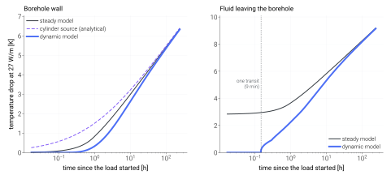
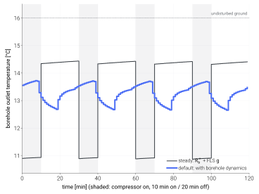

===============
Ground response
===============

How the ground-source models (:doc:`gshpb`, :doc:`gshp`) turn the heat they
take from the ground into the temperature of the fluid that comes back. This
page covers the response itself: what the default path assumes, the dynamic
borehole model for sub-hourly work, bore fields that are not a rectangular
grid, and how each part was checked.

.. contents::
    :local:
    :depth: 1

The default path
================

Three pieces, all derived from inputs the models already take:

``g-function``
    The borehole-wall temperature response of the whole field to a unit load
    step, :math:`g(t)` [m·K/W], computed once by
    `pygfunction <https://github.com/MassimoCimmino/pygfunction>`_ from finite
    line sources (uniform borehole-wall temperature) and superposed over the
    load history with step-mean weights (:class:`tmhp.g_function.GFunction`,
    :class:`tmhp.ground_coupling.AggregateGFunctionCoupler`).

Borehole resistance
    The fluid-to-wall resistance :math:`R_b^*` [m·K/W] from the multipole
    method (pygfunction ``SingleUTube``, order 2) with Hellström's correction
    for the fluid temperature along the depth
    (:func:`tmhp.borehole.calc_borehole_thermal_resistance`).

Fluid temperatures
    :math:`\bar T_f = T_b - q' R_b^*` and
    :math:`T_{in/out} = \bar T_f \mp Q / (2 \dot m c_p)`, with :math:`q'` the
    extraction per metre of borehole.

This is exact for the steady state it describes and has been compared with
independent references: the borehole resistance agrees with a closed-form
first-order multipole within 0.1 % and with multipole order 10 within
:math:`10^{-5}`; :math:`R_b^*` and the inlet/outlet temperatures reproduce
pygfunction's pipe model to four digits; the single-borehole g-function agrees
with a direct integration of the finite line source within 0.12 % from one
hour on.

What it leaves out matters below about six hours:

- The wall response is a *line* source evaluated at the borehole radius. It is
  valid after :math:`Fo = \alpha t / r_b^2 \approx 5` (seven hours for the
  default borehole), and below one hour the g-function is a straight line
  from the origin.
- The fluid-to-wall difference :math:`q' R_b^*` appears at once. In a real
  borehole the fluid, the pipe and above all the grout store heat, and the
  fluid temperature takes one to three hours to move.
- The fluid needs minutes to travel down and up the U-tube (nine minutes
  through 200 m of DN32 at 24 L/min). Until the first pass returns, the
  outlet does not know the heat pump has started.

With hourly steps and runs of several hours these effects are small. With
minute-scale cycling the steady model swings the source temperature by
:math:`q' R_b^*` (3 to 5 K) at every start and stop, which a borehole does not
do.

.. note::

    *Steady model* below means this default path: the multipole borehole
    resistance plus the finite-line-source g-function, the usual way to
    compute borehole fluid temperatures. "Steady" refers to the inside of the
    borehole, which is a resistance with no heat capacity. The ground is
    transient in both models, and the dynamic model uses the same resistance
    and the same g-function; it adds what happens inside the borehole.

Dynamic borehole model
======================

:func:`tmhp.borehole_capacity.enable_borehole_dynamics` replaces the
g-function of a model by one that contains the three effects. It needs no new
inputs:

.. code-block:: python

   from tmhp import GroundSourceHeatPumpBoiler
   from tmhp.borehole_capacity import enable_borehole_dynamics

   model = GroundSourceHeatPumpBoiler(H_b=150.0, dt_s=600.0)
   enable_borehole_dynamics(model)          # same model, dynamic ground response
   df = model.analyze_dynamic(...)

The heat capacities of fluid, pipe wall and grout default to water, HDPE
(1.8 MJ/(m³·K)) and a set, saturated grout (3.4 MJ/(m³·K)) and can be passed
(``rhoc_g``, ``rhoc_p``); everything else is read from the model. The dynamic
response is opt-in in this release: results of the default path are unchanged.

        for a constant extraction of 27 W/m. Left, borehole-wall temperature
        drop: steady model, analytical cylinder source, dynamic model. Right,
        temperature drop of the fluid leaving the borehole: the steady model
        starts at 2.8 K, the dynamic model at zero until one transit time.
    :align: center
    :width: 100%

    Response to a constant extraction of 27 W/m from the default borehole
    (200 m, 80 mm radius, DN32 single U-tube, 24 L/min). Left: the wall. The
    dashed curve is the wall of a borehole with no heat capacity (heat
    released at the wall at once); with the grout in between, the wall
    responds later than even the line source. Right: the fluid leaving the
    borehole. The steady model drops it by 2.8 K at the first instant; in the
    dynamic model nothing changes until the first pass returns, and the two
    meet after a few days. Generated by
    ``scripts/visualization/ground_transient_response.py``.

How it works
------------

**Section.** The borehole cross-section is mapped onto a one-dimensional
radial model, the equivalent-cylinder model of Xu and Spitler (2006): a fluid
node, the pipes lumped at the radius :math:`r_{eq} = \sqrt{n}\, r_{po}` that
keeps the grout cross-section (and so its heat capacity) exact, a grout
annulus whose conductivity is set so that the steady resistance of the model
is the :math:`R_b^*` the host uses, and the ground. Log-spaced finite volumes
and backward Euler; energy is conserved to round-off
(:class:`tmhp.borehole_capacity.EquivalentCylinderBorehole`).

**Splice.** A g-function built from line sources behaves at short times like
an infinite line source at :math:`r_b`, which has already filled the borehole
with soil. The dynamic fluid response to a unit load step is therefore
(Yavuzturk and Spitler 1999)

.. math::

   S_{dyn}(t) = g(t) - G_{ILS}(r_b, t) + S_{cap}(t),

with :math:`S_{cap}` the response of the section and
:math:`G_{ILS} = E_1(r_b^2 / 4 \alpha t) / (4 \pi k_s)`. Since
:math:`S_{cap} \to R_b^* + G_{ILS}`, the correction vanishes at long times:
after 30 days the difference from the steady model is 0.0004 m·K/W (0.01 K at
27 W/m), after a year 0.00003. In a field every borehole responds alone at
these time scales, so the same correction is added to the field g-function.

**Transit.** The fluid is in plug flow along the U-tube and exchanges heat
with the section at every depth. In the Laplace domain one pass multiplies the
fluid temperature by :math:`E(s) = \exp[-(s C_f + Y(s)) H / \dot m c_p]`,
where :math:`Y(s)` is the admittance of the section, so the outlet response to
a load step is :math:`\frac{H}{\dot m c_p} \frac{1}{s} \sum_{k \ge 1} E^k`:
nothing before one transit time :math:`t_{tr} = C_f H / \dot m c_p`, and the
:math:`k`-th pass arriving at :math:`k\, t_{tr}`. The series is inverted
numerically (fixed Talbot). It is used alone for the first eight transit times
and blended into the lumped-fluid response by 24
(:func:`tmhp.borehole_capacity.loop_outlet_response`).

**Drop-in kernel.** :class:`tmhp.borehole_capacity.DynamicGFunction` tabulates
:math:`K(t) = S_{dyn}(t) - R_b^*` (referred to the outlet when the transit is
resolved). It is callable and has ``step_mean`` like the g-function, so the
models use it unchanged: their steady relations
:math:`\bar T_f = T_b - q' R_b^*`, :math:`T_{out} = \bar T_f + Q / (2 \dot m
c_p)` then return the dynamic temperatures, exactly for piecewise-constant
loads. Two consequences for the result columns:

- ``T_bhe_f_out`` and ``T_bhe_f_in`` are the dynamic outlet and inlet;
  ``T_bhe_f`` is their mean.
- ``T_bhe`` is the *fluid-referenced* wall temperature
  :math:`\bar T_f + q' R_b^*`, the wall the fluid would need in steady state.
  It equals the physical wall temperature once the borehole has settled and
  differs just after a load change. The physical wall is available from the
  boiler's coupler as ``borehole_wall_rise(n, time_arr)``
  (:class:`~tmhp.GroundSourceHeatPump` superposes inline and has no such
  accessor yet).

Checks
------

All numbers are for the default borehole and 27 W/m. The same comparisons
run in ``tests/test_borehole_capacity.py`` with tolerances, some at a coarser
resolution than the tables.

.. list-table:: Borehole-wall temperature drop [K]
    :header-rows: 1
    :widths: 12 16 16 20 20 16

    * - Time
      - Steady model
      - Finite line source
      - Cylinder source (analytical)
      - Dynamic, capacity off
      - Dynamic
    * - 1 min
      - 0.01
      - 0.00
      - 0.25
      - 0.25
      - 0.00
    * - 10 min
      - 0.14
      - 0.04
      - 0.72
      - 0.72
      - 0.00
    * - 1 h
      - 0.84
      - 0.84
      - 1.51
      - 1.51
      - 0.39
    * - 6 h
      - 2.48
      - 2.48
      - 2.78
      - 2.78
      - 2.09
    * - 1 d
      - 3.92
      - 3.92
      - 4.04
      - 4.04
      - 3.76
    * - 10 d
      - 6.36
      - 6.36
      - 6.40
      - 6.38
      - 6.34

With the heat capacity switched off the dynamic wall is the analytical
hollow-cylinder source (Carslaw and Jaeger 1959) from the first minute; the
analytical integral itself agrees with a numerical inversion of its Laplace
transform to :math:`10^{-7}`. With heat capacity the wall responds *later*
than the line source: the heat has to cross the grout first.

.. list-table:: Mean fluid temperature drop [K] (fluid as one node)
    :header-rows: 1
    :widths: 16 28 28 28

    * - Time
      - Steady model
      - Dynamic (finite volumes)
      - Laplace solution of the section
    * - 1 min
      - 4.45
      - 0.32
      - 0.32
    * - 10 min
      - 4.58
      - 1.78
      - 1.78
    * - 1 h
      - 5.28
      - 3.87
      - 3.87
    * - 6 h
      - 6.91
      - 6.33
      - 6.33
    * - 1 d
      - 8.35
      - 8.15
      - 8.15
    * - 10 d
      - 10.80
      - 10.77
      - 10.77

The Laplace solution uses the analytical admittance of the continuous section
(Bessel functions) and shares no code with the finite-volume march; the two
agree within 0.0002 m·K/W (0.1 % of :math:`R_b^*`) at the default resolution
and 0.00005 at a finer one.

.. list-table:: Outlet response of the plug-flow loop [m·K/W per unit load]
    :header-rows: 1
    :widths: 22 26 26 26

    * - :math:`t / t_{tr}`
      - Laplace series
      - Time-domain finite volumes
      - Outlet drop at 27 W/m [K]
    * - 0.50
      - 0.00000
      - 0.00000
      - 0.00
    * - 1.50
      - 0.02818
      - 0.02822
      - 0.76
    * - 2.50
      - 0.04601
      - 0.04612
      - 1.24
    * - 4.00
      - 0.06468
      - 0.06481
      - 1.75

The time-domain reference marches 400 upwind segments along the pipe, each
with its own radial chain (``tests/_borehole_oracle.py``); the gap halves with
the segment size, as a first-order scheme should.

Against a model with more physics there are two published comparisons of the
section this module ports. The port is bit-identical to
``geolink.borehole.equivalent_cylinder`` at equal resolution, and that
implementation was compared in geolink's technical note with a load-driven 2-D
finite-element model of the real cross-section (pipes in place, no
equivalent cylinder): for most DN32 sections the correction is within 5 % of
:math:`R_b` between 0.5 h and 2 h and within about 2 % after 4 h. The
exceptions are a 0.2 m borehole with low-conductivity grout (7.4 %, on the
conservative side) and pipes close to the wall of a 0.2 m borehole (4.6 %,
on the other side). That comparison mapped the section to the local
resistance; here it is mapped to the effective :math:`R_b^*` the models use
(0.164 against 0.153 m·K/W for the default borehole), which was not part of
it. Against
GHEDesigner's short-time-step response (the same model family) it differs by
2 to 5.5 % of :math:`R_b` at one hour and under 0.0006 m·K/W after a day.

How long the difference lasts
-----------------------------

The two models describe the same borehole in the same ground, so they must
agree eventually. They do, but slowly: the difference decays like
:math:`\ln t / t`, not exponentially.

.. list-table:: Mean fluid temperature drop after a 27 W/m step: default path and dynamic model
    :header-rows: 1
    :widths: 14 14 18 18 18 18

    * - Time
      - :math:`\alpha t / r_b^2`
      - Default [K]
      - Dynamic [K]
      - Difference [K]
      - Heat still stored in the borehole
    * - 1 h
      - 1
      - 5.28
      - 3.87
      - −1.41 (27 %)
      - 84 %
    * - 6 h
      - 4
      - 6.92
      - 6.33
      - −0.58 (8 %)
      - 38 %
    * - 24 h
      - 17
      - 8.36
      - 8.16
      - −0.20 (2.4 %)
      - 15 %
    * - 100 h
      - 70
      - 9.88
      - 9.82
      - −0.06 (0.6 %)
      - 5 %
    * - 10 d
      - 169
      - 10.82
      - 10.79
      - −0.03 (0.3 %)
      - 2.2 %
    * - 30 d
      - 506
      - 12.00
      - 11.99
      - −0.01 (0.1 %)
      - 0.9 %

The last column is the share of all heat extracted so far that came out of
the fluid, pipes and grout rather than the ground. A line-source g-function
evaluated at :math:`r_b` treats the borehole as if it were filled with soil.
The real borehole holds more heat (68 kJ/(m·K) against 32 for the soil it
replaces, with the defaults) and its inside sits :math:`q' R_b` away from the
wall temperature, so it has more heat to give up before the ground carries
the whole load. The ground therefore lags by a few hours of load, and a line
source that lags by :math:`\Delta t` differs by about
:math:`q' \Delta t / (4 \pi k_s t)`. The finite-volume values in the table
agree with the Laplace solution of the same section to 0.001 K at every row,
so the tail is a property of the model, not of its discretisation.

How large it is depends on the borehole. The default one makes it large: it
is wide (160 mm) and sits in light soil (1.6 MJ/(m³·K)), so the borehole
holds twice the heat of the soil it replaces.

.. list-table:: Difference from the default path [K] at 27 W/m
    :header-rows: 1
    :widths: 46 13 13 14 14

    * - Borehole
      - 1 h
      - 6 h
      - 24 h
      - 100 h
    * - Default (r_b 80 mm, soil 1.6, grout 3.4 MJ/(m³·K))
      - −1.41
      - −0.58
      - −0.20
      - −0.06
    * - Default with water-rich bentonite grout, 3.9
      - −1.52
      - −0.70
      - −0.25
      - −0.07
    * - Default with grout 3.0
      - −1.31
      - −0.49
      - −0.17
      - −0.05
    * - Default with grout 2.5 (below the measured range)
      - −1.17
      - −0.37
      - −0.12
      - −0.04
    * - 110 mm borehole in rock (k_s 3.0, 2.2 MJ/(m³·K)), grout 3.4
      - −0.79
      - −0.16
      - −0.05
      - −0.01

The grout heat capacity is the one input of the dynamic model that the
default path never needed. The default, 3.4 MJ/(m³·K), is the middle of what
has been measured on set, water-saturated grouts: 3.0 to 3.6 for seven
commercial cement-based and thermally enhanced grouts (Albers et al. 2024),
3.84 for a bentonite-based grout (Javed 2010). A saturated grout is water
(4.18) plus solids (2.0 to 2.3), so a value much below 3.0 would mean less
than 40 % water by volume. Pass ``rhoc_g`` when the grout is known; between
3.0 and 3.9 the fluid temperature at one hour changes by 0.2 K (27 W/m).

What changes in a run
---------------------

        minutes off. The steady model jumps between 11.4 and 14.6 degrees
        Celsius at every switch; the dynamic model stays between 13.0 and
        14.0.
    :align: center
    :width: 80%

    ``GroundSourceHeatPumpBoiler`` with 60 s steps, 10 min on / 20 min off,
    second day of operation. The steady model puts the outlet 3 K lower the
    moment the compressor starts. In the dynamic model the outlet holds for
    one transit and then falls by under 1 K. While the compressor is off the
    reported outlet is that of a loop that keeps circulating (the cold fluid
    of the last run is still on its way out); the model does not use it.

.. list-table:: Default GSHPB, steady against dynamic response
    :header-rows: 1
    :widths: 34 12 18 18 18

    * - Case
      - Model
      - Outlet while running [°C]
      - Lowest outlet while running [°C]
      - COP (heat / compressor + pump)
    * - 10 min on / 20 min off, 60 s steps, day 2
      - steady
      - 11.28
      - 11.09
      - 3.93
    * -
      - dynamic
      - 13.69
      - 13.27
      - 4.06
    * - 1 h on / 2 h off, 60 s steps, day 2
      - steady
      - 11.55
      - 11.33
      - 3.34
    * -
      - dynamic
      - 13.10
      - 12.17
      - 3.43
    * - DHW draws morning and evening, 600 s steps, 48 h
      - steady
      - 12.32
      - 11.23
      - 3.46
    * -
      - dynamic
      - 13.76
      - 12.18
      - 3.54

The compressor sees a source 1.4 to 2.4 K warmer while it runs, and the COP
is 2 to 3 % higher. The difference shrinks with longer runs: the first hours
of any run are warmer than the steady model says, the days after are the same.

The dynamic response also removes most of the *source lag* of a time-stepping
model. The cycle of step :math:`n` reads the outlet of step :math:`n-1`; with
the steady model that outlet is up to 3 K above what the same step then
produces at start-up (600 s steps). With the dynamic response the largest gap
is 1.6 K and the first running step is right for a physical reason: for one
transit the outlet *is* the fluid that was in the pipe before.

Limits
------

- **One-dimensional section.** The pipe layout enters through :math:`R_b`
  only; see the finite-element comparison above for the size of the error.
- **One flow, one resistance.** The kernel cancels the models' steady terms
  :math:`q' R_b` and :math:`Q / (2 \dot m c_p)` at the first instant, for the
  flow it was built with. ``enable_borehole_dynamics`` therefore refuses
  ``variable_Rb``, and variable ground flow unless ``transit=False`` (a
  lumped fluid does not depend on the flow).
- **A loop that keeps circulating.** Superposition needs one linear system,
  so the fluid is taken to circulate also while the heat pump is off. A
  time-marched loop that circulates agrees with the kernel within 1 % of
  :math:`R_b`. A pump that stops leaves the fluid standing, and the outlet
  then moves less than the model says: over 10 min on / 20 min off the mean
  over a run is 2.5 to 4.4 % of :math:`R_b` smaller from the second run on
  (still growing at the sixth), and 12 % smaller (0.5 K at 27 W/m) in the
  first minute after a restart. The model is on the cold side for extraction
  (``tests/test_borehole_capacity.py``).
- **Circuits of different length.** In a field the transit uses the mean
  circuit (total length over the number of circuits).
- **Borehole only.** The fluid in headers, in horizontal runs and in the heat
  pump adds heat capacity and transit time that are not modelled.
- **Constant ground temperature.** As in the default path: no seasonal
  surface wave and no geothermal gradient.

Bore fields and pipe configurations
===================================

The models take a rectangular ``N_1 × N_2`` field of equal single-U
boreholes. Anything else is set up with :mod:`tmhp.borefield` and handed to
the model; the physics is pygfunction's (Cimmino's g-functions and network
model), already a dependency.

.. code-block:: python

   from tmhp import GroundSourceHeatPumpBoiler
   from tmhp.borefield import BoreField, FieldGroundResponse
   from tmhp.borehole import BoreholePipe

   field = BoreField.from_coordinates(
       [(0, 0), (6, 0), (3, 5)], H=[150.0, 200.0, 100.0])    # any positions, any depths
   response = FieldGroundResponse(
       field, BoreholePipe(kind="double_u_parallel", D_s=0.04),
       k_s=2.0, alpha_s=1.25e-6,
       m_flow_total=1.2,                  # kg/s through the whole field
       t_max_s=10 * 8760 * 3600)

   model = GroundSourceHeatPumpBoiler(**response.model_kwargs(), hp_capacity=12000.0)
   response.attach(model, borehole_dynamics=True)

``model_kwargs()`` gives the model the borehole count, the mean depth (so that
its total length is the field's), the field resistance and the flow;
``attach`` replaces the model's rectangular g-function and checks that the
two describe the same field.

:class:`~tmhp.borefield.BoreField`
    Positions, per-borehole depth and buried depth: ``from_coordinates``,
    ``rectangle``, and pygfunction's ``l_shape``, ``u_shape``, ``box``,
    ``circle``.

:class:`~tmhp.borehole.BoreholePipe`
    ``single_u`` (default, the models' pipe), ``double_u_parallel``,
    ``double_u_series`` and ``coaxial``.

``connectivity``
    Which boreholes are in series, in pygfunction's convention: ``-1`` is fed
    from the header, ``j`` is fed by the outlet of borehole ``j``. Every
    circuit receives an equal share of the flow.

Boundary condition
    ``'auto'`` keeps the uniform wall temperature (``UBWT``) of the default
    path when all boreholes are in parallel and equally deep, and otherwise
    uses mixed inlet fluid temperature (``MIFT``, Cimmino 2015): the boreholes
    share one inlet temperature and are coupled through the fluid. Its
    g-function is defined with the *effective* wall temperature that makes
    :math:`(T_{in} + T_{out})/2 = T_b^* - q' R_{field}` hold with the
    network's field resistance, which is the relation the models use.

Load shares
    ``response.borehole_load_shares(t)`` is the fraction of the field load
    each borehole carries after a load step. The models still see one field
    temperature; the shares say how unevenly the ground is used.

.. list-table:: Borehole resistance by pipe configuration (24 L/min per borehole, 200 m, r_b 80 mm) [m·K/W]
    :header-rows: 1
    :widths: 46 27 27

    * - Pipe
      - Local :math:`R_b`
      - Effective :math:`R_b^*`
    * - Single U-tube DN32, legs 25 mm off axis (default)
      - 0.1529
      - 0.1644
    * - Double U-tube DN32 in parallel, legs 40 mm off axis
      - 0.0826
      - 0.1007
    * - Double U-tube DN32 in series, legs 40 mm off axis
      - 0.0817
      - 0.1042
    * - Coaxial, 110 mm outer pipe, flow down the annulus
      - 0.1017
      - 0.1641

Each value equals a direct pygfunction calculation
(``tests/test_borefield.py``). The coaxial pipe loses its low local resistance
over 200 m: the inner pipe is not insulated from the annulus.

.. list-table:: Field response, :math:`g` [m·K/W] and field resistance (k_s 2.0, α 1.25e-6, 6 m spacing)
    :header-rows: 1
    :widths: 40 12 12 12 12 12

    * - Field
      - 1 h
      - 1 d
      - 1 y
      - 30 y
      - :math:`R`
    * - 2 × 2, 200 m, 96 L/min, ``UBWT`` (default path)
      - 0.0311
      - 0.1450
      - 0.4817
      - 0.8850
      - 0.1644
    * - same, ``MIFT``
      - 0.0312
      - 0.1450
      - 0.4826
      - 0.8950
      - 0.1644
    * - 3 boreholes of 150 / 200 / 100 m, 72 L/min (``MIFT``)
      - 0.0313
      - 0.1454
      - 0.4405
      - 0.6946
      - 0.1630
    * - 2 boreholes of 200 m in parallel, 48 L/min
      - 0.0311
      - 0.1450
      - 0.4164
      - 0.6302
      - 0.1644
    * - same two in series, 24 L/min
      - 0.0277
      - 0.1346
      - 0.4024
      - 0.6194
      - 0.1861
    * - same two in series, 48 L/min
      - 0.0302
      - 0.1421
      - 0.4130
      - 0.6304
      - 0.1607

For a rectangle the field route reproduces the default path to
:math:`10^{-12}`, and a boiler built either way gives the same run. ``MIFT``
differs from ``UBWT`` by 1 % after 30 years for the 2 × 2 field. In the
three-borehole field the 200 m borehole carries 45 % of the load after 30
years against 44 % of the length, and the 100 m one 22.0 % against 22.2 %; in
a 3 × 3 field a corner borehole carries 13.2 %, the centre one 6.8 %. Two
boreholes in series at half the flow have a higher resistance (0.186 against
0.164) and the first borehole takes 56 % of the load.

Three things to know:

- **Flow is per field.** ``m_flow_total`` is shared by the circuits, and the
  resistance depends on it strongly: four boreholes sharing the single-bore
  default of 24 L/min run laminar and have :math:`R = 0.306` instead of
  0.164 m·K/W at 96 L/min. The rectangular arguments of the models behave the
  same way.
- **One flow.** The field resistance and a ``MIFT`` g-function hold for the
  flow they were built with, so ``attach`` requires constant ground flow.
- **pygfunction's solver.** Boreholes are passed to pygfunction sorted by
  depth: its default ``'equivalent'`` solver assigns interleaved depths to the
  wrong clusters (depths 100/200/100/200/100 m on a line come out 5 % off).
  With that solver the load shares are per group of similar boreholes;
  ``method='similarities'`` resolves every borehole.

Groundwater flow, and responses pygfunction does not compute, come from the
optional ``geolink`` package through
:func:`tmhp.integrations.geolink.geolink_gfunction`, which returns a
g-function for the same chain. tmhp does not depend on it.

References
==========

Albers, A., Huttenloch, P., Zorn, R., Steger, H., & Blum, P. (2024).
Determination of thermal properties of grouting materials for borehole heat
exchangers (BHE). *Geothermal Energy*, 12, 36.
https://doi.org/10.1186/s40517-024-00316-3

Carslaw, H. S., & Jaeger, J. C. (1959). *Conduction of Heat in Solids*
(2nd ed.). Oxford University Press.

Cimmino, M., & Bernier, M. (2014). A semi-analytical method to generate
g-functions for geothermal bore fields. *International Journal of Heat and
Mass Transfer*, 70, 641-650.

Hellström, G. (1991). *Ground Heat Storage: Thermal Analyses of Duct Storage
Systems*. University of Lund.

Javed, S. (2010). *Design of ground source heat pump systems: Thermal
modelling and evaluation of boreholes* (Licentiate thesis, Technical report
D2010:02). Chalmers University of Technology.

Xu, X., & Spitler, J. D. (2006). Modeling of vertical ground loop heat
exchangers with variable convective resistance and thermal mass of the fluid.
*Proceedings of Ecostock 2006*.

Yavuzturk, C., & Spitler, J. D. (1999). A short time step response factor
model for vertical ground loop heat exchangers. *ASHRAE Transactions*, 105(2),
475-485.

API
===

The reference for :mod:`tmhp.borehole_capacity`, :mod:`tmhp.g_function` and
:mod:`tmhp.ground_coupling` is on
:doc:`/api/support/heat-transfer`.
