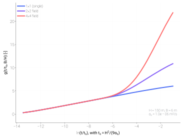

======================================
Ground-source heat pump boiler (GSHPB)
======================================

.. |gshpb| raw:: html

   GSHPB

The ``GSHPB`` family pairs the shared refrigerant cycle with a
ground-loop source side (vertical borehole field) and a DHW tank
sink.

Overview
========

|gshpb| solves the closed refrigerant cycle against a borehole heat
exchanger characterised by a precomputed **g-function**. The class is
:class:`tmhp.GroundSourceHeatPumpBoiler`. Composed variants
extend it the same way ASHPB's do:

- :class:`tmhp.GSHPB_STC_preheat`
- :class:`tmhp.GSHPB_STC_tank`
- :class:`tmhp.GSHPB_STC_ground`
- :class:`tmhp.GSHPB_STC_routed`
- :class:`tmhp.GSHPB_PV_ESS`

The base class and all variants report ``E_tot [W]`` as the whole electric
draw: compressor ``E_cmp`` + source-loop pump ``E_pmp`` + the collector-loop
pump ``E_stc_pump`` (tank, ground, routed; the mains-driven preheat has none)
+ the UV lamp ``E_uv`` (the base class and ``GSHPB_PV_ESS`` with ``uv=``; the
STC variants do not simulate a ``uv=`` lamp and warn if one is passed). The
lamp is counted once: ``GSHPB_PV_ESS`` routes the base class's ``E_tot``.
A model run twice with the same inputs gives the same result.

The collector, its irradiance inputs (direct-normal ``I_DN`` and
diffuse-horizontal ``I_dH``, transposed to the collector plane with the sun
position from ``latitude``/``longitude``/``utc_offset_h``/``start_time``), the
loop controller with its storage high limit and the preheat circuit are the
same as for the air-source variants — see :doc:`ashpb`, "Solar inputs and the
collector model". The STC scenario logic is shared by both families
(``tmhp._stc_scenarios``).

Base usage
==========

.. code-block:: python

   from tmhp import GroundSourceHeatPumpBoiler

   gshpb = GroundSourceHeatPumpBoiler(
       ref="R410A",
       N_1=1, N_2=1,      # single borehole
       H_b=150.0,         # depth [m]
   )

   result = gshpb.analyze_steady(
       T_tank_w=55.0,
       T_source=10.0,     # ground-loop fluid inlet [°C]
       Q_ref_tank=8_000,
   )

Default sizing
==============

``hp_capacity`` (default 8 kW) and the refrigerant are enough to build a
machine: every other size follows the capacity, so the rated cycle is the same
at 1 kW and at 100 kW (B0/W35: condensing 5 K above the tank, evaporating about
6 K below the entering fluid, COP of the cycle 4.2 with R410A and the default
efficiency map).

.. list-table::
    :header-rows: 1
    :widths: 26 34 40

    * - Argument
      - Default
      - Rule
    * - ``UA_tank_hx``
      - ``hp_capacity / 5`` [W/K]
      - 5 K condensing approach at the rated duty (as ASHPB).
    * - ``UA_ground``
      - ``0.18 × hp_capacity`` [W/K]
      - Fluid-to-refrigerant evaporator, the coefficient of
        :class:`tmhp.GroundSourceHeatPump` (``ground_hx_ua_per_capacity``).
    * - ``ground_flow_ref_lpm``
      - ``0.75 × hp_capacity / (ρ c · 3 K)``
      - Rated source-side heat at a 3 K loop temperature difference:
        3.58 L/min per kW (28.7 L/min at 8 kW), shared evenly by the boreholes.
    * - ``E_pmp``
      - ``75 W/ton × hp_capacity``
      - Upper bound of ASHRAE ground-loop pumping grade B, 21.3 W per kW
        (171 W at 8 kW). Used when the hydraulic pump model
        (``hydraulic_pump``) is off; it enters ``cop_sys`` in full and warms
        the fluid entering the evaporator.
    * - ``N_1``, ``N_2``, ``H_b``
      - 200 m boreholes on a near-square grid
      - With none of the three given, boreholes are added until the rated
        source-side heat (``0.75 × hp_capacity``) is at most 50 W per metre:
        one borehole up to 13.3 kW, 2 at 14 kW, 2 × 2 at 30 kW, 3 × 3 at
        100 kW.

A value you pass is used as given (the deprecated aliases ``UA_tank``,
``UA_cond_design``, ``UA_evap_design`` and ``dV_b_f_lpm`` keep their
precedence). The constructor warns (``UserWarning``) when

- a field you describe carries more than 80 W/m at the rated point;
- the default flow is laminar in the U-tubes (``Re < 2300``, e.g. many
  boreholes on a small machine);
- ``T_tank_w_upper_bound`` plus the tank heat-exchanger approach
  (``hp_capacity / UA_tank_hx``) is at or above the refrigerant's critical
  temperature: no cycle exists there, so the tank could not reach the set
  point. The default machine (R410A, 65 °C + 5 K = 70 °C against 71.3 °C) is
  just inside; real R410A compressors stop near 65 °C condensing, so use
  ``ref="R134a"`` or ``"R290"`` or a lower set point when that margin matters.

Cycle closures
==============

Two relations hold in every running result (``analyze_steady`` and each
``analyze_dynamic`` row).

- **Suction superheat.** The gas leaves the evaporator no hotter than the
  entering ground fluid: the superheat is ``dT_superheat`` or the evaporator
  approach less ``dT_hx_min``, whichever is smaller (the same cap as ASHPB).
- **Tank heat exchanger on a speed bound.** When the request is below what the
  compressor delivers at ``rps_min`` (``capacity_clamped == "min"``) or above
  its ``rps_max`` duty (``"max"``), the condensing temperature is solved from
  the heat actually delivered, ``Q_ref_tank = UA_tank_hx × dT_ref_tank``, not
  from the request. ``dT_ref_tank [K]`` is the approach the cycle ran at and
  ``tank_hx_residual [W]`` the remaining imbalance (zero unless the closure
  could not be bracketed, as on the pressure-ratio floor). On the speed floor
  the running machine no longer depends on the request.

The evaporator approach is searched between 1 and 20 K and, when the heat
exchanger already carries the duty at 1 K (a compressor at low speed against
an evaporator sized for the full capacity), down to 0.05 K.

.. _boiler-steady-cycling:

Steady state below the minimum capacity
=======================================

A request below what the compressor delivers at ``rps_min`` is met by
switching it on and off. ``analyze_steady`` reports such a point
(``capacity_clamped == "min"``) as the mean over the cycling period, with the
same keys as :doc:`ashp` and :doc:`gshp` (:mod:`tmhp.cycling`):

- ``Q_ref_tank [W]`` equals the request. ``Q_min [W]`` is the duty of the
  running machine and ``capacity_ratio [-]`` the request divided by it (the
  *CR* of EN 14825).
- ``runtime_fraction [-]``, the share of the time the compressor runs, equals
  *CR*: heat and refrigerant rates (``Q_ref_tank``, ``Q_ref_ground``,
  ``m_dot_ref``) are the running values times it. This is how a dynamic step
  reports a compressor that ran part of the step.
- The electrical inputs (``E_cmp``, ``E_pmp``, ``E_tot``) carry the EN 14825
  degradation for a unit delivering to water,
  ``COP = COP_min · CR / (Cc · CR + 1 − Cc)``. The standard takes the start-up
  loss of a hydronic unit as negligible and charges the power the unit draws
  while its compressor is off; ``Cc`` is one minus that power over the
  running input. The mean input is therefore the running input times
  ``CR + (1 − Cc)(1 − CR)``, and both COPs are the continuous ones times
  ``part_load_factor [-]``. ``E_cycling_loss [W]`` is the off-state part.
- ``Q_bhe [W]`` is the mean ground-side heat less the mean pump power.
- Temperatures, pressures and speed are those of the running machine; the
  loop flow keeps its running value, as in a dynamic step.

``Cd_cycling`` is that coefficient ``Cc`` (the constructor argument has the
same name in every family). The default 0.9 is the value the standard
prescribes for a unit that has not been tested: an off-state draw of a tenth
of the running input. For a unit with a measured standby power use
``Cd_cycling = 1 − P_off / P_on``; ``1.0`` is loss-free cycling; ``None``
returns the continuous minimum-speed point, which delivers more than the
request (the behaviour before this report existed).

.. list-table:: EN 14825 degradation with ``Cc = 0.9``
   :header-rows: 1
   :widths: 25 25 25 25

   * - ``capacity_ratio``
     - ``part_load_factor``
     - Mean input / running input
     - ``runtime_fraction``
   * - 0.1
     - 0.526
     - 0.190
     - 0.1
   * - 0.2
     - 0.714
     - 0.280
     - 0.2
   * - 0.4
     - 0.870
     - 0.460
     - 0.4
   * - 0.6
     - 0.938
     - 0.640
     - 0.6
   * - 0.8
     - 0.976
     - 0.820
     - 0.8
   * - 1.0
     - 1.000
     - 1.000
     - 1.0

The default machine (8 kW, R410A) at a 0 °C source and a 35 °C tank delivers
3.05 kW at its minimum speed. A 400 W request used to return those 3.05 kW at
896 W of input; it now returns 400 W at 195 W (system COP 2.05 against 3.40
for the running machine), and a 2 kW request 2 kW at 619 W (COP 3.23).

A dynamic run is not affected. There the tank thermostat switches the
compressor, which runs at ``hp_capacity`` — not at its minimum speed — for
``runtime_fraction [-]`` of a step, and the row already is the step mean
(next section). No standby power is added to the off time of a dynamic run:
the 10 % default belongs to the standard's part-load points, and applied to
a storage heater whose compressor runs a fifth of the day it would add more
than 40 % to the daily electricity.

Dynamic operation
=================

``analyze_dynamic`` follows the tank thermostat (``T_tank_w_lower_bound``
/ ``T_tank_w_upper_bound``, 55 / 65 °C) inside each step: a step reports
the fraction of it the compressor ran (``runtime_fraction [-]``), its
starts (``hp_starts [-]``), and heat, power and ground heat averaged
over the step. ``min_on_time_s`` / ``min_off_time_s`` (default 0) hold
the compressor to a minimum run and rest time. See
:ref:`time-step-and-thermostat`.

On a step the compressor runs only part of, loads are kept by source: the
compressor extracts only while it runs, a solar collector charging the
ground (``GSHPB_STC_ground``, ``GSHPB_STC_routed``) injects for the whole
step. The ground history and the borehole wall take the step-average net
load (the ground's step-mean response). The reported fluid temperatures
``T_bhe_f*`` are step-time averages -- the borehole resistance and loop
temperature difference are linear in the load, so continuous in the run
fraction and equal to the injection-only state when the compressor does
not run. ``T_bhe_f*_running`` are the fluid while the compressor runs (its
running extraction net of the injection), which the evaporator's
source-side exergy uses.

The cycle of a step is solved against that running fluid of the *same*
step: the borehole wall's response to the step's own load, the borehole
resistance and the loop temperature difference are closed together with
the cycle (to 10\ :sup:`-4` K), so in every running row
``T_ref_evap_sat < T_bhe_f_out_running <= T_bhe_f_out``. (Earlier releases
fed the evaporator the previous step's outlet, which could put the
evaporating temperature above the row's own fluid.) A ground coupler
without ``preview_wall_temperature_rise`` cannot evaluate an uncommitted
load; with such a backend the cycle still reads the previous step's outlet.

The constructor's ``dt_s`` (default 3600 s) is not the simulation step:
it sets the shortest lag time tabulated for the g-function (never below
one hour; shorter lags are interpolated linearly from zero). Pass the
simulation step to ``analyze_dynamic``. Hourly steps keep the tank
within its bounds, but they average hot-water draws over the hour; use
10–15 min steps or shorter when the draw profile matters.

Source-side mechanics
=====================

For ground-source models, the source-side dynamics are encoded in a
**g-function** — the dimensionless thermal response of a borehole
field to a unit heat-extraction step. TMHP precomputes the
g-function once via
`pygfunction <https://github.com/MassimoCimmino/pygfunction>`_ and
interpolates it during the simulation, so the per-step cost stays
constant whether the field is one borehole or a hundred.

The precomputed grid covers ``1.5 × t_max_s`` (default one year). A longer
simulation does not extrapolate it: the g-function is recomputed by
pygfunction to cover the requested time (about 0.2 s for a 10 × 10 field), so
a multi-year run gives the same ground temperatures whatever ``t_max_s`` was.
Each step ``n`` reports the borehole-wall and fluid temperatures averaged over
``[t_n, t_n + dt]``, including the response to that step's own load; with an
hourly load history the hourly means are the same for ``dt`` = 60, 600 or
3600 s. Below one hour the g-function is the straight line from zero to its
one-hour value and the borehole has no heat capacity, so minute-scale
start-up transients are approximate on the default path.
:func:`tmhp.borehole_capacity.enable_borehole_dynamics` adds the heat
capacity of fluid, pipe and grout, the short-time wall response and the fluid
transit through the U-tube; bore fields other than a rectangular grid are set
up with :mod:`tmhp.borefield`. Both are described in :doc:`ground-response`.

        field geometries: 1×1, 2×2, and 4×4.
    :align: center
    :width: 100%

    Dimensionless g-function for three rectangular borehole-field
    geometries. The 1 × 1 field is the single-borehole baseline;
    2 × 2 and 4 × 4 diverge as borehole-to-borehole thermal
    interference accumulates over the multi-year horizon. Generated
    by ``scripts/visualization/g_function_curve.py``.

Sink-side mechanics
===================

Single-node DHW tank, implicit per-step solve — the same demand-side
sink used by the air-source and water-source boiler families. A step whose
implicit solve returns no root is solved again with the same energy balance
by bracketing over 0-200 °C; if the balance has no solution there the step is
taken explicitly with the whole heat rate (heat pump, draw-off, loss,
subsystems) and a ``tmhp._tank_solve.TankSolveWarning`` names it. The tank
temperature is not held at the mains temperature: a tank in a cold room cools
below it.

Tank backends
-------------

``tank_model`` selects how the tank itself is resolved (always-full tank,
no ``stc``/``pv``/``uv`` subsystem in the multi-node modes):

.. list-table::
   :header-rows: 1
   :widths: 18 82

   * - ``tank_model``
     - Tank
   * - ``"lumped"`` (default)
     - One fully mixed node.
   * - ``"stratified"``
     - ``n_tank_nodes`` nodes (:class:`tmhp.stratified_tank.StratifiedTank`,
       sub-stepped to a Courant number of 1): smooth, numerically diffusive.
   * - ``"hybrid"``
     - The same nodes with a tracked thermocline
       (:class:`tmhp.hybrid_tank.HybridStratifiedTank`): a sharp front
       between drawn and stored water.

In the multi-node modes the condenser is a coil immersed in the tank:
``UA_tank_hx`` spread evenly over the nodes, or all of it at
``condenser_node`` (0 = top). Heat flows only into water colder than the
refrigerant:

- Node ``i`` receives ``k·UA_i·(T_cond − T_i)⁺``, with ``T_cond`` the
  condensing temperature of the step's cycle (``T_ref_cond_sat_l``) and
  ``T_i`` the node's end-of-step temperature; ``k`` is set so that the nodes
  receive the step's condenser heat ``Q_ref_tank``. A node as hot as the
  refrigerant receives nothing and no node is heated past ``T_cond``.
- The cycle condenses at the temperature that coil needs. With cold water
  at the bottom and hot water above the refrigerant temperature, only the
  cold nodes take heat and the cycle condenses near them, below what the
  mean tank temperature would give; in a mixed tank the two agree, and a
  one-node ``"stratified"`` tank reproduces ``"lumped"``.
- If the water around the coil cannot take the step's heat below ``T_cond``
  (a coil in the top node only), the compressor stops when that water
  reaches ``T_cond``: the row's ``runtime_fraction``, heat and power are cut
  to what was delivered and the thermostat call stands.

The thermostat reads the volume-average temperature ``T_tank_w [°C]``, so
on/off timing and delivered heat follow the lumped tank; with a coil that
reaches the top, the top node can sit several kelvin above
``T_tank_w_upper_bound`` while staying below ``T_cond``. Hot water leaves
from the top: the mixing valve, ``T_mix_w_out``, ``Q_tank_w_out`` and
``X_tank_w_out`` use ``T_tank_w_out [°C]``, the temperature of the water that
left during the step. The multi-node modes add ``T_tank_w_out``,
``T_tank_w_top`` and ``T_tank_w_bottom`` to the result, and ``Q_tank_loss``
is the wall loss of the node profile. Each run closes
``Σ Q_ref_tank·dt = C_tank·ΔT_tank_w + Σ ρc·dV_tank_w_out·(T_tank_w_out −
T_tank_w_in)·dt + Σ Q_tank_loss·dt``. The storage exergy ``Xst_tank`` is still
evaluated at the mean temperature.

Composed variants
=================

Usage patterns for the tank-side variants follow the same demand-side
composition pattern as the air-source boiler family — see :doc:`ashpb`
for full STC preheat and PV + ESS examples. The ground-side STC
variants route collected solar heat into the borehole field instead
of, or in exclusive alternation with, the tank.

.. tab-set::
   :class: composition-tabs

   .. tab-item:: Base

      The standalone GSHPB: borehole-field g-function source, R32 cycle,
      DHW tank charge.

      .. code-block:: python

         from tmhp import GroundSourceHeatPumpBoiler

         gshpb = GroundSourceHeatPumpBoiler(
             ref="R410A",
             N_1=1, N_2=1,
             H_b=150.0,
         )
         result = gshpb.analyze_steady(
             T_tank_w=55.0,
             T_source=10.0,
             Q_ref_tank=8_000,
         )

   .. tab-item:: + STC preheat

      Adds a flat-plate STC that preheats mains water entering the
      tank. Reduces the tank-charge duty the heat pump has to deliver.

      .. code-block:: python

         from tmhp import GSHPB_STC_preheat
         from tmhp.subsystems import SolarThermalCollector

         stc = SolarThermalCollector(A_stc=4.0, stc_tilt=35.0, stc_azimuth=180.0)
         model = GSHPB_STC_preheat(stc=stc, ref="R410A", N_1=1, N_2=1, H_b=150.0)

   .. tab-item:: + STC tank loop

      A pumped collector loop draws tank water, heats it and returns it,
      under a differential controller with a storage high limit
      (``T_stc_tank_max``, 85 °C).

      .. code-block:: python

         from tmhp import GSHPB_STC_tank
         from tmhp.subsystems import SolarThermalCollector

         stc = SolarThermalCollector(A_stc=4.0, stc_tilt=35.0, stc_azimuth=180.0)
         model = GSHPB_STC_tank(stc=stc, ref="R410A", N_1=1, N_2=1, H_b=150.0)

   .. tab-item:: + STC ground

      STC injects collected heat into the borehole loop for seasonal
      ground charging; the DHW tank balance remains heat-pump-only.

      .. code-block:: python

         from tmhp import GSHPB_STC_ground
         from tmhp.subsystems import SolarThermalCollector

         stc = SolarThermalCollector(A_stc=4.0, stc_tilt=35.0, stc_azimuth=180.0)
         model = GSHPB_STC_ground(stc=stc, ref="R410A", N_1=1, N_2=1, H_b=150.0)

   .. tab-item:: + STC routed

      A per-step router sends solar heat either to the tank or to the
      borehole field. The default policy serves a cold tank first, then
      charges the ground.

      .. code-block:: python

         from tmhp import GSHPB_STC_routed
         from tmhp.subsystems import SolarThermalCollector

         stc = SolarThermalCollector(A_stc=4.0, stc_tilt=35.0, stc_azimuth=180.0)
         model = GSHPB_STC_routed(stc=stc, ref="R410A", N_1=1, N_2=1, H_b=150.0)

   .. tab-item:: + PV / ESS

      Photovoltaic generation + ESS preferentially feeds the
      compressor and auxiliaries.

      .. code-block:: python

         from tmhp import GSHPB_PV_ESS
         from tmhp.subsystems import EnergyStorageSystem, PhotovoltaicSystem

         model = GSHPB_PV_ESS(
             pv=PhotovoltaicSystem(),
             ess=EnergyStorageSystem(),
             ref="R410A",
             N_1=1, N_2=1, H_b=150.0,
         )

STC preheat
-----------

.. autoclass:: tmhp.GSHPB_STC_preheat
    :members:
    :show-inheritance:
    :no-index:

STC tank loop
-------------

.. autoclass:: tmhp.GSHPB_STC_tank
    :members:
    :show-inheritance:
    :no-index:

STC to ground loop
------------------

Besides ``Q_solar_ground`` the result carries the collector columns of the tank
variant (``Q_sol_stc``, ``Q_stc_w_in``, ``Q_stc_w_out``, ``Q_stc_pump_w_out``,
``Q_l_stc``, ``T_stc_*``, ``dV_stc``, ``E_stc_pump``), so the collector balance
``Q_sol_stc = (Q_stc_w_out - Q_stc_w_in) + Q_l_stc`` and
``Q_stc_w_out - Q_stc_w_in = Q_solar_ground`` can be checked step by step.
The loop runs inside the ``preheat_start_hour``–``preheat_end_hour`` window
when the collector controller allows it (outlet at least ``dT_stc_off`` above
the borehole wall, gain above the pump power). The freeze protection and the
stagnation lock-out described in :doc:`ashpb` apply
(``stc_freeze_protected [-]``, ``stc_stagnation_lockout [-]``): the loop does
not run while the idle collector is below ``T_stc_freeze`` or the borehole
wall is below 0 °C (the loop carries water; ``T_stc_freeze=None`` for an
antifreeze loop), and a collector that idled above ``T_stc_lockout`` while
the clock window was closed is not started until it has cooled.

.. autoclass:: tmhp.GSHPB_STC_ground
    :members:
    :show-inheritance:
    :no-index:

STC routed between tank and ground
----------------------------------

The result carries the same collector columns as :class:`~tmhp.GSHPB_STC_tank`.
While the collector is active, every step closes
``Q_sol_stc = (Q_stc_w_out - Q_stc_w_in) + Q_l_stc`` and
``Q_stc_w_out - Q_stc_w_in = Q_solar_tank + Q_solar_ground`` (one of the two is
zero). On the tank route the collector is reported at the solved tank
temperature, i.e. the heat that entered the tank balance, and charging stops
at ``T_stc_tank_max`` within the step as in :class:`~tmhp.GSHPB_STC_tank`.
A router that returns ``"off"`` in strong sun leaves the collector idle: at
or above ``T_stc_lockout`` the loop is then locked out
(``stc_stagnation_lockout [-]``) and neither route runs until the collector
has cooled.

.. autoclass:: tmhp.GSHPB_STC_routed
    :members:
    :show-inheritance:
    :no-index:

PV + ESS
--------

Routing and balances are the same as for :class:`~tmhp.ASHPB_PV_ESS` (see
:doc:`ashpb`): no grid export (surplus is ``E_dump``), every loss is a column
(``Q_l_ctrl``, ``Q_l_inv``, ``Q_l_ess``) and each step closes
``E_pv_out = Q_l_ctrl + E_pv_to_inv + E_ess_chg + E_dump`` and
``E_tot = E_inv_out + E_grid_import`` with ``E_tot = E_cmp + E_pmp + E_uv``.

.. autoclass:: tmhp.GSHPB_PV_ESS
    :members:
    :show-inheritance:
    :no-index:

API reference
=============

.. automodule:: tmhp.ground_source_heat_pump_boiler
    :members:
    :undoc-members:
    :show-inheritance:

.. automodule:: tmhp.gshpb_stc_preheat
    :members:
    :undoc-members:
    :show-inheritance:

.. automodule:: tmhp.gshpb_stc_tank
    :members:
    :undoc-members:
    :show-inheritance:

.. automodule:: tmhp.gshpb_stc_ground
    :members:
    :undoc-members:
    :show-inheritance:

.. automodule:: tmhp.gshpb_stc_routed
    :members:
    :undoc-members:
    :show-inheritance:

.. automodule:: tmhp.gshpb_pv_ess
    :members:
    :undoc-members:
    :show-inheritance:

See :doc:`ground-flow` for opt-in flow-dependent component physics, optimal pump
control, source boundaries, and feasibility diagnostics.
