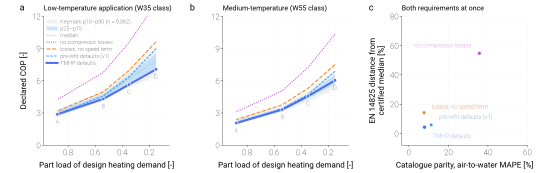

============================
Where the defaults come from
============================

TMHP decides a lot on your behalf. Hand it a capacity and a refrigerant and it
produces heat-exchanger conductances, a compressor displacement, a rated air
flow, the efficiency model of a compressor and the power its electronics
draw. That convenience is the point of the
library — but it is only worth having if each of those numbers can be traced to
a published document rather than to somebody's judgement, and if you can rerun
the step that produced it.

This page is that trace. Every row links to the source and to the script that
reads it.

.. admonition:: The one rule behind all of it
    :class: important

    Published literature reports the conductance, displacement or efficiency of
    *particular machines*. Nobody publishes a rule expressed per unit of
    capacity — which is exactly what a model that sizes its own components
    needs. So the numbers below are not taken from a paper. They are derived
    from populations: manufacturer catalogues that rate an entire product range
    at one declared condition, which makes models of different capacity
    comparable by construction. The citations are for the *method*, the
    *rating standard* and the *correlation*; the numbers are measured across
    many machines.

    A consequence worth stating plainly: validating against a catalogue is
    never calibrating against it. No parameter below is fitted to any unit in
    :doc:`the validation set <index>`. One choice between two candidate
    compressor speed shapes was made on certified heat-pump data — the
    declared part-load points of the Heat Pump Keymark population, not the
    validation catalogues — and it is stated where it was made
    (`Compressor data, not heat-pump data`_).

Summary
=======

.. list-table::
    :header-rows: 1
    :widths: 22 26 32 20

    * - Quantity
      - Default
      - Where it comes from
      - Reproduce
    * - Outdoor coil conductance (per role)
      - Leaving-end approach 2.73 K as a condenser (``UA_ou_rated`` of
        ``AirSourceHeatPump``, air at 35 °C) and 2.82 K as an evaporator
        (``UA_ou_evap_rated``, and ``UA_ou_rated`` of
        ``AirSourceHeatPumpBoiler``, air at 7 °C), at the rated outdoor airflow
      - Saturation temperature at the printed pressure of 120 / 87 operating
        points (11 / 8 product lines, 4 / 2 manufacturers) of split and
        air-to-water outdoor units; the law chosen by product-line hold-out
      - ``default_inputs.hx_approach``
    * - Indoor coil conductance (air-to-air)
      - ``UA_iu_rated = 0.16 × hp_capacity``, provisional
      - The earlier rule, no longer tied to the outdoor coil. The wall-mounted
        indoor-coil rows come from one manufacturer and disagree on the
        leaving approach, so no value is issued (`Heat-exchanger conductance`_)
      - ``default_inputs.hx_approach``
    * - Indoor coil conductance (water-to-air)
      - Leaving-end approach 2.79 K at the rated indoor airflow
        (``UA_iu_rated`` of ``GroundSourceHeatPump``, both modes)
      - 113 operating points of water-to-air units (5 product lines, 2
        manufacturers)
      - ``default_inputs.hx_approach``
    * - Liquid–refrigerant exchanger conductance
      - Leaving-end approach 4.06 K as a condenser and 3.47 K as an evaporator
        at the rated loop flow (``UA_ground_rated`` / ``UA_ground_evap_rated``
        of ``GroundSourceHeatPump``; the evaporating value is ``UA_ground`` and
        ``UA_water`` of the liquid-source boilers)
      - 117 / 118 operating points of the coaxial source exchangers of
        water-to-air units (5 product lines, 2 manufacturers)
      - ``default_inputs.hx_approach``
    * - Plate condenser of the boilers (``UA_tank_hx``)
      - Leaving-end approach 2.01 K with circulating water at
        ``m_dot_w_rated = hp_capacity / (c_w · dT_w_rated)``, ``dT_w_rated``
        5 K
      - 20 operating points of the plate condensers of air-to-water units (3
        product lines, 2 manufacturers)
      - ``default_inputs.hx_approach``
    * - Compressor displacement
      - ``V = Q̇ / (ρ₁ · Δh · η_vol·n)`` with ``η_vol·n`` = 53.2 rev/s, so it
        follows the refrigerant (``estimate_displacement``); every family,
        the ground- and water-source boilers included
      - 41 catalogue rows of inverter twin-rotary compressors (LG, Mitsubishi
        Electric SCI; 14 families), pooled by dividing out ``ρ₁ · Δh`` at each
        row's own rating point, then evaluated at that rating point
        (7.2 / 54.4 °C)
      - ``default_inputs.compressor_displacement``
    * - Compressor efficiencies (volumetric, isentropic, electro-mechanical)
      - Semi-empirical models by compressor type, version
        ``semi-empirical-2026-11-15``. ``compressor_type`` is
        ``rotary_twin_inverter`` (the default), ``scroll`` or
        ``rotary_single_fixed``; each gives an overall isentropic efficiency,
        its split into the isentropic and the electro-mechanical part, a
        volumetric efficiency and a drive (inverter) efficiency
      - Standalone-compressor data only. Scroll: 11,957 points of 92 machines
        (manufacturer calculation data and polynomials, calorimeter
        measurements). Rotary types, both provisional: the shape from 390
        points of five machines, the level from catalogue rating points (48
        inverter twins, 56 fixed-speed singles). Drive: five measured
        inverters (`Compressor efficiency`_)
      - ``validation/coefficients/semi-empirical-2026-11-15/``,
        ``compressor_maps.semi_empirical``
    * - Efficiency guards
      - ``0 < η ≤ 1``; data hull of the default type PR 1.94–6.84,
        N 30.0–120.0 rev/s
      - Above one is set to one, nonpositive is infeasible. Outside the hull
        nothing is held or clamped: the forms are followed as they are, and
        the result row carries ``efficiency_extrapolated``
      - :mod:`tmhp.compressor_efficiency`
    * - Compressor speed range
      - ``rps_min`` 15 rev/s; ``rps_max = max(120, 1.5 × rps_rated)``
      - The ceiling is the upper end of the speed range manufacturers specify
        for inverter rotary compressors of heat-pump size (100 to 130 rev/s);
        a machine rated above 80 rev/s keeps 1.5 times its rated speed. The
        floor lies below the rotary efficiency data, which start at
        30 rev/s (`Limits and provisional items`_)
      - :mod:`tmhp.compressor_envelope`
    * - Pressure-ratio limit
      - ``PR_cycle_max`` 11 (air-to-air), 11 (air-to-water)
      - Operating points above it are rejected. 11 is the hardware limit of a
        single-stage scroll (self-unloading), kept as the bound for every
        compressor type; a default split unit heating from −15 °C outdoor
        air reaches 6.0 to 6.4 at its speed ceiling. Higher ratios are
        two-stage or injection machines; the discharge-temperature limit
        (R32 150 °C, other refrigerants 135 °C, held first by suction
        control) binds before it almost everywhere
      - :mod:`tmhp.compressor_envelope`
    * - Rated outdoor air flow
      - Air-to-air: ``0.1084·Q + 0.1776`` m³/s (``Q`` in kW, cooling-rated).
        Air-to-water: ``0.0864·Q + 0.2208`` m³/s (heating-rated)
      - Largest printed fan step of 128 single-split outdoor units (31
        families, four manufacturers) and of 59 air-to-water outdoor units
        (13 families, 6 manufacturers; the widest scatter of the airflow
        laws, see `Maximum fan airflow`_)
      - ``default_inputs.fan_airflow``
    * - Rated indoor air flow
      - Wall-mounted split: ``0.0320·Q + 0.1035`` m³/s. Water-to-air
        (ground source): ``0.0491·Q + 0.1305`` m³/s (cooling-rated)
      - Largest printed fan step of 130 wall-mounted units (38 families, five
        manufacturers) and 52 water-to-air units (7 families, four
        manufacturers). The validation units publish their own indoor airflow
        and are run at it, so the indoor default does not enter the parity
        results
      - ``default_inputs.fan_airflow``
    * - Fixed control power (``E_ctrl``)
      - 15 W for a unit delivering to water, 12 W for a unit delivering to
        air
      - Medians of what Heat Pump Keymark certificates declare with the
        compressor off: the two off/standby powers of 8,676 air-to-water
        certificates pooled, and the thermostat-off power of 19 air-to-air
        certificates. The ground- and water-source models take the value of
        their sink, carried over (`Fixed control power`_)
      - ``auxiliary_power.pto_proxy``

Every ``Reproduce`` entry is a module under ``validation/extraction/``,
``validation/compressor_maps/``, ``validation/default_inputs/`` or
``validation/auxiliary_power/``::

    uv run python -m validation.extraction.<name>
    uv run python -m validation.compressor_maps.<name>
    uv run python -m validation.default_inputs.<name>.build
    uv run python -m validation.auxiliary_power.pto_proxy

The shipped compressor models are version ``semi-empirical-2026-11-15``
(:data:`tmhp.compressor_efficiency.COEFFICIENT_VERSION`).
``validation/coefficients/semi-empirical-2026-11-15/`` holds the fitted
coefficients, the list of data sources with their power basis, the exclusions,
every cross-validation table and a README that says what is provisional;
``validation/compressor_maps/semi_empirical/`` is the pipeline. Three steps
regenerate the archive and the constants of the library module::

    uv run python -m validation.compressor_maps.derive
    uv run python -m validation.compressor_maps.semi_empirical
    uv run python -m validation.compressor_maps.semi_empirical.emit

The first needs a point file that is not redistributable (`The data`_). The
maps of the earlier releases are no longer in the library; they are kept as
records under ``validation/coefficients/`` (`Where the earlier maps went`_).
The `Compressor efficiency`_ section below describes what ships.

Heat-exchanger conductance
==========================

The problem
-----------

Every model generates its heat-exchanger conductances from a single declared
capacity, so what has to be established is a capacity-normalised rule for each
exchanger — not any particular machine's conductance. Real machines do not
publish a conductance either. What their service manuals, installation manuals
and test reports print at a rated point is the refrigerant pressure at a
service or compressor port, next to the entering air or water temperature, the
flow and the capacity. That is evidence at the level of the heat exchanger, and
it is what the cycle needs: the conductance is only the means by which the
model arrives at the saturation temperature the compressor works against.

What the conductance means
--------------------------

Every refrigerant-side exchanger in TMHP is an isothermal refrigerant against
a single-phase fluid, ``ε = 1 − exp(−UA/C)`` and ``Q = ε C |T_in − T_sat|``.
There is no refrigerant pressure drop and no desuperheating or subcooling
zone, so the model's saturation temperature has to be the one at the
compressor's ports for the pressure ratio to be right. A default conductance is
therefore defined as the **effective** conductance that reproduces, at the
rated point, the saturation temperature at the pressure the machine prints.
Line and coil pressure drop and the single-phase zones are inside it; it is not
the ``U·A`` one would compute from the coil geometry.

Which approach temperature transfers
------------------------------------

For one operating point, the inlet temperature difference
``ITD = |T_in − T_sat|``, the leaving-end approach ``ITD − Q/C``, the LMTD and
``UA/Q`` convert into each other exactly. The choice only matters when a value
measured on one machine is carried to another of a different capacity and flow:
what is held fixed? That is a question the data can answer. Per exchanger and
refrigerant role, each candidate law is fitted with one product line held out
(product lines that share hardware count as one) and scored by how well it
predicts the saturation temperature of the held-out units at their own flow and
duty. The rule, fixed before the data were collected: the simplest law within
10 % of the lowest error ships, if the stratum has at least three product lines
and two manufacturers.

.. list-table:: Product-line hold-out error of the predicted saturation temperature (RMSE)
    :header-rows: 1
    :widths: 40 20 20 20

    * - Exchanger and role
      - Fixed leaving approach
      - ``UA ∝ duty``
      - Fixed ``ITD``
    * - Outdoor coil, condensing
      - 1.63 K
      - 1.96 K
      - 3.13 K
    * - Outdoor coil, evaporating
      - 1.37 K
      - 1.49 K
      - 1.84 K
    * - Plate condenser of air-to-water units
      - 1.17 K
      - 1.53 K
      - 2.22 K
    * - Coaxial source exchanger, evaporating
      - 1.58 K
      - 1.61 K
      - 1.99 K
    * - Coaxial source exchanger, condensing
      - 2.87 K
      - 3.14 K
      - 4.73 K
    * - Water-to-air indoor coil, condensing
      - 2.72 K
      - 2.83 K
      - 3.73 K

The leaving-end approach wins or ties in every stratum a model uses, and a
fixed inlet difference — the obvious convention — is the worst everywhere. The
reason shows in the data: manufacturers build several capacities on one
chassis, and on a shared coil the inlet difference grows with the load while
the leaving approach stays put. Holding it fixed gives the conductance in
closed form,

.. math::

    UA = C \ln\!\left(1 + \frac{\dot Q}{C\,\Delta T_{\mathrm{out}}}\right)

with ``C`` the fluid's heat capacity rate at the reference flow and ``Q̇`` the
exchanger's own duty. A solution exists for every positive duty and flow. A
fixed inlet difference has none once ``Q̇ ≥ C · ITD`` — a reference flow 15 %
below the one assumed can be enough — and conductance per unit capacity
ignores the flow altogether.

The duty is the exchanger's, not the nameplate: as a condenser the outdoor coil
of a split unit rejects 1.24 W per watt of cooling nameplate (the nameplate
plus the compressor work), and as an evaporator absorbs 0.76 W per watt of
heating nameplate, both archive medians
(:func:`tmhp.default_inputs.hx_duty_per_nameplate`). The reference flow is the
rated airflow of the coil (`Maximum fan airflow`_), the rated loop flow, or the
rated circulation flow of a plate condenser.

What the archive says
---------------------

.. list-table:: The strata the models use (``validation/default_inputs/hx_approach``)
    :header-rows: 1
    :widths: 30 26 16 14 14

    * - Exchanger and role
      - Used for
      - Rows / product lines / manufacturers
      - Leaving approach, median (p10–p90)
      - Inlet difference, median
    * - Outdoor coil, condensing
      - ``AirSourceHeatPump`` ``UA_ou_rated``
      - 120 / 11 / 4
      - 2.73 K (0.9–3.9)
      - 9.4 K
    * - Outdoor coil, evaporating
      - ``AirSourceHeatPump`` ``UA_ou_evap_rated``; ``AirSourceHeatPumpBoiler``
        ``UA_ou_rated``
      - 87 / 8 / 2
      - 2.82 K (2.0–4.5)
      - 6.8 K
    * - Plate condenser of air-to-water units
      - ``UA_tank_hx`` of the three boilers
      - 20 / 3 / 2
      - 2.01 K (0.7–3.3)
      - 7.0 K
    * - Coaxial source exchanger, condensing
      - ``GroundSourceHeatPump`` ``UA_ground_rated``
      - 117 / 5 / 2
      - 4.06 K (1.6–6.5)
      - 10.2 K
    * - Coaxial source exchanger, evaporating
      - ``GroundSourceHeatPump`` ``UA_ground_evap_rated``;
        ``GroundSourceHeatPumpBoiler`` ``UA_ground``;
        ``WaterSourceHeatPumpBoiler`` ``UA_water``
      - 118 / 5 / 2
      - 3.47 K (1.0–6.6)
      - 7.7 K
    * - Water-to-air indoor coil, condensing
      - ``GroundSourceHeatPump`` ``UA_iu_rated``
      - 113 / 5 / 2
      - 2.79 K (1.5–6.6)
      - 15.9 K

The 59 sources are manufacturer service and installation manuals (Mitsubishi
Electric, ClimateMaster, WaterFurnace, Carrier, Bosch, Toshiba, Gree), the
AHRI low-GWP AREP system test reports, an ORNL mini-split test and a KTH
air-to-water prototype; the archive's README lists them with their hosts, the
conversions and the anomalies the documents contain. Outdoor coils are pooled
across product classes: split and air-to-water outdoor coils are one
construction and their leaving approaches agree (as condensers 2.5 K for
wall-mounted splits, 2.3 K for ducted splits and 3.7 K for air-to-water units).
Indoor coils are not pooled — 6.8 K for wall-mounted units, 2.6 K for ducted
ones, 2.8 K for water-to-air units — and each model takes the stratum of its
own kind of indoor unit, where one ships.

The same outdoor coil has a smaller effective conductance as an evaporator than
as a condenser (a median ratio of 0.72 over the units printed in both modes),
so each role takes the law of its own stratum: ``AirSourceHeatPump`` has
``UA_ou_rated`` for cooling and ``UA_ou_evap_rated`` for heating, and
``GroundSourceHeatPump`` ``UA_ground_rated`` and ``UA_ground_evap_rated``. A
conductance you pass for the first and not the second serves both roles; a
value you give is never split.

These values were not chosen by catalogue COP: the laws and their constants
come from the archive and the hold-out rule alone, and the catalogue comparison
of :doc:`index` was run only after they were fixed. With them the comparison
still under-predicts, so the conductance is not where the remaining bias sits.

Every default conductance is recorded in
``model.default_input_estimates["UA_…"]`` with its law, the spread of the
population, the hold-out error, the sources and whether the duty lies outside
the archive's range (``extrapolated``). A conductance you pass is used as given
and has no entry there.

What it means for a default machine
-----------------------------------

.. list-table:: Default conductance [W/K], previous rule → now (``Q`` = ``hp_capacity``)
    :header-rows: 1
    :widths: 34 18 16 16 16

    * - Conductance
      - Previous rule
      - 3.5 kW
      - 8 kW
      - 15 kW
    * - ``AirSourceHeatPump`` ``UA_ou_rated`` (condensing)
      - ``Q/5``
      - 700 → 801
      - 1600 → 1677
      - 3000 → 3025
    * - ``AirSourceHeatPump`` ``UA_ou_evap_rated`` (evaporating)
      - ``Q/5``
      - 700 → 639
      - 1600 → 1360
      - 3000 → 2470
    * - ``AirSourceHeatPump`` ``UA_iu_rated``
      - ``0.8 × Q/5``
      - 560 → 560
      - 1280 → 1280
      - 2400 → 2400
    * - ``AirSourceHeatPumpBoiler`` ``UA_ou_rated``
      - ``0.7 × Q/5``
      - 490 → 586
      - 1120 → 1214
      - 2100 → 2173
    * - ``UA_tank_hx`` of the three boilers
      - ``Q/5``, no flow
      - 700 → 875
      - 1600 → 1999
      - 3000 → 3749
    * - ``GroundSourceHeatPump`` ``UA_ground_rated`` (condensing)
      - ``0.18 × Q``
      - 630 → 682
      - 1440 → 1559
      - 2700 → 2923
    * - ``GroundSourceHeatPump`` ``UA_ground_evap_rated`` (evaporating)
      - ``0.18 × Q``
      - 630 → 575
      - 1440 → 1314
      - 2700 → 2464
    * - ``GroundSourceHeatPump`` ``UA_iu_rated``
      - ``0.08 × Q``
      - 280 → 544
      - 640 → 1082
      - 1200 → 1900
    * - ``UA_ground`` / ``UA_water`` of the liquid-source boilers
      - ``0.18 × Q``
      - 630 → 549
      - 1440 → 1255
      - 2700 → 2354

For the outdoor coil as a condenser the new evidence lands almost exactly on
the previous rule, which was derived from different data by a different route
(`The previous rule`_). The larger changes are elsewhere: an outdoor coil as an
evaporator now has about four fifths of its condensing value; the
indoor coil of the ground-source model has 1.6 to 1.9 times the conductance; and
the boilers' sink is a different structure, so its ``UA_tank_hx`` is not
comparable with the earlier one by itself — what the cycle sees is ``K_tank_hx``
(next section), which is below the earlier ``Q/5``. Small machines get more
outdoor conductance per watt than large ones because their rated airflow per
watt is larger (the airflow laws have an intercept).

.. admonition:: How wide the band is, and what that costs you
    :class: warning

    The leaving approach of a stratum is a *median*. Between the 10th and 90th
    percentile of the product lines it spans 0.9–3.9 K for outdoor coils as
    condensers, 2.0–4.5 K as evaporators, 0.7–3.3 K for plate condensers,
    1.0–6.6 K and 1.6–6.5 K for coaxial source exchangers as evaporators and
    condensers, and 1.5–6.6 K for water-to-air indoor coils. That width is
    real hardware, not measurement noise: at the same duty and flow, two
    machines at either end of the outdoor condensing band condense about 3 K
    apart. Even the best law misses the saturation temperature of a held-out
    product line by 1.2 to 2.9 K (RMSE).

    So a single vendor-neutral default describes a typical machine, and **will
    under-predict a high-efficiency product line and over-predict a
    lower-efficiency one**. If you know the machine, pass its conductances
    (``UA_ou_rated``, ``UA_ou_evap_rated``, ``UA_iu_rated``,
    ``UA_tank_hx`` …). :doc:`index` backs the conductance out of each
    validation unit's own rating point, and decomposes the rest of the
    residual, which is not all conductance.

    .. note::

        Quote the band on the same basis as the rule. The archive's spread is
        a spread of leaving approach; its spread in ``UA`` per watt also
        carries the spread of airflow per watt, and is wider.

.. admonition:: Where this does not apply
    :class: warning

    * **Wall-mounted indoor coils.** No value is shipped. Every row that gives
      duty, airflow and pressure at one point comes from one manufacturer
      (Mitsubishi Electric, six product lines), and the evidence disagrees
      on the quantity the law uses: 6.8 K of leaving approach on the declared
      duty and airflow, about 3.6 K on the discharge-air temperature the same
      tables print, about 3.3 K from a second manufacturer's pipe temperatures
      at an assumed rated load. The inlet difference agrees at 22 K. So
      ``AirSourceHeatPump`` keeps ``UA_iu_rated = 0.16 × hp_capacity``, no
      longer tied to the outdoor coil, and records it as provisional with
      that reason.
    * **Frosted operation.** Frosting rows are excluded; frost and defrost are
      handled by the defrost adjustment, not by the conductance.
    * **Microchannel coils.** The archive has none; the strata are
      fin-and-tube coils.
    * **Wet cooling coils.** Indoor coils run wet in cooling and TMHP's coils
      are dry, so those rows are excluded. The indoor values come from the dry
      condensing role and are used in both modes.
    * **Immersed or wrapped tank coils.** No measured row pairs a condensing
      pressure with a tank temperature, so no value is issued. Build the
      boiler with ``m_dot_w_rated=0`` and pass ``UA_tank_hx``.
    * **Water-to-water machines.** The archive's water-to-water rows come from
      one manufacturer whose heating tables print suction pressures below
      their own low-pressure cut-out; the liquid-source boilers borrow the
      water-to-air coaxial evaporator.

The boilers' sink
-----------------

The tank heat exchanger of ``AirSourceHeatPumpBoiler``,
``GroundSourceHeatPumpBoiler`` and ``WaterSourceHeatPumpBoiler`` is an
external plate condenser fed with tank water by a circulation pump, the
structure of monobloc air-to-water units. ``T_tank_w`` is the water entering
the condenser. The rated circulation flow is
``m_dot_w_rated = hp_capacity / (c_w · dT_w_rated)`` with ``dT_w_rated``
5 K (the EN 14511 30/35 °C rating), and the heat the exchanger carries per
kelvin of condensing temperature above the entering water is
``K_tank_hx = C_w (1 − exp(−UA_tank_hx / C_w))``. ``AirSourceHeatPumpBoiler``
takes a per-call ``m_dot_w``; the liquid-source boilers run at
``m_dot_w_rated``. ``m_dot_w_rated=0`` selects the earlier form without
circulating water, ``UA_tank_hx`` working against the tank temperature
directly; with ``UA_tank_hx = hp_capacity / 5`` it is the earlier machine.

A rating condition names the *leaving* water (``W35``, ``W55``). The catalogue
comparisons and ``operating_range()`` hand a boiler the water EN 14511 enters
with — the leaving water less the standard's rise, 5 K up to 45 °C, 8 K at
55 °C, 10 K at 65 °C — and, for ``AirSourceHeatPumpBoiler``, the flow that
carries the duty at that rise (:func:`tmhp.standard_conditions.en14511_water_rise`,
:func:`tmhp.standard_conditions.en14511_condenser_water`). This replaces the
earlier convention of a tank 2.5 K below the leaving water with no flow.

The previous rule
-----------------

Until November 2026 the outdoor coil of ``AirSourceHeatPump`` had
``UA_ou = hp_capacity / 5`` in both roles and its indoor coil ``0.8 × UA_ou``;
the boilers had ``UA_tank_hx = hp_capacity / 5`` without circulating water,
the air-source boiler's outdoor coil ``0.7 × UA_tank_hx``, and the
ground-source models ``0.18 × hp_capacity`` on the source side and
``0.08 × hp_capacity`` for the indoor coil. ``hp_capacity / 5`` came from
1,414 component coils in catalogues rated under EN 328 (352 evaporators,
median ``UA/Q`` 0.190) and ENV 327 (1,062 condensers, 0.146), converted to the
nameplate basis with ``1 + 1/EER`` and corroborated by twelve Trane packaged
units' published coil geometry through the Wang, Chi & Chang (2000) air-side
correlation. The scripts under ``validation/extraction/``
(``ua_transfer_law``, ``en328_inversion``, ``trane_geometry``,
``dt_convention``) still reproduce it.

It was replaced for two reasons. The rating standards fix the temperature
difference at which a component coil is rated, so the populations say how much
conductance a coil has at that difference, not which approach a heat pump runs
at; and residential mini-splits, the product class of the air-to-air validation
units, were outside that evidence. For outdoor coils the new evidence lands on
almost the same value. An earlier version of that work also reported a pooled
regression of ``UA/Q`` against air flow (slope −0.020, R² 0.001) as evidence
that the two are unrelated; inside one rating standard they are linked by an
identity, so the regression meant nothing and was withdrawn, leaving the
overlap of the two standards' bands and the geometric route as the evidence.

Compressor displacement
=======================

The machine has to move enough refrigerant to carry the nameplate duty at the
nameplate condition:

.. math::

    V_{\mathrm{disp}}
        = \frac{\dot Q_{\mathrm{nom}}}
               {\Delta h \; \rho_{1} \; \eta_{\mathrm{vol}} \; n_{\mathrm{rated}}}

Both :math:`\Delta h` and :math:`\rho_1` come from CoolProp at a declared
rating point, so the dependence on the working fluid is pure fluid property
rather than a tabulated coefficient. That dependence is not small: per kilowatt
of nameplate the displacement runs from about 3.0 cm³/rev for R32 to 7.3 for
R134a.

What is left, :math:`\eta_{\mathrm{vol}}\, n`, belongs to the compressor, and
compressor catalogues print it. Each row gives a displacement and a capacity at
a declared rating point, so
:math:`\eta_{\mathrm{vol}}\, n = \dot Q / (V \rho_1 \Delta h)` row by row.
Across 41 rows of inverter twin-rotary compressors from two manufacturers (LG
and Mitsubishi Electric SCI; 14 families, R32 and R410A, 2.9 to 14.9 kW) it is
53.2 rev/s — 0.887 of the 60 rev/s the rows are published at. Predicting a
family, a manufacturer or a refrigerant from the others misses the printed
displacement by 2.7, 2.6 and 3.8 %.

The default displacement is that relation at the catalogues' own rating point
(evaporating 7.2 °C, condensing 54.4 °C, suction 18.3 °C, liquid 46.1 °C), with
the nameplate capacity standing in for the compressor's catalogue capacity
(:func:`tmhp.default_inputs.estimate_displacement`). Every model —
``AirSourceHeatPump``, ``GroundSourceHeatPump``, ``AirSourceHeatPumpBoiler``,
``GroundSourceHeatPumpBoiler`` and ``WaterSourceHeatPumpBoiler`` — uses it when
``V_cmp_ref`` is left out, and says so: ``model.default_input_estimates["V_cmp_ref"]``
holds the value, the data release, the capacity range of the catalogue rows,
whether the capacity lies outside that range (``extrapolated``) and the source
documents. A ``V_cmp_ref`` you pass is used as given and has no entry there.

.. list-table:: Default displacement [cm³/rev]
    :header-rows: 1
    :widths: 16 24 15 15 15 15

    * - Nameplate
      - Until November 2026 (any refrigerant)
      - R32
      - R410A
      - R290
      - R134a
    * - 3.5 kW
      - 16.33
      - 10.55
      - 11.64
      - 19.68
      - 25.60
    * - 8 kW
      - 37.33
      - 24.10
      - 26.61
      - 44.98
      - 58.51
    * - 15 kW
      - 70.00
      - 45.20
      - 49.90
      - 84.34
      - 109.70

The earlier default, 42 cm³/rev per 9 kW for every refrigerant, was 55 % above
the catalogue value for R32 and 17 % and 36 % below it for R290 and R134a. The
speed solver absorbed the difference into the rated speed — the speed at which
the machine delivers its nameplate at its rating condition, and the point the
rotary efficiency models are read relative to (`The forms`_). The constant is
no longer in the library. ``GroundSourceHeatPumpBoiler`` and
``WaterSourceHeatPumpBoiler`` were the last two models on it and take the
catalogue displacement since November 2026 like the others.

.. list-table:: Rated speed of a default machine [rev/s], with the earlier constant passed as ``V_cmp_ref`` → with the catalogue displacement
    :header-rows: 1
    :widths: 52 24 24

    * - Machine
      - Earlier constant
      - Catalogue displacement
    * - ``AirSourceHeatPump``, 4 kW, R32
      - 31.2
      - 48.4
    * - ``AirSourceHeatPumpBoiler``, 15 kW, R290
      - 84.4
      - 70.0
    * - ``GroundSourceHeatPump``, 4 kW, R32
      - 24.8
      - 38.4
    * - ``GroundSourceHeatPumpBoiler``, 8 kW, R290
      - 101.6
      - 84.3
    * - ``GroundSourceHeatPumpBoiler``, 8 kW, R134a
      - not constructible
      - 102.1
    * - ``WaterSourceHeatPumpBoiler``, 8 kW, R290
      - 71.4
      - 59.3

Both columns are the present library; only the displacement differs. For the
two liquid-source boilers the change is the one of November 2026: the default
8 kW R290 ground-source boiler went from a rated speed of 101.6 to 84.3 rev/s
and the water-source boiler from 71.4 to 59.3, and an R134a ground-source
boiler, which on the constant found no speed up to 150 rev/s that delivers its
nameplate at B0/W55 and so could not be built, is now rated at 102.1 rev/s.
With the catalogue displacement every machine of the table is rated inside the
speed range of the rotary efficiency data, 30 to 120 rev/s
(`Compressor efficiency`_); with the constant one was below it and one could
not be built.

The rated speed is the speed that delivers the nameplate, and the heat a
boiler delivers includes the part of the compressor's loss that reaches the
gas, so the rated speed of a heating-rated machine moves a little with the
efficiency model. Between the two speed shapes of the rotary types
(`Compressor data, not heat-pump data`_) the R290 boilers of this table differ
by 0.3 to 0.6 rev/s and the R134a ground-source boiler by 5 rev/s (96.8 rev/s
with ``shao_informed``); the two cooling-rated units do not move. The fixed
control power (`Fixed control power`_) does not enter the rated speed.

One limit remains, and it belongs to the rule. A ground-source boiler is still
rated high — at 8 kW, 74.6 rev/s with R32, 82.2 with R410A, 84.3 with R290 and
102.1 with R134a — because its nameplate condition, B0/W55, is harsher than the
catalogue rating point (7.2 / 54.4 °C) at which the rule reads the nameplate: a
compressor sized to deliver the nameplate there has to turn faster to deliver
it from brine at 0 °C. A machine rated above 80 rev/s takes its speed ceiling
from 1.5 times the rated speed (126.5 rev/s for the R290 machine, 153.1 for
the R134a one), which is above the 120 rev/s the efficiency data reach. If you
know the compressor of such a machine, pass ``V_cmp_ref`` and ``rps_max``.

The class rating points
-----------------------

:func:`tmhp.compressor_speed.refrigerant_aware_displacement` evaluates the same
relation at any declared rating point and rated speed. Two are declared per
equipment class — EN 14511 A7/W35 for air-to-water, ISO 5151 T1 for
air-to-air — and their rated speed is the one quantity that carries real
uncertainty, since the result is exactly inversely proportional to it. They are
not what the default uses; they are the record of how the rated speed of each
class was bounded before compressor catalogues were collected.

For air-to-water it is not a guess. Inverting the relation against the nine
Panasonic Aquarea units whose compressor displacement is published by the
manufacturer's compressor division gives a median rated speed of 42 rev/s, and

.. list-table::
    :header-rows: 1
    :widths: 20 26 26 28

    * - Nameplate
      - R32
      - R290
      - R410A
    * - 9 kW
      - 33.6 rev/s
      - 32.8
      - 36.2
    * - 12 kW
      - 44.9
      - 43.7
      - 48.3

— at a fixed capacity the three refrigerants agree within 5 %. The physics
carries the fluid dependence on its own. The scatter that remains is the
manufacturers' practice of sharing one compressor across adjacent capacity
steps: in all three of those product lines the 9 and 12 kW units use the same
machine, which no continuous rule can reproduce.

For air-to-air the evidence is thinner. Daikin's SL-series service manual
publishes rated compressor frequency in place of displacement — 52 rev/s
cooling for the 2.5 kW class, 72 for the 3.5 kW class — and no displacement is
published anywhere to check the result against. A search of five data books,
three service manuals and two specification sheets, about 90 MB, returned no
displacement for any Daikin, Fujitsu or Trane unit; every ``cm³`` in those
documents is an oil charge. This is the weakest link in the chain and is
treated as such.

.. tip::

    A displacement error is second order for steady-state COP: the speed solver
    absorbs it into speed, and the result moves only through the speed
    dependence of the efficiencies. Where it matters is the modulation envelope
    — displacement and ``rps_min`` jointly fix the lowest duty the machine can
    deliver. If you know your machine's displacement, pass ``V_cmp_ref``.

Maximum fan airflow
===================

A fan default has to say *which* airflow it is. Catalogues print several fan
steps, and the one the model needs is the largest: the rated airflow is where
the fan stops (``dV_*_fan_a_max`` defaults to it), where the coil conductance
is stated and where the fan power is anchored. So the default is the largest
fan step a product publishes, fitted against the capacity of the same duty —
cooling airflow against cooling capacity, heating against heating — with one
law per product class. Families are weighted equally, and of a proportional, a
linear and a power law the simplest within 2 % of the best family-hold-out
error is kept (:func:`tmhp.default_inputs.estimate_max_airflow`; ``Q`` is the
capacity in kW, the result m³/s).

.. list-table:: Catalogue airflow laws the constructors use
    :header-rows: 1
    :widths: 34 22 16 14 14

    * - Input left out
      - Law [m³/s]
      - Rows / families / manufacturers
      - Capacity [kW]
      - Family hold-out MAPE
    * - ``AirSourceHeatPump`` outdoor, cooling-rated
      - ``0.1084·Q + 0.1776``
      - 128 / 31 / 4
      - 1.5–13.6
      - 14.5 %
    * - ``AirSourceHeatPump`` outdoor, heating-rated
      - ``0.1224·Q``
      - 125 / 30 / 4
      - 2.0–16.0
      - 16.4 %
    * - ``AirSourceHeatPump`` indoor wall-mounted, cooling-rated
      - ``0.0320·Q + 0.1035``
      - 130 / 38 / 5
      - 1.5–9.7
      - 12.9 %
    * - ``AirSourceHeatPump`` indoor wall-mounted, heating-rated
      - ``0.0312·Q + 0.0950``
      - 131 / 37 / 5
      - 2.0–11.2
      - 12.4 %
    * - ``AirSourceHeatPump`` indoor floor-standing, cooling-rated
      - ``0.0425·Q``
      - 26 / 7 / 3
      - 2.4–13.6
      - 12.8 %
    * - ``AirSourceHeatPump`` indoor floor-standing, heating-rated
      - ``0.0330·Q + 0.0402``
      - 26 / 7 / 3
      - 3.2–16.0
      - 10.9 %
    * - ``GroundSourceHeatPump`` indoor, cooling-rated
      - ``0.0491·Q + 0.1305``
      - 52 / 7 / 4
      - 4.7–21.6
      - 9.6 %
    * - ``GroundSourceHeatPump`` indoor, heating-rated
      - ``0.1158·Q^0.824``
      - 52 / 7 / 4
      - 3.4–16.9
      - 8.2 %
    * - ``AirSourceHeatPumpBoiler`` outdoor, heating-rated
      - ``0.0864·Q + 0.2208``
      - 59 / 13 / 6
      - 3.0–16.0
      - 20.2 %

The duty is the one the nameplate names: the mode of the rating condition
(cooling unless ``rated_condition={"mode": "heating"}`` is given).
``indoor_unit_type="floor_standing"`` selects that class for
``AirSourceHeatPump``; cassette and ducted units have no stratum and need
their own ``dV_iu_fan_a_rated``. A capacity outside the catalogue rows still
gets a value, flagged ``extrapolated`` in
``model.default_input_estimates["dV_iu_fan_a_rated"]`` (and
``["dV_ou_fan_a_rated"]``) — the default 4 kW ``GroundSourceHeatPump`` is such
a case, below the smallest water-to-air row.

.. list-table:: Default rated (= maximum) airflow [m³/s], before → after
    :header-rows: 1
    :widths: 40 20 20 20

    * - Input
      - 3.5 kW
      - 8 kW
      - 15 kW
    * - ``AirSourceHeatPump`` ``dV_ou_fan_a_rated``
      - 0.700 → 0.557
      - 1.600 → 1.045
      - 3.000 → 1.804
    * - ``AirSourceHeatPump`` ``dV_iu_fan_a_rated``
      - 0.188 → 0.216
      - 0.430 → 0.360
      - 0.805 → 0.584
    * - ``GroundSourceHeatPump`` ``dV_iu_fan_a_rated``
      - 0.188 → 0.302
      - 0.430 → 0.523
      - 0.805 → 0.867
    * - ``AirSourceHeatPumpBoiler`` ``dV_fan_a_rated``
      - 0.525 → 0.523
      - 1.200 → 0.912
      - 2.250 → 1.517

Until November 2026 the outdoor airflow was ``0.0002 m³/s`` per watt
(720 m³/h per kW) for air-to-air and ``0.00015 m³/s`` per watt (540 m³/h per
kW) for air-to-water, and both indoor airflows ``5.37e-5 m³/s`` per watt
(400 cfm per ton, the airflow unitary equipment is *rated* at, not its
largest). Against the catalogue maxima the air-to-air outdoor figure was 1.26
to 1.66 times too large, the air-to-water one 1.00 to 1.48 times, and the
water-to-air indoor figure 0.62 to 0.93 of it.

.. admonition:: Where the catalogue airflow meets the dry-coil model
    :class: note

    The indoor laws give no more than 157 m³/h per kW for wall-mounted units
    of 9 kW and above (140 at 15 kW) and 153 for floor-standing units of any
    size. TMHP's coils are dry, so the whole nameplate is sensible heat, and
    at that airflow the room air has to change by about 20 K or more: the refrigerant
    then stands 20 to 25 K from the room air at nameplate capacity (a 15 kW
    unit condenses at 42 °C in a 20 °C room and evaporates at 4.6 °C in a
    27 °C one).

    That is why the approach-temperature search box of ``AirSourceHeatPump``
    (``dT_approach_bounds``) is 1 to 30 K — the box the catalogue parity runs
    have always used. With the earlier upper bound of 20 K the box itself was
    the limit at the rating point: a default unit reaches its nameplate at
    35/27 °C only up to 8 kW (98 % at 9 kW, 89 % at 15 kW; a floor-standing
    unit 96 % at any capacity), and in heating at −7 °C outdoors falls short
    from 5 kW (92 % at 6 kW, 86 % at 8 kW). At 30 K every default unit from
    1.5 to 50 kW, of either indoor class and either rated duty, delivers its
    nameplate at both rating points. In mild weather the ceiling of the
    default 4 kW unit is then its compressor (188 % of the nameplate at
    7/20 °C, 164 % at 35/27 °C) rather than the box (126 % and 124 % at
    20 K).

The air-to-water outdoor stratum is the weakest of the airflow laws and says
so. It has 59 rows from 13 families and 6 manufacturers (Daikin, LG,
Mitsubishi Electric, Samsung, Toshiba, Vaillant), and the manufacturers
differ: predicting each from the other five misses by 22.7 % on average,
between −27 % and +25 % by manufacturer, and a family held out by 20.2 % —
both a little over the 20 % the other strata were held to. It ships as the
default by the owner's decision (2026-11-15), as a central value with that
spread stated: a default is chosen by the evidence for the input, and against
the nine Panasonic units of the validation set — which are not in the stratum
— the law misses the published airflow by 14.1 % (8.0 % low on average) where
the constant missed it by 32.5 %.
``model.default_input_estimates["dV_fan_a_rated"]`` carries the sources, the
hold-out errors and the spread between manufacturers (a unit's own airflow
can differ from the default by about ±23 %); a published airflow passed as
``dV_fan_a_rated`` replaces it.

Fixed control power
===================

A running heat pump draws more than its compressor, fans and pumps. A control
board, sensors, a display, communications and the standby losses of the drive
are fed whenever the unit is in operation, at about the same level whatever
the load. The cycle knows nothing of that power, and the rating standards
count it: the effective power input of EN 14511-3 includes "all control and
safety devices", so a catalogue COP has it in its denominator. Every model
takes it as the constructor input ``E_ctrl`` [W]. It is part of ``E_tot [W]``
and of ``cop_sys [-]``, it is reported as ``E_ctrl [W]``, and ``E_ctrl=0`` is
the machine without it. How it is accounted row by row is in
:ref:`the cycle page <fixed-control-power>`; the constants are in
:mod:`tmhp.control_power`.

Where the values come from
--------------------------

No source at hand states what the electronics of a *running* unit draw.
Catalogues print compressor current and fan motor output, not the power of
the board, and backing 15 W out of a measured total of 3 kW needs the total
and its parts to agree within 0.5 %. What is declared, on every Heat Pump
Keymark certificate and measured by an accredited laboratory, is the power of
the unit with the compressor **off**: in thermostat-off mode (``P_TO``: the
unit is on, controls, sensors and communications live), and in the standby
and off modes of EN 14825 (the archive holds these two as ``P_offsb_a_W`` and
``P_offsb_b_W`` without claiming which is which). The defaults are medians of
those declarations, read from ``keymark_pto_air_to_water.csv`` and
``keymark_pto_air_to_air.csv``.

.. list-table:: Declared compressor-off powers (``validation/data/auxiliary_power/``)
    :header-rows: 1
    :widths: 20 22 30 28

    * - Population
      - Certificates / outdoor units / manufacturers
      - Statistic the default is
      - The other declaration
    * - Air-to-water
      - 8,676 / 5,675 / 174
      - Median of the two off/standby declarations pooled: 15 W (quartiles
        11–21)
      - ``P_TO``: median 19 W (quartiles 12–25)
    * - Air-to-air
      - 19 / 15 / 3
      - Median ``P_TO``: 12 W (quartiles 11.5–21.5)
      - Off/standby: median 1 W

The two populations do not use the same declaration, and that is a judgement.
On an air-to-water unit the thermostat-off power can include a circulation
pump, which is not electronics, so the off/standby declarations are read. On
the air-to-air certificates the off/standby
declarations are about 1 W — the ecodesign standby cap, not the power of live
controls — so ``P_TO`` is read. ``fixed_power_levels.csv`` under
``validation/data/rotary_speed_evidence/`` records the statistic, the counts
and the value of each level; ``validation.auxiliary_power.pto_proxy`` extracts
the two files from the hplib archive listed in
``validation/registry/sources.yaml``.

.. list-table:: Default ``E_ctrl``
    :header-rows: 1
    :widths: 46 14 40

    * - Model
      - Default
      - Basis
    * - ``AirSourceHeatPumpBoiler``
      - 15 W
      - The air-to-water median
    * - ``AirSourceHeatPump``
      - 12 W
      - The air-to-air median
    * - ``GroundSourceHeatPumpBoiler``, ``WaterSourceHeatPumpBoiler``
      - 15 W
      - Carried over from the air-to-water family: a unit delivering to water
    * - ``GroundSourceHeatPump``
      - 12 W
      - Carried over from the air-to-air family: a unit delivering to air

The archive holds no declared population of brine- or water-source units, so
the three liquid-source models take the value of the air-source family with
the same sink. That is an assumption about where the electronics sit, not a
measurement.

What it amounts to
------------------

.. list-table:: Share of ``E_ctrl`` in the electrical input of a default machine at a rating condition (``operating_range()``)
    :header-rows: 1
    :widths: 56 22 22

    * - Default machine and condition
      - ``E_tot`` [W]
      - Share of ``E_ctrl``
    * - ``AirSourceHeatPump`` (4 kW, R32), A7/20
      - 870
      - 1.4 %
    * - ``AirSourceHeatPump`` (4 kW, R32), A35/27
      - 933
      - 1.3 %
    * - ``AirSourceHeatPumpBoiler`` (15 kW, R290), A7/W35
      - 3277
      - 0.5 %
    * - ``GroundSourceHeatPump`` (4 kW, R32), B0/20
      - 1003
      - 1.2 %
    * - ``GroundSourceHeatPump`` (4 kW, R32), B25/27
      - 545
      - 2.2 %
    * - ``GroundSourceHeatPumpBoiler`` (8 kW, R290), B0/W35
      - 2088
      - 0.7 %
    * - ``WaterSourceHeatPumpBoiler`` (8 kW, R290), W10/W35
      - 1590
      - 0.9 %

At a rating point the control power lowers ``cop_sys`` by its share, between
0.5 and 2.2 % for the machines of the table. It weighs more where the
compressor draws little. On the EN 14825 part-load trajectory of
`Does the coefficient set survive both tests?`_ (thirty cases of an
air-to-water unit), 15 W is 0.3 to 1.1 % of the
input at point A and 2.3 to 5.6 % at point D, the lightest (12 °C outdoor air,
15 % of the design load, the compressor on its speed floor, an input of 268 to
663 W); the medians are 0.6 and 4.0 %. That is the size of the differences on
which the part-load trajectory is judged, and the reason this input bears on
the choice of the compressor's speed shape
(`Compressor data, not heat-pump data`_).

Limits
------

* **The declarations are compressor-off powers, read as the draw of the
  electronics of a running unit.** No certificate states the latter. A drive
  under load loses more than a drive on standby; that loss is in the drive
  model of the compressor (`What is modelled, and where each loss sits`_), not
  here.
* **The values are medians of a wide population.** A quarter of the
  air-to-water declarations are at or below 11 W and a quarter at or above
  21 W, and the upper quartile of ``P_TO`` is 25 W (21.5 W for air-to-air).
  With 25 W in place of 15 W the part-load level check of
  `Does the coefficient set survive both tests?`_ is passed by 18 of the 30
  cases, not 27 (the study behind the choice of the speed shape, power added
  after the solve). If you know the unit, pass its ``E_ctrl``.
* **The air-to-air value rests on 19 certificates** of three manufacturers,
  all R32, 2.0 to 8.2 kW; five of them are multi-split outdoor units, which
  declare 26 to 33 W.
* **One value for every capacity.** Nine tenths of the air-to-water
  certificates are rated between 3 and 16 kW, and inside that range the
  declared median barely moves (14 W up to 8 kW, 15 W from 8 to 12 kW, 17 W
  from 12 to 16 kW). Above 25 kW it does: 22 W from 25 to 50 kW and 110 W
  above 50 kW. For a large machine the default is low.
* **The liquid-source values are carried over**, as said above.
* **Off rows draw nothing.** ``E_ctrl`` is the power of the unit in
  operation. A unit that is not asked to run is switched off in the models,
  not on standby: its row has ``E_ctrl [W]`` = 0, and the standby energy of
  the hours without a request (the ``P_SB``, ``P_OFF`` and ``P_TO`` hours of an
  EN 14825 seasonal figure) is not in the results. In the on/off mean of a
  steady row ``E_ctrl`` is scaled like the machine's other inputs, and the
  mean over frosting and defrost leaves it as it is
  (:ref:`the accounting rules <fixed-control-power>`).

The input and its default values entered the library together with the
change of the default speed shape of the rotary types. On 2026-11-16 the owner
chose to have both implemented and the committed results regenerated as a
draft pull request; the merge is held.

Compressor efficiency
=====================

The default compressor is the model of a compressor *type*. The constructor
argument ``compressor_type`` selects it — ``rotary_twin_inverter`` (the
default: the inverter twin rotary of residential heat pumps), ``scroll`` (a
scroll without injection) or ``rotary_single_fixed`` (a fixed-speed single
rotary, kept as a reference) — and each type is a semi-empirical form fitted
to standalone-compressor data, version ``semi-empirical-2026-11-15``
(:mod:`tmhp.compressor_efficiency`). This section says what the forms are, what
they were fitted to, how they were chosen and where they are weak, so that you
can decide whether to trust the default for your case. The authority for every
statement is the archive, ``validation/coefficients/semi-empirical-2026-11-15/``,
and its README.

.. admonition:: Two things to know before the detail
    :class: warning

    * The two rotary types, the default among them, are **provisional**: their
      shape rests on five machines, and one decision about it was taken on
      heat-pump data (`Compressor data, not heat-pump data`_).
    * The efficiency **level** of all three types is the level manufacturers
      publish. The measured machines in the archive sit lower, by up to
      16 % (`Limits and provisional items`_).

What is modelled, and where each loss sits
------------------------------------------

The fitted quantity is the overall isentropic efficiency on the *terminal*
basis — the electrical power at the compressor terminals, the inverter
excluded:

.. math::

    \eta_{oi} = \frac{\dot m \,(h_{2s} - h_1)}{P_{\mathrm{terminal}}}

A source whose power was measured at the inverter input is divided by the
drive model below first, so every source enters on this basis.

A cycle needs more than that one number, because it uses the lost work in two
places: the part that reaches the gas raises the discharge enthalpy, and so
the heating duty and the discharge temperature; all of it is paid for
electrically. The models send a fixed share :math:`f` of the loss work
:math:`P - \dot m\, w_s` to the gas and the rest out of the shell as heat:

.. math::

    \eta_{is} = \frac{1}{1 + f\,(1/\eta_{oi} - 1)},
    \qquad
    \eta_{em} = \eta_{oi} + f\,(1 - \eta_{oi})

so :math:`\eta_{is}\,\eta_{em} = \eta_{oi}`, and both lie in (0, 1] whenever
:math:`\eta_{oi}` does. :math:`f` is fitted to measured discharge
temperatures: 0.769 for the scroll (818 rows of four machines) and 0.576 for
the rotary types (four rows of one machine).

The drive is a separate model, fitted to five measured inverters:

.. math::

    \eta_{inv} = 1 - \lambda\,\bigl(1 + \beta\,(60/N - 1)\bigr)

with :math:`N` the shaft speed in rev/s, :math:`\beta` = 0.618 and
:math:`\lambda` = 0.0588, the median of the five (their quartiles are 0.045
and 0.062). It is 0.941 at 60 rev/s, 0.869 at 20 rev/s and 0.832 at the
default speed floor of 15 rev/s.

A model reports three quantities, as it always has: ``eta_cmp_isen`` is
:math:`\eta_{is}`, ``eta_cmp_vol`` the volumetric efficiency, and ``eta_cmp``
is :math:`\eta_{em}\,\eta_{inv}`. The electrical input of the compressor,
``E_cmp``, is therefore the power at the **inverter input**. The map shipped
until November 2026 had no drive loss; the library applies the drive model to
all three types, the fixed-speed one included. All three quantities depend on
the suction state — pressure, density and the isentropic enthalpy rise — as
well as on the pressure ratio and the speed. An efficiency you pass yourself
(``eta_cmp_isen=…``) is a number or a function of the pressure ratio and the
speed and is used as given, drive loss included or not as you decide.

The forms
---------

.. math::

    \text{scroll:}\quad
    \frac{1}{\eta_{oi}} = a\,\varphi_z(PR;\, r_v, k, z_v)
        + q_2\, n\,\frac{10^5}{MEP_s} + c_L\,\frac{PR - 1}{n}

    \text{rotary:}\quad
    \frac{1}{\eta_{oi}} = 1 + a \left( n\,\frac{10^5}{MEP_s}
        + q_f\, n^2\, \frac{10^4 \rho_1}{MEP_s}
        + c_u\,\frac{MEP_s / 10^6}{n}
        + c_H \left( PR^{(k-1)/k} - 1 \right) \right)

:math:`MEP_s = \rho_1 (h_{2s} - h_1)` is the isentropic work per unit of swept
volume [Pa], :math:`\rho_1` the suction density, :math:`k` the effective
exponent of the isentropic compression at the suction state, and :math:`n` the
speed coordinate. Every term is a loss per unit of isentropic power:

* :math:`\varphi` is the work of a machine with a built-in volume ratio
  :math:`r_v` — isentropic compression to :math:`r_v`, then isochoric work to
  the discharge pressure — over the isentropic work. A scroll has one, so its
  efficiency peaks where the pressure ratio matches it and falls on both
  sides. Below :math:`PR = r_v^k` the machine over-compresses, and a share
  :math:`z_v` of that loss is relieved:
  :math:`\varphi_z = \varphi - z_v(\varphi - 1)` there.
* A rolling-piston rotary has no built-in volume ratio (its discharge valve
  opens at the discharge pressure), so its base is one and its losses scale
  together with the level :math:`a`.
* :math:`n \cdot 10^5 / MEP_s` is a loss power that grows with the square of
  the speed (viscous friction), and :math:`c_L (PR - 1)/n`, in the scroll
  form, leakage that is compressed again.
* :math:`q_f\, n^2 \cdot 10^4 \rho_1 / MEP_s` is the flow loss through the
  ports and the valve, a pressure drop that goes as the density and the
  square of the speed; :math:`c_u (MEP_s/10^6)/n` the copper loss of the
  motor, which goes as the torque squared; and
  :math:`c_H (PR^{(k-1)/k} - 1)` the heating of the suction gas by the shell,
  which follows the temperature rise from suction to discharge.

This rotary form is the default of the two speed shapes the library carries,
``ossorio_anchored``; the other, ``shao_informed``, has the leakage term
:math:`c_L (PR - 1)/n` in place of the flow-loss and suction-heating terms
(:math:`c_L` = 0.0340, :math:`c_u` = 0.1188). Why there are two, and how the
default was chosen, is `Compressor data, not heat-pump data`_.

With a level of at least one and nonnegative coefficients,
:math:`0 < \eta_{oi} \le 1` is a property of the scroll form and of the
``shao_informed`` rotary form. It is not a property of the default rotary
form: its suction-heating term turns negative when the effective exponent
falls below one — with a wet suction, and at a high pressure ratio with a
saturated one — and the form can then exceed one
(`Limits and provisional items`_).

.. list-table:: Parameters of the overall isentropic efficiency
    :header-rows: 1
    :widths: 22 30 22 26

    * - Type
      - Parameters
      - Speed coordinate
      - Level :math:`a`
    * - ``scroll``
      - :math:`r_v` = 2.975, :math:`q_2` = 1.054 bar, :math:`c_L` = 0.0584,
        :math:`z_v` = 0.645
      - ``n = N / 50 rev/s`` (absolute)
      - 1.091 (quartiles 1.069–1.147): median of 62 machines of residential
        size
    * - ``rotary_twin_inverter``
      - :math:`q_f` = 0.1233, :math:`c_u` = 0.2430, :math:`c_H` = 2.409
      - ``n = N / N_rated`` (relative to the machine's rated speed)
      - by refrigerant, next table
    * - ``rotary_single_fixed``
      - the same shape
      - ``n = N / N_rated``
      - by refrigerant, next table

The scroll's speed is read as an absolute speed: leaving a source out, the
absolute coordinate scored slightly better than the relative one (0.0416
against 0.0422), and it needs no rated speed, which several sources do not
state. The rotary shape is
read relative to the rated speed. In the archive that is the 60 rev/s (twin) or
50 Hz (single) of the catalogue rating points; in the library it is the speed
the model solves at its own rating point, so ``n = 1`` is the machine's rated
point whatever its rated speed (`Compressor displacement`_ lists some).

.. list-table:: Level of the rotary types by refrigerant
    :header-rows: 1
    :widths: 40 34 26

    * - Type and refrigerant
      - Rating points
      - Level :math:`a` (quartiles)
    * - ``rotary_twin_inverter``, R32
      - 23 (LG, Mitsubishi Electric SCI)
      - 0.448 (0.434–0.489)
    * - ``rotary_twin_inverter``, R410A
      - 18 (LG, Mitsubishi Electric SCI)
      - 0.567 (0.527–0.590)
    * - ``rotary_twin_inverter``, R290
      - 7 (Highly)
      - 0.790 (0.782–0.877)
    * - ``rotary_twin_inverter``, any other refrigerant
      - pooled over the 48
      - 0.523 (0.452–0.585)
    * - ``rotary_single_fixed``, R22
      - 10 (Panasonic)
      - 0.802 (0.776–0.833)
    * - ``rotary_single_fixed``, R410A
      - 46 (LG, Panasonic)
      - 0.784 (0.731–0.841)
    * - ``rotary_single_fixed``, any other refrigerant
      - pooled over the 56 and the measured AREP #26 machine
      - 0.790 (0.744–0.834)

A refrigerant has its own level where the type has at least three rating
points of it; every other refrigerant — R134a and R1234yf among them — takes
the pooled level, which is an extrapolation in suction pressure. For one
refrigerant a larger level is a lower efficiency; across refrigerants the
levels are not comparable, because the suction-heating term is small for a
refrigerant whose exponent is near one (R290) and its level makes up for it.
At the catalogues' rating condition (7.2 / 54.4 °C,
a pressure ratio of 3.2 to 3.4 by refrigerant) and the rated speed, the twin
model gives :math:`\eta_{oi}` = 0.705 for R32, 0.733 for R410A and 0.757 for
R290, the single one 0.665 for R410A, and the scroll 0.765 for R410A at
60 rev/s. A refrigerant on the pooled level can come out above all of these —
the twin model gives 0.808 for R134a there — and that figure has no rating
point behind it (`Limits and provisional items`_).

The volumetric efficiency has one form for all three types:

.. math::

    \eta_v = \frac{c_0\, \exp\!\bigl(-c_{re}\,(PR^{1/k} - 1)\bigr)}
                  {1 + c_L\,(PR - 1)/n + c_s/n}

The exponential is the re-expansion of the clearance gas, written so that it
stays positive; the denominator is the share that is delivered when the gas in
the chamber leaves either through the discharge (at a rate that goes as the
speed) or back to suction, by leakage driven by the pressure difference
(:math:`c_L`) or by a loss that does not grow with it (:math:`c_s`). So
:math:`0 < \eta_v \le c_0` at every pressure ratio and speed, and it falls with
the pressure ratio and with falling speed. The scroll has :math:`c_{re}` =
0.00980, :math:`c_L` = 0.0207 and :math:`c_0` = 1.011 (quartiles 0.998–1.033)
with ``n = N / 50``; the rotary types :math:`c_{re}` = 0.0681 and :math:`c_s` =
0.1234 with ``n = N / N_rated``, and :math:`c_0` = 1.130 for the twin
(1.103–1.171, 41 rating points) and 1.102 for the single (1.078–1.121, 98
rating points). The rotary level is set on the catalogue rating points the
default displacement pools, so the two agree where they have to: at the
displacement rule's reference condition the twin model gives 0.889 for R32 and
0.871 for R410A against the 0.887 the rule uses.

The data
--------

.. list-table:: Sources of the fit (``data_sources.csv`` of the archive)
    :header-rows: 1
    :widths: 24 16 9 31 20

    * - Source
      - Kind
      - Machines
      - What it gives
      - Power basis
    * - BITZER selection software, scrolls of 114 to 444 cm³/rev
      - manufacturer calculation
      - 9
      - 3,744 points, PR 1.5–7.7, 33.8–72.5 rev/s, R32, R410A, R454B: scroll
        shape
      - terminal (stated)
    * - Copeland Online Product Information, AHRI 540 coefficient sets of
        variable-speed scrolls
      - manufacturer polynomial
      - 78
      - 7,347 points, PR 1.5–7.3, 20–90 rev/s, R32, R407C, R410A: scroll
        shape and most of the scroll level
      - inverter input (stated; the drive is not named), divided by the drive
        model
    * - AHRI Low-GWP AREP reports #11, #21, #39 and ORNL/TM-2013/414
      - measurement (calorimeter: ORNL, Emerson)
      - 3
      - 772 points, PR 1.6–8.8, fixed speed, R32, R410A, R404A: scroll shape,
        the split
      - line-fed, no inverter (stated)
    * - `Cuevas & Lebrun (2009) <https://doi.org/10.1016/j.applthermaleng.2008.03.016>`_
      - measurement (university laboratory)
      - 1
      - 46 points, R134a, PR 1.5–5.6, 33.8–72.5 rev/s: scroll shape, the split
      - line-fed rows and inverter-fed rows (stated), the latter converted
        with the drive model
    * - `Guth & Atakan (2023) <https://doi.org/10.1016/j.ijrefrig.2022.10.024>`_
      - published efficiency functions
      - 1
      - 48 points, R290, PR 2.2–4.2, 30–90 rev/s: scroll shape
      - inverter input (assumed)
    * - `Shao et al. (2004) <https://doi.org/10.1016/j.ijrefrig.2004.02.008>`_
      - manufacturer polynomial
      - 3
      - 324 points, R22, PR 1.9–6.8, 30–120 rev/s: rotary shape in pressure
        ratio (and in speed for the ``shao_informed`` variant only)
      - terminal (assumed: the paper does not say)
    * - Ossorio-Santiago & Navarro-Peris (2019), congress paper
      - measurement (university laboratory)
      - 1
      - 18 points, R290, one condition (PR 4.5), 30–120 rev/s: rotary speed
        shape; two of the five inverters
      - both sides of the inverter measured
    * - AHRI Low-GWP AREP report #26
      - measurement (calorimeter: Shanghai Hitachi)
      - 1
      - 48 points, R32 and R410A, PR 2.3–6.3, fixed 50 Hz: rotary shape, the
        rotary split
      - line-fed (stated)
    * - LG and Mitsubishi Electric SCI catalogues, inverter twin rotaries
      - rating point
      - 41
      - one point each at 60 rev/s, R32 and R410A: the level of the default
        type
      - terminal (assumed: not printed)
    * - Highly catalogue 2024, R290 inverter twin rotaries
      - rating point
      - 7
      - one point each at 60 rev/s: the R290 level of the default type
      - terminal (assumed: not printed)
    * - LG and Panasonic catalogues, fixed-speed single rotaries
      - rating point
      - 56
      - one point each at 50 Hz, R22 and R410A: the level of
        ``rotary_single_fixed``
      - line-fed (assumed)

The drive model rests on a sixth kind of data: 185 points of three inverters
between 15 and 110 Hz (`Ossorio & Navarro-Peris, 2023
<https://doi.org/10.1016/j.applthermaleng.2023.120725>`_) and the two inverters
of the 2019 rotary test. One AREP report (#58) is excluded because its tables
do not define the suction state, and two vapour-injection scrolls because a
single-stage form does not describe them; ``exclusions.csv`` lists every
excluded row with its reason.

The scroll shape therefore rests on 11,957 points of 92 machines from four
independent groups of sources. The rotary shape rests on 390 points of five
machines, the level of each rotary type on one rating point per machine. The
rotary volumetric shape rests on three machines (138 rows) and its level on
the 139 rating points above.

Everything the pipeline reads is committed except two files. The Copeland
points are not redistributable: ``validation/compressor_maps/fetch`` and
``parse`` rebuild ``points_copeland_opi.csv`` from the manufacturer's online
product information, and ``validation.compressor_maps.derive`` then writes the
table of derived efficiencies the fit starts from. Without the Copeland file
the pipeline stops and prints those commands. The source documents themselves
are listed, with where to obtain them, in ``validation/registry/sources.yaml``
(`Provenance`_); the archive's ``coefficients.json`` records the SHA-256 of
every input the fit was run on.

Selection and cross-validation
------------------------------

The rule was fixed before the fit. For each family, start from every candidate
loss term and drop them one at a time: a term stays only if leaving it out
raises the leave-one-machine-out error of the *shape* (the held-out machine
predicted with its own level refitted) by more than 0.0001. The speed
coordinate is the one with the lower leave-one-source-out shape error, the
absolute one within 0.001. Each machine has weight one, however many rows it
has, and the fit uses a Huber loss with a threshold of 0.05 in efficiency.

For the rotary types the rule was run on two arrangements of the same data
(`Compressor data, not heat-pump data`_). In the default one it keeps the
copper-loss and the suction-heating term, and the flow-loss term by a rule of
its own: a term that makes the efficiency fall at a high speed stays only if
it lowers the machine-left-out shape error, which it does (0.0209 with it,
0.0215 without). The scaled level and the relative speed coordinate were
selected on the other arrangement and are kept; on the default arrangement the
same rules would pick an additive level, the absolute coordinate and two terms,
at a shape error of 0.0200 against 0.0209 — a tie within the rule's tolerance.

The table sets the selected forms beside the form TMHP shipped until November
2026 — a quadratic in pressure ratio and speed — refitted to the same rows
under the same procedure. Errors are in units of efficiency.

.. list-table:: Cross-validation of the selected forms and of the quadratic form (``model_selection.csv``)
    :header-rows: 1
    :widths: 40 15 15 15 15

    * - Criterion
      - Scroll, selected
      - Scroll, quadratic
      - Rotary, default
      - Rotary, quadratic
    * - Leave one machine out, shape RMSE
      - 0.0448
      - 0.0546
      - 0.0209
      - 0.0298
    * - Leave one machine out, total RMSE
      - 0.0830
      - 0.0876
      - 0.1020
      - 0.1231
    * - Leave one source out, mean shape RMSE
      - 0.0416
      - 0.0574
      - 0.0179
      - 0.0767
    * - Leave one source out, largest level bias
      - 0.072
      - 0.083
      - 0.131
      - 0.093
    * - Top 20 % of pressure ratio held out, bias
      - +0.018
      - −0.050
      - +0.027
      - −0.071
    * - Bottom 20 % of pressure ratio held out, bias
      - −0.008
      - +0.041
      - +0.037
      - +0.025
    * - Lowest speed record held out, bias
      - +0.021
      - +0.001
      - −0.002
      - +0.055
    * - Slope against pressure ratio above PR 5, model / data
      - 0.85
      - 2.39
      - 0.35
      - 1.26

Read by column pairs. Where the forms have to carry something the fit did not
see, the semi-empirical ones do it better: predicting a source from the
others, the shape error falls from 0.0574 to 0.0416 for the scroll and from
0.0767 to 0.0179 for the rotary; and at the top fifth of the pressure ratios,
held out, the quadratic under-predicts by 0.050 and 0.071 where the selected
forms over-predict by 0.018 and 0.027. That is where a quadratic is weakest:
it turns down beyond its data, and the map shipped before had to be held at
its boundary value above a pressure ratio of 7.15.

The two rotary columns are not on equal terms. The default arrangement gives
every speed record of the 2004 machines its own level, which takes their
variation with speed out of the residual by construction; the quadratic was
scored with the three sources in one shared shape. Its shape errors and its
lowest-speed hold-out (two points, those of the 2019 machine) are therefore
not comparable with the quadratic's. On equal terms — the ``shao_informed``
arrangement — the semi-empirical rotary form has a shape error of 0.0318 with
a machine left out against the quadratic's 0.0298: inside the rotary data the
quadratic fits the shape slightly more closely.

The table also shows what the selected forms do not do better. The largest
level bias of the default rotary form is larger than the quadratic's (0.131
against 0.093), and so is its bias at the bottom fifth of the pressure ratios.
The total errors, 0.08 for the scroll and 0.10 for the rotary, are several
times the shape errors under either form: what dominates the error for a
machine you have no data on is its *level*, which no form can supply. And
above a pressure ratio of 5 the default rotary form falls only a third as
steeply with the pressure ratio as the rotary data do (0.35), where the scroll
form is at 0.85.

The split and the drive were scored the same way. For the scroll the
loss-share split predicts the measured isentropic efficiency of a left-out
machine with an RMSE of 0.040 (a constant electro-mechanical efficiency gives
0.041); the rotary split has one machine and cannot be cross-validated. The
drive form misses a left-out inverter by 0.013 to 0.042 in efficiency, most
of it the inverter's own level (0.002 to 0.012 with the level refitted).

Compressor data, not heat-pump data
-----------------------------------

The coefficients are fitted to *standalone compressor* performance and then
frozen. Heat-pump catalogue COP is never used to fit them — a catalogue COP
mixes compressor, conductance, fan and frost effects, and fitting the
compressor to it would let a conductance error hide inside an efficiency
coefficient. The catalogue set is what the assembled model is checked against
afterwards (:doc:`index`). No number of a heat-pump catalogue is read anywhere
in the fitting pipeline.

That principle was widened in one place, and only there.

The low-speed shape of the rotary types could not be decided by compressor
data. Two sources carry it and they disagree: at 30 rev/s the three machines
of Shao et al. (manufacturer polynomials of 2004, power basis not stated) have
0.72, 0.77 and 0.85 of their efficiency at 60 rev/s, the machine Ossorio-Santiago
& Navarro-Peris measured in 2019 has 0.98. There is no third rotary source
with a speed sweep. Both readings are in the library as ``rotary_speed_variant``
of :class:`tmhp.compressor_efficiency.CompressorSpec`:

* ``ossorio_anchored``, the default, gives every speed record of the 2004
  machines its own level, so they inform only the pressure-ratio shape and the
  speed terms rest on the 2019 measurement, which was taken on both sides of
  the inverter. At the 2019 test condition it gives 0.968 at 30 rev/s.
* ``shao_informed`` fits all three rotary sources in one shared shape. It
  gives 0.905. It is selected with
  ``CompressorSpec("rotary_twin_inverter", rotary_speed_variant="shao_informed")``.

The default was chosen on certified heat-pump data, in two steps, and the
second reversed the first.

**The rule, and what it chose first.** A rule was written down before the
measurement it uses: run the EN 14825 part-load trajectory of the next
subsection for both variants and count the cases whose ratio COP(D) / COP(A)
lies inside the 10th to 90th percentile of the certified Heat Pump Keymark
population; a difference of three cases or more decides. The model it was
first measured on had the compressor and the fan as its only electrical
inputs. There the count was 30 of 30 cases for ``shao_informed`` against 24 of
30 for ``ossorio_anchored``, with a median distance from the certified median
ratio of 0.041 against 0.115 in logarithm, and ``shao_informed`` became the
default.

**What was missing from that model.** A real unit also draws a fixed control
power (`Fixed control power`_), and at point D, the lightest of the
trajectory, 15 W is about 4 % of the modelled input — the size of the
difference the rule was deciding on. With that power in the model the rule no
longer separates the shapes: the ratio lies inside the band in 30 of 30 cases
under both. The level does. All four points lie inside their certified 10th
to 90th percentile in 27 of the 30 cases under ``ossorio_anchored`` against 6
under ``shao_informed``. What ``ossorio_anchored`` exceeded without the
control power — point D above the 90th percentile in 12 cases — is accounted
for by the power that was missing; what ``shao_informed`` misses, points B
and C below the 10th percentile, is not. On that measurement
``ossorio_anchored`` is the default.

.. list-table:: Cases of thirty inside the certified p10–p90, by speed shape and fixed power (``en14825_summary.csv`` of the study)
    :header-rows: 1
    :widths: 36 16 16 16 16

    * - Speed shape, fixed power
      - All four points
      - D / A
      - B / A
      - C / A
    * - ``shao_informed``, 0 W
      - 9
      - 30
      - 23
      - 22
    * - ``shao_informed``, 15 W
      - 6
      - 30
      - 19
      - 19
    * - ``shao_informed``, 25 W
      - 5
      - 30
      - 16
      - 17
    * - ``ossorio_anchored``, 0 W
      - 16
      - 24
      - 30
      - 30
    * - ``ossorio_anchored``, 15 W
      - 27
      - 30
      - 30
      - 30
    * - ``ossorio_anchored``, 25 W
      - 18
      - 30
      - 30
      - 30

The table is the study the decision was taken on
(``validation/analysis/rotary_speed_evidence.py``, tables in
``validation/data/rotary_speed_evidence/``). It ran both variants on a model
without the control power and added the power to the input of each solved
point afterwards; 15 W is the certified median for an air-to-water unit and
25 W the upper quartile of the thermostat-off power. The present library
carries the power inside the operating-point search and returns the same
counts for 15 W: 27 and 30 for the default (the committed
``en14825_trend_verdict.csv``), 6 and 30 for ``shao_informed``.

.. admonition:: What this costs
    :class: warning

    The EN 14825 part-load comparison — the shape of the trajectory *and* its
    level — was used to choose the speed shape of the rotary types. For those
    types, the default among them, **the EN 14825 comparison is not
    independent validation**: that the default passes it
    (`Does the coefficient set survive both tests?`_) confirms the choice and
    nothing more. It is a choice between two shapes that were each fitted to
    compressor data alone; no coefficient was fitted to heat-pump data. The
    catalogue parity set (:doc:`index`) and the A−7/W55 gate
    (:ref:`high-lift-deficit`) were not used and remain independent.

What does not support the choice, or limits it. The README records it and so
does this page:

* **The independent comparisons point the other way, by a little.** With the
  control power in both, the catalogue COP error and bias are 8.49 % and
  −6.30 % for the air-to-water units under the default against 8.51 % and
  −5.36 % under ``shao_informed``; for the air-to-air units 12.51 % and
  −11.52 % against 11.48 % and −9.71 % in heating and 6.91 % and −1.12 %
  against 6.82 % and −3.73 % in cooling. The two A−7/W55 gate points that run
  read −7.1 % and −2.7 % against −3.2 % and +1.4 %, all inside the ±10 % gate.
* **The level count depends on the power that is put in.** With 25 W in place
  of 15 W the default passes in 18 cases, 10 B points and 9 C points falling
  below the 10th percentile. The count of 27 holds for the certified median,
  not for every unit.
* **On the rule's own second measure the other shape is still closer.** With
  the control power in the model the median distance of COP(D) / COP(A) from
  the certified median ratio is 0.045 in logarithm for ``shao_informed`` and
  0.082 for the default.
* **The three cases the default fails are one machine**: the 9 kW R410A unit
  on the medium-temperature application, below the 10th percentile at point C
  at all three sizing ratios and at point B at one.
* Point D lies outside the rotary data under either variant, in speed (the
  data start at 30 rev/s and the machine runs at 15) and in pressure ratio
  (1.58 to 1.88; the data start at 1.94). Both values of COP(D) / COP(A) are
  extrapolations, and the first choice rested on how each form extrapolates.
* One compressor-level check does not separate the variants: the two R290
  machines of a manufacturer whose specification states the power at the
  inverter input imply an inverter efficiency of 0.89–0.90 under
  ``ossorio_anchored`` and 0.90–0.91 under ``shao_informed``.

Two other measurements agree with the choice without having decided it. Over
the low-temperature cases the median COP(B) / COP(A) and COP(C) / COP(A) are
1.52 and 2.01 for the default and 1.40 and 1.78 for ``shao_informed``; the
ratios of the certified medians are 1.52 and 2.06. (A weaker comparison than
the counts above: only percentiles per point are published, and a ratio of
medians is not the median of a ratio.) And the part-load curve at held
temperatures, from the same study: with frost left out and 15 W of control
power, the 9 kW R32 air-to-water unit loses 6.1 % of its nameplate-load COP by
the time it reaches its speed floor at +7 °C air and 35 °C leaving water,
14.1 % at +7 / 45 °C and 16.2 % at −7 / 45 °C under the default, and its curve
peaks at 60 to 78 % of the nameplate; under ``shao_informed`` it loses 18.2,
27.9 and 34.9 % and peaks at 78 to 96 %. Published part-load curves of
inverter air-to-water units peak near half of the maximum frequency, or rise
all the way to the lowest speed.

On 2026-11-16 the owner first kept ``shao_informed`` as the rule had chosen it
and reopened the choice; after the measurements above, on the same day, the
owner chose to have ``ossorio_anchored`` as the default, together with the
fixed control power as a model input, implemented and the committed results
regenerated as a draft pull request. The merge is held. A study of part-load
or seasonal performance should still be run with both variants: where they
differ, the difference is the uncertainty of the rotary shape.

Limits and provisional items
----------------------------

**The rotary types are provisional.** The default is one of them. Their shape
rests on five machines: three manufacturer polynomials of 2004 for R22 whose
power basis is not stated, one R290 machine measured across speed at a single
condition, and one fixed-speed machine measured up to a pressure ratio of 6.3.
There are no rotary data above a pressure ratio of 6.8. The inverter twin
rotaries the default is named after contribute one rating point each, so they
set its level and nothing of its shape.

**The level is the manufacturers' level, and independent measurements sit
lower.** Carried to the catalogues' rating condition (R410A, 7.2 / 54.4 °C,
60 rev/s) with the scroll form, the level of the Copeland polynomials is an
:math:`\eta_{oi}` of 0.767 and that of the BITZER calculation data 0.728; the
default, the median of the residential-size machines, is 0.765. The measured
scrolls are at 0.639, 0.663 and 0.758 (the three AREP machines) and 0.648
(Cuevas & Lebrun), the published functions of Guth & Atakan at 0.720: between
1 % and 16 % below the default, three of the four measured machines by 13 to
16 %. For the rotary types the manufacturers' rating points give medians of
0.705 (R32), 0.733 (R410A) and 0.744 (R290) for inverter twins and 0.655
(R410A) for fixed-speed singles; the one measured rotary, a fixed-speed
machine, is at 0.629 (R32) and 0.645 (R410A). With R410A that is 3 % below
the catalogue level of its own class; with R32, which the fixed-speed
catalogues do not rate, it is 9 % above what the pooled level gives. Both are
11 to 12 % below the inverter twins. Every one of
these measured machines is fixed-speed and line-fed, or a laboratory machine
of 2009; a modern inverter compressor may well be better than they are, and
nothing in the archive decides by how much, because it holds no independent
measurement of the efficiency level of one. **If the measured machines are
the better guide, the default efficiency is optimistic by up to that
margin.**

**The power basis of the rating points is assumed.** The catalogues of the
inverter twin rotaries do not print whether the rated power includes the
inverter; it is read as excluding it. One check bears on it: two R290 machines
of another manufacturer (GMCC), whose specification does state the
inverter-input power, are matched by the default model only with an inverter
efficiency of 0.89–0.90, where the drive model has 0.94 at that speed. For
those two machines the model's electrical input is 5 to 6 % low. The scroll
level comes mostly from Copeland powers measured at the input of a drive that
is not named; they were divided by the median drive model, so that level
carries the spread between inverters, about 1.5 % in efficiency.

**Refrigerants without rating points take the pooled level.** That covers
every refrigerant but R32, R410A and R290 for the default type — R134a and
R1234yf in particular — and it is an extrapolation in suction pressure. With
the default speed shape it is a weak one. The three levels that do exist span
a factor of 1.76 for rating-point efficiencies of 0.705 to 0.744: the level
depends strongly on the refrigerant, because the suction-heating term it
multiplies does (``shao_informed``, which has no such term, spans 1.15). A
pooled level therefore says little about a fourth refrigerant. For R134a it
gives an :math:`\eta_{oi}` of 0.808 at the catalogues' rating condition, above
every refrigerant that has rating points. The fixed-speed type has one check,
and it shows the risk: six R290 single rotaries, marked as under development
in their catalogue, sit 15 % below what the pooled level gives (4 % under
``shao_informed``). **For a refrigerant other than R32, R410A and R290 the
default efficiency may be optimistic by that order.**

**The split of the loss is weakly identified**: four measured scroll machines,
whose own values of :math:`f` run from 0.67 to 1.00, and for the rotary types
four points of one machine. It moves the discharge temperature and the heating
duty at a given electrical input, not the overall efficiency.

**Below 30 rev/s the default is an extrapolation.** The default speed floor
is 15 rev/s; the rotary data cover 30 to 120 rev/s. The form is followed as it
is (``efficiency_extrapolated`` is set). For a machine rated at 40 rev/s
running R32, :math:`\eta_{oi}` drops by 7.3 % between the rated speed and
15 rev/s at a pressure ratio of 2.2 and by 9.5 % at 5.4, while the drive
efficiency goes from 0.923 to 0.832; with ``shao_informed`` the same two
drops are 13.2 and 26.1 %. In a machine, with frost left out, the
default 9 kW R32 air-to-water unit at −7 °C outdoor air and 45 °C leaving
water has a COP of 2.62 at full load, 2.68 at 75 % load and 2.19 at its speed
floor (15 % of the nameplate); at +7 °C and 35 °C it has 4.45, 4.60 and 4.18
(23 %). Whether real inverter rotaries lose that little at a low speed, or as
much as the other shape has it, is exactly what the two speed sources disagree
on, and it was settled on heat-pump data, not on compressor data
(`Compressor data, not heat-pump data`_). On the EN 14825 trajectory the
default sits below the certified 10th percentile at a part-load point in 3 of
the 30 cases and the variant with the steeper fall in 24; neither is above the
90th percentile at point D (next subsection).

**The volumetric efficiency of the rotary types above a pressure ratio of 6.8
is an extrapolation.** Its fall with the pressure ratio comes mostly from the
2004 polynomials; the measured machine falls more slowly. For R32 at the rated
speed the selected fit gives 0.736 at a pressure ratio of 8 and 0.684 at 10;
the slope of the measured machine alone gives 0.763 and 0.719, that of the
2004 machine alone 0.728 and 0.673. That range is the stated uncertainty. It
bears on the capacity a machine reaches in cold weather.

**The rotary volumetric efficiency passes one at a low lift and a high
speed.** Its level :math:`c_0` is 1.13, so for R32 the form exceeds one above
1.25 times the rated speed at a pressure ratio of 1.5 and above 1.74 times at
2.0 (it gives 1.03 and 1.01 at twice the rated speed). The value is then set
to one, by the rule of the `Summary`_.

**The default rotary form can exceed one.** Its suction-heating term, in
:math:`PR^{(k-1)/k} - 1`, turns negative when the effective exponent
falls below one: with a wet suction, and at a high pressure ratio with a
saturated one as well. At a pressure ratio of 4.9 with R290 and a suction
quality of 0.7 the form gives :math:`\eta_{oi}` = 1.04. Over a grid of five
refrigerants (suction saturated at −25 to 7 °C, quality 0.7 to 1.0, pressure
ratio 3 to 10, 30 to 120 rev/s for a machine rated at 60) it is above one in
292 of 3,500 states: from a pressure ratio of 6 at a quality of 0.9 (up to
1.24 at a ratio of 10), up to 1.87 at a quality of 0.7, and in 5 states with a
saturated suction (at a ratio of 10, up to 1.08). The isentropic
efficiency is then set to one — a compressor without loss, which is the rule
of the `Summary`_ and not a physical result. A wet suction is what the
discharge-temperature control produces at a high lift, so the question is
whether a machine gets there. Where it was tried it does not: the default
9 kW R32 air-to-water unit (frost left out, the water flow of the
medium-temperature application), at −25 and −20 °C outdoor
air with 55 °C leaving water and at −15 °C with 65 °C, runs with a suction
quality above 0.95, and the form gives 0.53 to 0.60 there. ``shao_informed``
has no such term: it gives 0.71 at the state named above, and its largest
value on the grid is 0.76.

**The speed shape of the rotary types was chosen on heat-pump data.** The
EN 14825 part-load comparison, shape and level, decided between two shapes the
compressor data could not separate, and the result depends on the fixed
control power that was put in. That comparison does not validate the default
(`Compressor data, not heat-pump data`_).

**The scroll type has not been checked on a machine it describes.** No unit of
the validation set has a scroll without injection: the four air-to-water units
with a scroll have vapour or flash injection, which the single-stage cycle
does not represent, and the six others have rotaries. The five adopted
air-to-air units have swing compressors and are run as the twin-rotary type.
The scroll form is the better-founded of the three as a compressor model, and
the least tested inside a heat pump.

**Sources disagree on the scroll's shape at a high pressure ratio.** Above a
ratio of 7 the Copeland polynomials fall faster than the model and the BITZER
data and the R404A AREP machine more slowly. The built-in volume ratio and the
relieved share are not stable when the Copeland machines are left out
(:math:`r_v` moves by 0.31, :math:`z_v` goes to zero).

What is deliberately absent
---------------------------

* **No fit to heat-pump catalogue COP**, and no per-machine tuning: a default
  machine is its type, its refrigerant and its rated speed.
* **No automatic choice of type.** Every model is a twin rotary unless you say
  otherwise, whatever its capacity. Larger machines are often scrolls;
  ``compressor_type="scroll"`` has to be asked for.
* **No injection.** Vapour- and flash-injection compressors are excluded from
  the fit and are not modelled.
* **No refrigerant-specific shape.** The refrigerant enters through the fluid
  properties and, for the rotary types, through the level.
* **No bound outside the data.** The forms are followed as they are; the
  earlier validity-domain guard and the lower limit on the isentropic
  efficiency are gone with the map they protected. ``efficiency_extrapolated``
  tells you when a result lies outside the data hull of the type.

Where the earlier maps went
---------------------------

The quadratic map shipped from October to November 2026
(``BITZER-three-C3-absolute-N-2026-10-06``), the correlations before it
(``v2026-09-24``) and the older sets are no longer in the library, and no alias
is left for them. They are records: ``validation/coefficients/recorded_maps/``
evaluates each of them number for number, for the comparison in the next
subsection and for tests whose scenarios were recorded with them, and
``validation/coefficients/README.md`` lists the folders. The quadratic map can
be refitted from its tracked raw points with the ``reproduce.py`` of its
folder, which reproduces the released coefficients to within 3e-13 in
predicted efficiency.

Does the coefficient set survive both tests?
--------------------------------------------

A compressor description fitted on compressor measurements still has to work
inside a heat pump. Whether it does is a question with two halves:

* **The population.** EN 14825 lowers the required duty and the flow
  temperature together across four test points, and Heat Pump Keymark
  publishes what real machines declare at each of them. A coefficient set can
  be checked against the certified *population*, in the shape of its
  trajectory and in its level (:doc:`part-load`).
* **The individual machine.** A set can sit on the certified median and still
  miss every individual machine. That is what the catalogue parity set answers
  (:doc:`index`).

Five compressor descriptions were run through both, identically, with the
current model code. One of them is the previous release, on the same tree: it
is the "before" of the change of compressor model. The comparison swaps the
three efficiencies and nothing else, so every description runs with the fixed
control power of the default machine, 15 W, in its electrical input
(`Fixed control power`_) — ``ideal`` and the earlier sets included, which
never had one.

.. admonition:: The population half is not an independent test of the default
    :class: warning

    The speed shape of the rotary types was chosen on this very trajectory:
    first on its shape, then, with the fixed control power in the model, on
    its level (`Compressor data, not heat-pump data`_). For the ``defaults``
    row, passing the two EN 14825 criteria below confirms that choice and is
    not evidence for the model. The catalogue parity figures were not used in
    the choice.

        medium-temperature applications against the Keymark band for four
        compressor descriptions, and a plane placing each description against
        catalogue parity error and distance from the certified median.
    :align: center
    :width: 100%

    **(a, b)** The certified trajectory, low- and medium-temperature
    application. **(c)** Both requirements at once. The figure draws four of
    the five descriptions; the previous release is in the table only.

.. list-table::
    :header-rows: 1
    :widths: 22 36 14 14 14

    * - Description
      - What it is
      - Parity MAPE (air-to-water)
      - Bias
      - Evaluated points (all catalogues)

    * - ``ideal``
      - all three efficiencies pinned at 1.0 — what ASHP did before this work
      - 35.0 %
      - +35.0 %
      - 742

    * - ``constant``
      - the ``v2026-09-24`` correlations (a record) frozen at their rated
        point, no speed dependence
      - 7.6 %
      - +3.8 %
      - 749

    * - ``legacy-v1``
      - the pre-refit defaults: ``0.90 − 0.02 PR``, the one-machine leakage term,
        the Guth speed shape at 0.80 (``validation/coefficients/v1-legacy/``)
      - 11.5 %
      - −10.3 %
      - 744

    * - ``quadratic-2026-10-06``
      - the previous release: three quadratic fits in pressure ratio and speed
        to BITZER scroll data, with their guard, no drive loss, one map for
        every compressor type (a record,
        ``BITZER-three-C3-absolute-N-2026-10-06``)
      - 8.3 %
      - −2.5 %
      - 736

    * - ``defaults``
      - what TMHP ships: the models ``semi-empirical-2026-11-15``, each unit
        with the compressor type its manufacturer documents
      - 8.5 %
      - −6.3 %
      - 741

Parity figures are the ten adopted air-to-water units; the held Fujitsu
catalogues are excluded from every headline. The ``defaults`` row is the
air-to-water row of :doc:`index`: six of the ten units are run as twin
rotaries and four as scrolls, where the four other rows put one description
on all ten. The rows are not scored on the same points. A point the model
cannot deliver at the catalogue's duty is not scored, and which points those
are depends on the description: of the 153 points of the ten units, 137 are
evaluated with the defaults and 132 with the previous release (138, 145 and
140 for the first three rows). Every row carries the frost and defrost
adjustment of the air-source boiler (:ref:`ashpb-frost`), which lowers each
description's COP by 16 to 21 % at and below +2 °C outdoor (median over those
points); without it the five rows read 52.5 / 18.1 / 7.1 / 12.2 / 9.9 % with
biases of +52.5 / +16.6 / +1.6 / +9.7 / +5.2 %.

Three things to read off it.

**The compressor description carries most of the model, and on the catalogues
the default is not better than the map it replaced.** An ideal compressor is
35.0 % out. The shipped models come to 8.49 % with a −6.30 % bias; the
previous release, on the same tree, to 8.28 % with −2.46 %. The error is 0.2
points larger and the bias is 3.8 points more negative. The speed-independent
``constant`` set comes to 7.6 % and the pre-refit ``legacy-v1`` set to 11.5 %,
and the order of all four depends on the frost adjustment as much as on the
compressor: without it they read 12.2 (previous release), 9.9 (defaults),
18.1 and 7.1 %. The case for the present model is the compressor-level
evidence of the previous subsections — how it behaves beyond its data, the
drive loss, the type. This table does not add to it.

**The shape passes, and does not tell the descriptions apart.**
Across fifteen combinations of capacity, refrigerant and sizing ratio the
modelled COP rises at every step A → D in all fifteen runs of each application
(96.9 % of the 9,062 certified low-temperature records and 98.7 % of the 9,044
medium-temperature ones do the same), and the A-to-D gradient lands inside the
certified p10–p90 in all thirty runs: median 2.95 modelled against 2.63
certified for the low-temperature application and 2.99 against 2.86 for the
medium-temperature one. Frost lowers point A and so steepens both; without it
the two medians are 2.58 and 2.65. The gradient criterion is not a sharp one:
the previous release passes it in all thirty runs as well (medians 2.29 and
2.93), and so does the ``constant`` set, which has no speed dependence at all;
``ideal`` passes in 30 and ``legacy-v1`` in 20.

**The level sits inside the certified band — which, for the default, was the
criterion of a choice.** Twenty-seven of the thirty runs have all four
points inside the certified p10–p90: all fifteen low-temperature runs and
twelve of the medium-temperature ones. No run is outside at point A or at
point D. The three that fail are the medium-temperature runs of the 9 kW
R410A machine, below the 10th percentile at C (+7 °C, 35 % of the design
load) in all three and at B (+2 °C, 54 %) in one. Read as percentiles of the
certified population, the R32 9 kW low-temperature trajectory (design load two
thirds of the nameplate) sits at the 40 / 32 / 27 / 83rd percentile at points
A / B / C / D and the medium-temperature one at 36 / 13 / 11 / 65: below the
median at the three colder points and above it at D, and at point C of the
medium-temperature application only just inside (a COP of 4.08 against a 10th
percentile of 4.06).

The points the choice turned on are the ones the compressor runs slowly at.
At A it turns at 46 to 80 rev/s; at B at 21 to 32, below the 30 rev/s where
the rotary data start in 24 of the 30 runs; at C at 15 to 17 and at D at 15,
the speed floor. That is the range in which the default speed shape is an
extrapolation and in which the two speed sources disagree
(`Limits and provisional items`_), and the variant that was not chosen passes
this criterion in 6 runs.

Nor does the level criterion single out the default. The previous release, on
the same tree and with the same control power, passes it in 24 (9 low- and 15
medium-temperature), failing above the 90th percentile at point A in six
low-temperature runs; ``legacy-v1`` passes it in 26, ``constant`` and
``ideal`` in none. Against the previous release the default's COP is 12 %
lower at point A of the low-temperature application and 11 and 12 % lower at
points B and C of the medium-temperature one, and 14 % higher at point D of
the low-temperature application (medians over the runs).

The count has moved four times in November 2026, and the committed verdicts
give each step: 25 of the 30 runs met the criterion in the results of
14 November, 14 once the default inputs came from catalogues (displacement
and airflow; 15 November), 9 with the semi-empirical model in its
``shao_informed`` shape, the approach-temperature conductances and the
plate-condenser sink (16 November), and 27 now, with the ``ossorio_anchored``
shape and the fixed control power. The study behind the choice separates the
two parts of the last step (power added after the solve): the speed shape
alone takes the count from 9 to 16, the control power alone from 9 to 6, and
the two together to 27. The previous map moved with the tree as well: it met
the criterion in 18 runs before the control power was in the input and meets
it in 24 runs on the present tree. Nothing was fitted to this count; the
choice between the two speed shapes was made on it.

Certified COP is measured with defrost, and what the model does about frost
decides this criterion as much as the compressor does. Without any adjustment
the same R32 trajectories sit at 91 / 62 / 27 / 83 and 86 / 43 / 11 / 65 —
above the 90th percentile at point A in 15 of the 15 low-temperature runs and
in 3 of the medium-temperature ones, 9 runs passing. With the EnergyPlus
adjustment applied in full at every load they
sit at 34 / 3 / 27 / 83 and 35 / 1 / 11 / 65 — point B below the 10th
percentile in all 30 runs, no run passing: that adjustment is a function of
outdoor temperature and humidity alone and corrects a unit at half load like
one flat out. With the load on the coil taken into account
(:ref:`frost at part load <ashp-frost-load>`; no constant added) point A keeps
over nine tenths of the correction and point B a quarter of it.

.. admonition:: Point C of the medium-temperature trajectory
    :class: note

    An earlier edition of this page marked point C of the medium-temperature
    application as an artefact: the operating-point search starved the
    outdoor coil below the compressor speed floor. That search now scores
    candidates by electrical input per unit of heat delivered
    (:mod:`tmhp._opt_utils`). That the default is lowest in its band at this
    point today is not that artefact: with the previous map the same search
    puts the R32 9 kW machine at the 66th percentile there. See
    :doc:`part-load`.

Reproduce both halves with::

    uv run python -m validation.en14825_seasonal_trend.air_to_water --jobs 6
    uv run python -m scripts.validation.en14825_verdict_figure

or regenerate everything with ``scripts/regen-validation.sh``. The study reads
the certified population from ``validation/data/keymark_en14825_declared.csv``,
which is not committed; ``validation.extraction.keymark_declared`` builds it
from the hplib archive listed in ``validation/registry/sources.yaml``. The
study writes ``en14825_trend_verdict.csv``, ``en14825_trend_points.csv`` and
``coefficient_ablation_parity.csv`` under ``validation/data/``. The counts by
speed shape and fixed power are the committed tables of
``validation.analysis.rotary_speed_evidence``
(``validation/data/rotary_speed_evidence/``). The figures without frost, with
the full adjustment and for the other speed-shape variant with the control
power inside the model are not committed outputs: they were measured with the
study's own functions on models built with ``defrost=False``,
``DefrostModel(load_weighted=False)`` and
``rotary_speed_variant="shao_informed"``.

Provenance
==========

The source documents are archived locally but **not** committed: publisher PDFs
and supplementary datasets are not redistributable. The tracked half is
``validation/registry/sources.yaml``, which records what each document is,
where to obtain it and the SHA-256 of the copy the scripts were run against. A
reader who obtains the same document from the manufacturer and gets the same
checksum is running on identical bytes, and everything under
``validation/data/`` follows from those bytes by the scripts in
``validation/extraction/``.

.. seealso::

    :doc:`index`
        Catalogue parity results, unit by unit.

    :doc:`part-load`
        The part-load trend, and the certified data it is judged against.

    :doc:`adding-a-catalogue`
        How to add a unit and have all of it update.

.. note::

   The compressor models described above (`Compressor efficiency`_) are the
   shipped ones, version ``semi-empirical-2026-11-15``. Their archive is
   ``validation/coefficients/semi-empirical-2026-11-15/``; the three commands
   under the `Summary`_ regenerate it and the constants of
   :mod:`tmhp.compressor_efficiency`. The maps of the earlier releases — the
   quadratic fits of 2026-10-06 and the correlations of 2026-09-24 — are
   records under ``validation/coefficients/`` and are not in the library. The
   comparison in `Does the coefficient set survive both tests?`_ and the
   results on :doc:`index` are for the shipped defaults.
