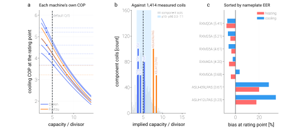

==========
Validation
==========

A physics-based model is only useful if its first-principles answers land close
to the real machines it is meant to describe. This page is that check.

The harder question is whether it keeps landing close when the machine changes.
A model tuned to one unit will match that unit; what tells you something is
whether the same defaults, unchanged, follow a different refrigerant, a
different size, and a different equipment architecture.

.. admonition:: How to read these numbers
    :class: important

    **Nothing here is fitted to anything here.** Every unit is run with the
    library defaults exactly as shipped. The only per-unit inputs are values the
    manufacturer publishes about the machine itself — nameplate capacity,
    refrigerant, and, where the manufacturer publishes them at all, compressor
    displacement and rated air flow. Those have the same status as the
    nameplate: specification, not tuning. Where the evidence for a default came
    from is a separate page, :doc:`defaults`.

    **Points the model could not evaluate are reported, not dropped.** The
    counts below distinguish points attempted from points evaluated, and the
    interactive table shows each unevaluated point with its reason. A point at
    which the model runs but delivers more than 1 % less than the published
    duty (a capacity ceiling) is not scored either, with the reason
    ``capacity_short``: its COP belongs to a different operating point. The
    same holds at the other end: a published duty below the smallest one the
    model runs continuously is reported as the mean of on/off cycling
    (``capacity_clamped == "min"``), which is not what a catalogue row is, and
    is left out with the reason ``cycling_mean``. No point of the present
    catalogues is in that case.

.. toctree::
    :hidden:

    defaults
    part-load
    adding-a-catalogue

Parity
======

.. figure:: ../_static/validation_parity.svg
    :alt: Predicted against published COP for every catalogue point, split into
        air-to-water and air-to-air panels, coloured by refrigerant and sized
        by nominal capacity, with ±10 % and ±20 % bands. Units on hold are
        hollow grey rings.
    :align: center
    :width: 100%

    Predicted against published COP. Colour is refrigerant, marker size is
    nominal capacity. A model quietly tuned to one unit would show one tight
    cluster on the diagonal and the rest scattered. The statistics on each
    panel are those of the adopted units; the two units on hold are drawn as
    hollow grey rings and not scored.

.. list-table:: Coverage
    :header-rows: 1
    :widths: 30 70

    * - Dimension
      - Span
    * - Families
      - Air-to-water (``AirSourceHeatPumpBoiler``), air-to-air
        (``AirSourceHeatPump``)
    * - Refrigerants
      - R32, R410A, R290
    * - Nominal capacity
      - 2.0 – 16.0 kW, a factor of eight
    * - Manufacturers
      - Panasonic, Samsung, Daikin, Fujitsu
    * - Points
      - 757 attempted, 740 evaluated
    * - Modes
      - Heating and cooling
    * - Source temperature
      - −15 to +46.1 °C (adopted units −15 to +40 °C)
    * - Sink temperature
      - 15 to 65 °C leaving water / indoor dry bulb

Per-unit results
================

.. raw:: html

   

   
   

Sort by any column, filter by unit, refrigerant or mode. The numbers come from
``validation/results/``, which the parity harness writes.

Reading the residuals
=====================

There is no single headline number: the two families answer different
questions, and the set mixes rating standards (EN 14511 and AHRI 210/240) that
define COP differently, so each family is reported on its own and nothing is
pooled across standards. The two held catalogues are run and written but never
enter a headline. The compressor efficiencies are the shipped
``semi-empirical-2026-11-15`` models (:doc:`defaults`), one per compressor
type: each unit runs with the type its catalogue publishes (``rotary`` and
``swing`` on the library's ``rotary_twin_inverter``, ``scroll`` on
``scroll``), applied unchanged, inside the compressor operating envelope
(:doc:`/developer/reference-operating-limits`). Three properties of those
models are read with every figure below:

- **The rotary types are provisional.** Their efficiency shape rests on five
  machines, with no rotary data above a pressure ratio of 6.8 and none below
  30 rev/s; outside that hull the forms are followed as they are
  (``efficiency_extrapolated``).
- **The efficiency level is the manufacturers' published level.** Independent
  measurements of compressors sit 5–15 % lower; none of a modern inverter
  compressor exists to decide between them.
- **The electrical input is taken at the inverter input**, drive loss
  included (about 6 % at 60 rev/s, more at low speed). Run with the drive
  efficiency set to one -- input at the compressor terminals, everything else
  as shipped -- the air-to-water bias is +1.1 % and the air-to-air (Daikin)
  bias +0.5 %; with the drive loss they are −5.0 % and −5.1 %.

The previous release (the BITZER quadratic map, committed results of before
November 2026) gave the air-to-air set 7.7 % MAPE and −3.4 % bias, and the
air-to-water set 8.2 % and −4.3 %.

**17 air-to-water points are not evaluated, all of them because the model
delivers more than 1 % less than the published duty** (``capacity_short``);
their COP belongs to a smaller operating point and is not compared with the
catalogue's full-load COP. Twelve run at the 120 rev/s speed ceiling and
deliver 81 to 99 % of the duty: eleven at −15 °C outdoor (WH-UQ12, WH-UQ16,
WH-MXC12 and WH-WXG16) and WH-UQ12 at −7 °C / 55 °C. Nine of the twelve meet
the published duty with the frost and defrost adjustment switched off
(:ref:`ashpb-frost`): the mean over frosting and defrost needs a larger
frost-free duty than the ceiling allows. The other five are the Samsung unit
at 65 °C leaving water, held at 72 to 88 % of the duty by the 65 °C condensing
limit of R32 (``capacity_binding == "condensing_temperature"``). No point
stops on the discharge-temperature limit; other air-to-water points are
evaluated under the discharge-temperature control, with wet suction or
reduced superheat where it acts.

**Every air-to-air point is evaluated**, the held Fujitsu grids included.

.. list-table::
    :header-rows: 1
    :widths: 34 12 12 12 30

    * - Group
      - COP MAPE
      - Bias
      - Evaluated
      - What it is
    * - Air-to-water, 10 units
      - 8.3 %
      - −5.0 %
      - 136 / 153
      - Low at every outdoor temperature, most at +2 °C; frost and defrost
        adjusted at and below +2 °C
    * - Air-to-water, no injection, 6 units
      - 7.0 %
      - −2.2 %
      - 84 / 93
      - Rotary compressors without injection: the machines the single-stage
        cycle represents
    * - Air-to-water, injection, 4 units
      - 10.5 %
      - −9.6 %
      - 52 / 60
      - Scroll compressors with vapour or flash injection, which the
        single-stage cycle does not represent; reported, not corrected
    * - Air-to-air, Daikin, 5 units
      - 8.5 %
      - −5.1 %
      - 360 / 360
      - EN 14511; cooling centred, heating low
    * - Daikin cooling
      - 6.3 %
      - −1.8 %
      - 180 / 180
      - Optimistic at 20 °C, pessimistic at 40 °C outdoor
    * - Daikin heating
      - 10.7 %
      - −8.4 %
      - 180 / 180
      - Low at every outdoor temperature but −15 °C, frosting or not
    * - Daikin heating at or below −7 °C
      - 7.9 %
      - −0.9 %
      - 60 / 60
      - Low at −10 °C, optimistic at −15 °C
    * - Air-to-air, Fujitsu, 2 units
      - 33.8 %
      - **+33.6 %**
      - 244 / 244
      - Held: AHRI 210/240, COP boundary not stated — a uniform offset

The air-to-water headline by unit, with the compressor each catalogue
publishes (``compressor_type``, ``injection``; :doc:`adding-a-catalogue`) and
the library type it runs on:

.. list-table::
    :header-rows: 1
    :widths: 24 9 24 13 10 10 10

    * - Unit
      - Refrigerant
      - Compressor (library type)
      - Injection
      - COP MAPE
      - Bias
      - Evaluated
    * - WH-MXC09J3E8
      - R32
      - rotary (``rotary_twin_inverter``)
      - none
      - 9.7 %
      - −8.9 %
      - 15 / 15
    * - WH-MXC12J9E8
      - R32
      - rotary (``rotary_twin_inverter``)
      - none
      - 9.0 %
      - −4.4 %
      - 13 / 15
    * - WH-MXC16J9E8
      - R32
      - rotary (``rotary_twin_inverter``)
      - none
      - 8.5 %
      - +6.4 %
      - 15 / 15
    * - WH-UQ09HE8
      - R410A
      - rotary (``rotary_twin_inverter``)
      - none
      - 5.6 %
      - −4.6 %
      - 15 / 15
    * - WH-UQ12HE8
      - R410A
      - rotary (``rotary_twin_inverter``)
      - none
      - 4.6 %
      - −2.9 %
      - 11 / 15
    * - WH-UQ16HE8
      - R410A
      - rotary (``rotary_twin_inverter``)
      - none
      - 4.2 %
      - +0.7 %
      - 15 / 18
    * - WH-WXG09ME8
      - R290
      - scroll (``scroll``)
      - vapor
      - 14.0 %
      - −13.4 %
      - 15 / 15
    * - WH-WXG12ME8
      - R290
      - scroll (``scroll``)
      - vapor
      - 10.9 %
      - −10.9 %
      - 15 / 15
    * - WH-WXG16ME8
      - R290
      - scroll (``scroll``)
      - vapor
      - 8.4 %
      - −5.5 %
      - 12 / 15
    * - Samsung EHS Mono HT Quiet R32 14 kW
      - R32
      - scroll (``scroll``)
      - flash
      - 7.3 %
      - −6.9 %
      - 10 / 15

No validation machine has a scroll without injection, so the ``scroll`` type
is checked here only on machines the single-stage cycle does not represent.
The held Fujitsu units publish a rotary compressor and run on the same
``rotary_twin_inverter`` type as the Panasonic rotaries; their offset grew
from +29.8 % (221 of 244 points evaluated) in the previous release to +33.6 %
(all 244). The Daikin units publish a swing compressor.

The biases are stated here, not corrected. **Air-to-air cooling is centred
overall and moves with outdoor temperature**, from +7.6 % at 20 °C to −9.1 %
at 40 °C outdoor. The dry indoor coil (see `Cooling and latent load`_) does
not make it optimistic: the cooling rows with no latent load (sensible heat
ratio 0.95 or above, 25 rows) are the most pessimistic, at −7.5 %, and those
with the most latent load (below 0.75, 79 rows) the least, at +1.1 %. Run
with the room humidity of each row, the wet coil is the more optimistic of the
two, at +12.8 % over the same rows (② below). At the rating point the
three smallest Daikin units, with the highest nameplate EER, sit 6 to 7 % low
(①). **Air-to-air heating runs low at every outdoor temperature but the
coldest**, the frost-free ones included: with the frost and defrost
adjustment (the EnergyPlus DX heating-coil model, its constants unchanged;
:doc:`/models/ashp`) the bias is −17.4 % at 0 °C, −14.4 % at −5 °C, −8.3 % at
−10 °C and +6.5 % at −15 °C outdoor, against −7.7 % and −8.9 % at 6 and
10 °C, where the coil does not frost. Without the adjustment the same rows run
+8.7 %, +6.2 %, +9.1 % and +22.3 %. **Air-to-water carries the same
adjustment and runs low where it applies** (:ref:`ashpb-frost`): the bias is
−4.1 % over the 63 points at +7 °C outdoor and above, where the coil does not
frost, −10.4 % at +2 °C, −3.4 % at −7 °C and −2.2 % below −7 °C. Without the
adjustment the same rows run +15.4 % at +2 °C, +15.9 % at −7 °C and +12.3 %
below. Split by injection, the machines without it run −4.1 % frost-free,
−7.8 % at +2 °C, +2.6 % at −7 °C and +7.0 % below, the injection machines
−4.0 %, −14.6 %, −14.8 % and −13.5 %. The adjustment follows the load on the
coil (:ref:`frost at part load <ashp-frost-load>`), but these catalogues do
not test that: every air-to-water point at or below +2 °C, and all but four
of the air-to-air ones (at −15 °C, +0.2 to +1.2 % in COP), is at or above the
capacity the adjustment's correlation is written for, so the figures on this
page are those of the full correction. What the load term changes is the
part-load trajectory of :doc:`part-load` and :doc:`defaults`.

A bias equal to the error is the signature of a systematic cause, so the
Fujitsu result was checked before being published rather than after.

.. admonition:: The offset is three things, not one
    :class: important

    An earlier version of this page attributed the whole gap to hardware
    efficiency. That was one of three causes presented as the explanation, and
    this is the correction. Comparing each machine at its own **nominal**
    rating point -- no latent load, no forced maximum output, the cleanest
    comparison available -- separates them.

    **① Residual hardware efficiency (about 25 points at the heating rating point).** At the nominal
    heating rating point Daikin lands between −8 and −4 % and Fujitsu at +18
    to +20 %; at the cooling rating point Daikin spans −7 to +3 %, falling
    with nameplate EER, and Fujitsu +28 to +34 %. That part is real and it is
    the defaults' responsibility: the two product lines are built to different
    efficiency targets and a rule written per kilowatt cannot tell which one
    it is looking at.

    **② Dehumidification, cooling half.** The results on this page are those
    of the dry indoor coil, which carries the whole published capacity as
    sensible heat. At its rating point the Fujitsu removes 34 % of its duty as
    latent heat (SHR 0.66) against the Daikin's 2 % (SHR 0.98). Within the
    Daikin set alone, the bias of the 180 cooling points correlates with their
    sensible heat ratio at *r* = −0.40: the more latent load, the more
    optimistic the model. The dry coil is not what makes it so. To move the
    same total heat it has to run colder than a coil that also condenses
    water, which costs lift and COP; run with the wet coil, the Daikin rows
    are more optimistic, not less, and the correlation is stronger
    (`Cooling and latent load`_). The Fujitsu rows could not be run that way:
    their indoor wet bulb is not in the catalogue files.

    **③ Maximum-capacity tables, heating half.** Fujitsu's heating grid is
    published at maximum capacity, with the compressor pinned at full speed
    where its efficiency is worst. The harness asks for that same duty and the
    model meets it well below its speed ceiling (median 76 and 80 rev/s of
    120). Different operating point; the comparison flatters the model.

    Only ① is a property of the defaults. ② is a stated model boundary and ③ is
    a property of the source document.

.. admonition:: Where each machine sits in the measured band
    :class: note

    Backing the conductance out of each machine's own rating point — "if the
    whole residual were conductance, how much would it be?" — places each one
    against the population the default came from. The population and the
    ``Q/x`` rules below are those of the outdoor-coil default before November
    2026 (``Q/5`` from component-coil catalogues, :doc:`defaults`, *The
    previous rule*); the shipped default is now an approach temperature, and
    this back-out is regenerated with it.

    .. list-table::
        :header-rows: 1
        :widths: 34 22 22 22

        * - Unit
          - Nameplate EER
          - Implied rule
          - In the band?
        * - FTXM20A / RXM20A
          - 5.41
          - Q/3.6
          - inside
        * - FTXM25A / RXM25A
          - 5.21
          - Q/3.7
          - inside
        * - FTXM35A / RXM35A
          - 4.61
          - Q/3.7
          - inside
        * - FTXM42A / RXM42A
          - 4.20
          - Q/4.3
          - inside
        * - FTXM50A / RXM50A
          - 3.68
          - Q/5.3
          - inside
        * - ASUH09LPAS
          - 3.67
          - Q/7.6
          - **outside** (low end)
        * - ASUH12LPAS
          - 3.23
          - Q/8.4
          - **outside** (low end)

    The band is **Q/3.3 to Q/7.1** at p10–p90 of 1,414 component coils, on the
    nameplate-capacity basis, and the previous default ``Q/5.0`` sits inside it.
    All five Daikin units now lie inside it (Q/3.6 to Q/5.3), while both
    Fujitsu units behave like machines with less coil per kilowatt than 90 %
    of it (Q/7.6 and Q/8.4 against Q/7.08). In the previous release the three
    most efficient Daikin units were outside the high end (Q/2.4, Q/2.6 and
    Q/3.26 against the band's Q/3.32); with the present defaults the
    back-out places them inside. A median default under-predicts the most
    efficient machines and over-predicts the Fujitsu pair, which is the
    residual pattern above. (Until the catalogue default inputs of November
    2026 no conductance in Q/2–Q/16 closed the cooling gap of the three Daikin
    units at all: with the constants of then -- a larger displacement, run
    below the speed range the efficiency fits of then covered, and a larger
    outdoor airflow -- the gap was 5 to 6 points wider.)

    .. note::

        The band must be quoted on the same basis as the rule. Component
        catalogues report conductance per unit of *coil* duty; the rule is
        written against the *nameplate*, and the two differ by ``1 + 1/EER``
        = 1.307. An earlier version of this page carried the median across but
        not the band, which made the default look better placed in its own
        population than it is.

        placed against the 1,414-coil measured band, and model bias at each
        machine's rating point sorted by nameplate EER.
    :align: center
    :width: 100%

    Reproduce with ``uv run python -m validation.analysis.residual_decomposition``
    and ``uv run python -m scripts.validation.residual_figure``.

.. admonition:: Why the default was not moved
    :class: note

    Moving the conductance away from ``Q/5`` would have improved the numbers on
    this page for the machines at one end of the band at the cost of the other.
    It was not done. The value was derived from
    the catalogue population before any parity result existed, and changing it
    afterwards to improve a parity plot is calibration wearing validation's
    clothes — the exact thing this harness is built to prevent. The spread is
    reported instead. The approach-temperature defaults that replaced ``Q/5``
    in November 2026 were fixed the same way, from an archive of machine data
    and a hold-out rule, before the parity results were read.

Three smaller patterns, also named rather than left for a reader to find:

**The air-to-water set rests on published displacements; the air-to-air set
does not.** Those units publish compressor displacement, which no air-to-air
unit in the set does — neither Daikin nor Fujitsu prints one, and a search of
five data books, three service manuals and two specification sheets found no
displacement for any of them. So the air-to-air panel is also a test of the
library's *default* displacement rather than of a specification input.

**Both air-to-air refrigerants are present for a reason.** Daikin's
pair-application range is entirely R-32. Without the Fujitsu R-410A units that
panel would say nothing about whether the physics carries across working
fluids. It is worth being explicit that the offset above is *not* a refrigerant
effect: the three R-410A air-to-water units sit at 4.2 to 5.6 % MAPE, the
lowest of the 4.2 to 14.0 % spread of the air-to-water set.

**The one air-to-water outlier turns out to be the same story.** The 16 kW R32
unit runs +6.4 % optimistic where the set runs −5.0 % (its 9 and 12 kW
siblings −8.9 and −4.4 %). Neither of its published inputs explains it: on
the points both runs evaluate, substituting its 12 kW sibling's rated air
flow moves the bias by 2.4 points (13 points), and replacing its published
displacement with the library default by 1.2 points (11 points; four more
fall short of the duty with it).
What explains it is the catalogue itself. At every one of the fifteen
conditions, the 16 kW machine's *published* COP is 8 to 22 % below the 9 kW
machine's from the same product line:

.. list-table::
    :header-rows: 1
    :widths: 26 18 18 18 20

    * - Condition
      - 9 kW
      - 12 kW
      - 16 kW
      - 16 kW / 9 kW
    * - −7 °C / 45 °C
      - 2.54
      - 2.39
      - 2.04
      - 0.80
    * - +2 °C / 55 °C
      - 2.54
      - 2.42
      - 2.07
      - 0.82
    * - +25 °C / 45 °C
      - 5.99
      - 5.71
      - 5.00
      - 0.84

Efficiency is not constant per kilowatt as you go up a product line, and a rule
written per kilowatt cannot know that. The model treats the three units as
near-identical machines at different sizes, which is what the rules say; the
manufacturer's own data says the largest is about 16 % worse. The residual is
that gap.

This is the Fujitsu finding again at smaller scale and inside a single
manufacturer's range, which is worth noticing: **the limitation is not one
unusual product line, it is capacity-normalised scaling itself.** The defaults
describe a typical machine of a given size; they do not know that a
manufacturer's 16 kW model is built to a different cost target than its 9 kW
model.

**The Samsung high-temperature unit is outside the model boundary.** Its
catalogue names a scroll compressor with flash injection, which the
single-stage cycle does not model, and it publishes no displacement. Its five
points at 65 °C leaving water are not evaluated: the 65 °C condensing limit
of R32 holds them at 72 to 88 % of the published duty. It is reported in the
injection stratum above, stated rather than corrected for.

.. note::

    An earlier published figure for the Samsung unit — MAE 0.35, MAPE 10.1 % —
    came from a parameter set written for that machine, including its own
    displacement, conductances and efficiency coefficients. It is not
    comparable to the number here, which is the shipped defaults applied
    without adjustment. Removing that divergence between the published
    validation script and the library default is part of what this work did.
    The deleted ``samsung_ehs_parity.py`` is not a reproduction route; the
    table is kept only as the historical record.

    .. list-table:: Historical Samsung comparison — superseded parameter set
        :header-rows: 1
        :widths: 8 14 12 18 16 16 8 8

        * - ID
          - LWT [°C]
          - T0 [°C]
          - Q_ref,cond [kW]
          - COP target
          - COP predicted
          - AE
          - APE
        * - 1
          - 40
          - −10
          - 13.45
          - 2.30
          - 2.37
          - 0.07
          - 3.0 %
        * - 2
          - 40
          - 2
          - 12.42
          - 3.04
          - 3.83
          - 0.79
          - 25.8 %
        * - 3
          - 40
          - 12
          - 14.65
          - 5.07
          - 4.67
          - 0.40
          - 7.9 %
        * - 4
          - 40
          - 20
          - 15.69
          - 6.48
          - 5.65
          - 0.83
          - 12.8 %
        * - 5
          - 40
          - 30
          - 16.98
          - 7.68
          - 7.43
          - 0.25
          - 3.2 %
        * - 6
          - 50
          - −10
          - 13.89
          - 2.00
          - 1.84
          - 0.16
          - 7.8 %
        * - 7
          - 50
          - 2
          - 13.27
          - 2.56
          - 3.04
          - 0.48
          - 18.9 %
        * - 8
          - 50
          - 12
          - 14.76
          - 3.86
          - 3.71
          - 0.15
          - 3.9 %
        * - 9
          - 50
          - 20
          - 15.97
          - 4.78
          - 4.34
          - 0.44
          - 9.2 %
        * - 10
          - 50
          - 30
          - 17.48
          - 5.95
          - 5.37
          - 0.58
          - 9.8 %
        * - 11
          - 65
          - −10
          - 13.97
          - 1.73
          - 1.42
          - 0.31
          - 17.7 %
        * - 12
          - 65
          - 2
          - 13.71
          - 2.04
          - 2.37
          - 0.33
          - 16.1 %
        * - 13
          - 65
          - 12
          - 16.38
          - 2.84
          - 2.73
          - 0.11
          - 3.7 %
        * - 14
          - 65
          - 20
          - 17.48
          - 3.34
          - 3.17
          - 0.17
          - 5.1 %
        * - 15
          - 65
          - 30
          - 18.84
          - 4.04
          - 3.79
          - 0.25
          - 6.1 %
        * -
          -
          -
          -
          -
          - **Mean**
          - **0.35**
          - **10.1 %**

    LWT is leaving-water temperature and T0 the outdoor (dead-state)
    temperature; AE and APE are the absolute and absolute percentage error.
    That comparison set the tank temperature 2.5 K below LWT up to 60 °C and
    5 K below it above 60 °C; the harness now hands the model the EN 14511
    entering and leaving water instead (:doc:`adding-a-catalogue`).

    Physics-based space-conditioning ASHP/GSHP outputs through commit
    ``c5d673e`` used coil-duty COP (``Q_ref_iu / E_tot``); results on this page
    use final indoor-air delivery with fan heat counted once
    (:doc:`../models/ashp`).

Cooling and latent load
=======================

The parity results on this page are those of the dry indoor coil: the model
carries the whole published cooling capacity as sensible heat. Manufacturer
cooling grids publish total capacity, part of which is dehumidification, and
each cooling point in the catalogue files records its sensible heat ratio for
this reason (the Daikin files its indoor wet bulb as well). Heating points
have no latent component.

``AirSourceHeatPump`` can also be given the room humidity, and its indoor coil
then condenses water below the room's dew point (:ref:`ashp-wet-coil`). A
one-off study runs the 180 Daikin cooling points both ways — dry, and wet at
the indoor dry bulb and wet bulb each row is published at
(``validation/wet_coil_shr/simulate.py``, results in
``validation/results/wet_coil_shr_once/``). Its dry pass is the shipped one,
row for row. The model's sensible heat ratio is taken net of the indoor fan's
heat, as the published capacities are. The two held Fujitsu units record a
sensible heat ratio but no indoor wet bulb, so their 144 cooling rows are not
in it.

.. list-table:: Daikin cooling points with the dry and the wet indoor coil, by published sensible heat ratio
    :header-rows: 1
    :widths: 22 12 16 16 17 17

    * - Published SHR
      - Points
      - Published SHR, mean
      - Model SHR, wet coil
      - COP bias, dry coil
      - COP bias, wet coil
    * - below 0.75
      - 79
      - 0.67
      - 0.74
      - +1.1 %
      - +24.7 %
    * - 0.75 to 0.95
      - 76
      - 0.85
      - 0.84
      - −2.9 %
      - +6.5 %
    * - 0.95 and above
      - 25
      - 0.98
      - 0.95
      - −7.5 %
      - −5.2 %
    * - all
      - 180
      - 0.79
      - 0.81
      - −1.8 %
      - +12.8 %

**Sensible heat ratio.** The wet coil gives 0.81 against the published 0.79 on
average, with a mean absolute difference of 0.047 and a correlation of
*r* = 0.94 over the 180 rows; single rows differ by −0.16 to +0.10. It moves
less with the size of the unit than the catalogue does: 0.04 low for the
2.0 kW unit (0.90 against 0.94), 0.08 high for the 5.0 kW unit (0.74 against
0.66). Put as a temperature: over the 172 rows that publish a ratio below 1,
the model's evaporating temperature is on average 1.0 K above the coil
temperature at which its own coil line gives the published ratio (−2.2 to
+3.7 K by row; 0.4 K below it for the 2.0 kW unit, 3.0 K above for the 5.0 kW
unit).

**COP.** For the same total heat the wet coil runs its evaporator 3.1 K warmer
than the dry one and draws 11.9 % less. The bias goes from −1.8 % to +12.8 %
and the mean absolute error from 6.3 % to 16.1 %, and the optimism grows with
the latent load: +24.7 % where the published ratio is below 0.75, and the
correlation of the bias with the ratio goes from *r* = −0.40 to −0.73. The dry
coil therefore does not flatter the model in cooling: it has it draw more,
and the centred cooling bias of the shipped results is that pessimism set
against an optimism of the same size elsewhere in the defaults. The study
does not say where: the indoor conductance rule (0.16 W/K
per W of nameplate, provisional, not derived for a wet coil), the compressor
level and the airflow all enter. As a sensitivity, not a calibration: with the
indoor coil's rated conductance halved the wet-coil bias is +2.6 % and the
ratio 0.71 (0.08 low); doubled, +16.2 % and 0.86 (0.07 high). No single
conductance fits both the ratio and the COP.

The wet coil is an option of the model, not the basis of this page: every
other figure here, and the results under ``validation/results/``, are the dry
coil's.

Scope
=====

.. admonition:: What has and has not been benchmarked
    :class: note

    ``AirSourceHeatPumpBoiler`` and ``AirSourceHeatPump`` are benchmarked
    against manufacturer catalogues here. The ground-source and water-source
    families (:class:`~tmhp.ground_source_heat_pump_boiler.GroundSourceHeatPumpBoiler`,
    :class:`~tmhp.water_source_heat_pump_boiler.WaterSourceHeatPumpBoiler`,
    :class:`~tmhp.ground_source_heat_pump.GroundSourceHeatPump`, and the
    subsystem-augmented variants) share the same refrigerant-cycle core. The
    test suite only checks that the three base models solve a representative
    operating point (``tests/test_models_smoke.py``: one tank-heating point for
    each boiler, a heating and a cooling point for the ground-source unit; each
    must converge and deliver the requested duty). That shows they run, not that
    their numbers are right: none has been compared against unit-specific
    data. Their liquid-coupled faces take the approach temperatures of the
    coaxial and plate exchangers of real machines (:doc:`defaults`), not the
    air-coil values.

    The default compressor displacement of every family, the ground- and
    water-source boilers included, is the one a compressor catalogue gives for
    the capacity and the refrigerant
    (:func:`tmhp.default_inputs.estimate_displacement`, :doc:`defaults`). For
    the liquid-source families no unit data exist to judge it.

Reproduce
=========

.. code-block:: bash

    uv sync --locked --all-groups
    scripts/regen-validation.sh                         # every catalogue, the site data and these figures
    uv run python -m validation.parity.run --unit <slug>   # one catalogue

Each unit run records what produced it in
``validation/results/provenance/<slug>.json`` — the commit, any uncommitted
edits, the ``src/tmhp`` and harness tree hashes, the coefficient version, the
Python, CoolProp and platform. The summary refuses units whose records
disagree, and ``validation/results/manifest.json`` carries what they share.
``tests/test_validation_results_current.py`` reruns every committed point and
fails when the model no longer reproduces it.

Adding a machine is a transcription and nothing else — see
:doc:`adding-a-catalogue`.

Citations
=========

- Jo, H. & Choi, W. *"Thermodynamic Modeling of Refrigerant Cycle in an
  Air-Source Heat Pump Boiler and Performance Validation"*, KJACR (2026, in
  press).
- Samsung Electronics, *EHS Mono HT Quiet R32 Technical Data Book* (2024).
- Panasonic, *Aquarea WH-MXC / WH-WXG / WH-UQ service manuals and compressor
  catalogues* (2025).
- Daikin, *RXM-A engineering data book*, EEDEN24-200.

Full provenance, with checksums, is in ``validation/registry/sources.yaml``.
