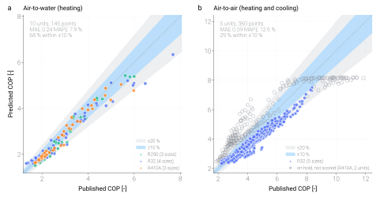

==========
Validation
==========

A physics-based model is only useful if its first-principles answers land close
to the real machines it is meant to describe. This page is that check.

The harder question is whether it keeps landing close when the machine changes.
A model tuned to one unit will match that unit; what tells you something is
whether the same defaults, unchanged, follow a different refrigerant, a
different size, and a different equipment architecture.

.. admonition:: How to read these numbers
    :class: important

    **Nothing here is fitted to anything here.** Every unit is run with the
    library defaults exactly as shipped. The only per-unit inputs are values the
    manufacturer publishes about the machine itself — nameplate capacity,
    refrigerant, and, where the manufacturer publishes them at all, compressor
    displacement and rated air flow. Those have the same status as the
    nameplate: specification, not tuning. Where the evidence for a default came
    from is a separate page, :doc:`defaults`.

    **Points the model could not evaluate are reported, not dropped.** The
    counts below distinguish points attempted from points evaluated, and the
    interactive table shows each unevaluated point with its reason. A point at
    which the model runs but delivers more than 1 % less than the published
    duty (a capacity ceiling) is not scored either, with the reason
    ``capacity_short``: its COP belongs to a different operating point. The
    same holds at the other end: a published duty below the smallest one the
    model runs continuously is reported as the mean of on/off cycling
    (``capacity_clamped == "min"``), which is not what a catalogue row is, and
    is left out with the reason ``cycling_mean``. No point of the present
    catalogues is in that case.

.. toctree::
    :hidden:

    defaults
    part-load
    adding-a-catalogue

Parity
======

        air-to-water and air-to-air panels, coloured by refrigerant and sized
        by nominal capacity, with ±10 % and ±20 % bands. Units on hold are
        hollow grey rings.
    :align: center
    :width: 100%

    Predicted against published COP. Colour is refrigerant, marker size is
    nominal capacity. A model quietly tuned to one unit would show one tight
    cluster on the diagonal and the rest scattered. The statistics on each
    panel are those of the adopted units; the two units on hold are drawn as
    hollow grey rings and not scored.

.. list-table:: Coverage
    :header-rows: 1
    :widths: 30 70

    * - Dimension
      - Span
    * - Families
      - Air-to-water (``AirSourceHeatPumpBoiler``), air-to-air
        (``AirSourceHeatPump``)
    * - Refrigerants
      - R32, R410A, R290
    * - Nominal capacity
      - 2.0 – 16.0 kW, a factor of eight
    * - Manufacturers
      - Panasonic, Samsung, Daikin, Fujitsu
    * - Points
      - 757 attempted, 749 evaluated
    * - Modes
      - Heating and cooling
    * - Source temperature
      - −15 to +46.1 °C (adopted units −15 to +40 °C)
    * - Sink temperature
      - 15 to 65 °C leaving water / indoor dry bulb

Per-unit results
================

.. raw:: html

   

   
   

Sort by any column, filter by unit, refrigerant or mode. The numbers come from
``validation/results/``, which the parity harness writes.

Reading the residuals
=====================

There is no single headline number: the two families answer different
questions, and the set mixes rating standards (EN 14511 and AHRI 210/240) that
define COP differently, so each family is reported on its own and nothing is
pooled across standards. The two held catalogues are run and written but never
enter a headline. The compressor efficiencies are the shipped
``ossorio-r290-te-2026-11-21`` maps (:doc:`defaults`), the same for every
unit, applied unchanged, inside the compressor operating envelope
(:doc:`/developer/reference-operating-limits`). Three properties of those
maps are read with every figure below:

- **They are one compressor's.** The maps are fitted to 134 measured points
  of one 46 cm³/rev R290 scroll. Every unit runs on them, whatever its
  refrigerant and its compressor: the rotary and swing compressors of the set
  as much as its scrolls. A particular machine is followed by calibrating the
  maps (#90), which no figure on this page does.
- **Outside their data they are followed as they are.** The data cover 30 to
  110 rev/s and a hull in pressure ratio and evaporating temperature; outside
  it the result carries ``efficiency_extrapolated``.
- **The electrical input is taken at the inverter input.** The maps are
  fitted on the power of compressor and inverter together; there is no
  separate drive model.

The previous release (the semi-empirical models of 2026-11-15, committed
results of before #217) gave the air-to-air set 8.5 % MAPE and −5.1 % bias,
and the air-to-water set 8.3 % and −5.0 % (136 of 153 points evaluated).

**8 air-to-water points are not evaluated, all of them because the model
delivers more than 1 % less than the published duty** (``capacity_short``);
their COP belongs to a smaller operating point and is not compared with the
catalogue's full-load COP. Three run at the 120 rev/s speed ceiling and
deliver 93 to 96 % of the duty: WH-WXG16 at −15 °C outdoor, at 45, 55 and
65 °C leaving water. All three meet the published duty with the frost and
defrost adjustment switched off (:ref:`ashpb-frost`): the mean over frosting
and defrost needs a larger frost-free duty than the ceiling allows. The other
five are the Samsung unit at 65 °C leaving water, held at 72 to 88 % of the
duty by the 65 °C condensing limit of R32
(``capacity_binding == "condensing_temperature"``). No point stops on the
discharge-temperature limit; other air-to-water points are evaluated under
the discharge-temperature control, with wet suction or reduced superheat
where it acts.

**Every air-to-air point is evaluated**, the held Fujitsu grids included.

.. list-table::
    :header-rows: 1
    :widths: 34 12 12 12 30

    * - Group
      - COP MAPE
      - Bias
      - Evaluated
      - What it is
    * - Air-to-water, 10 units
      - 7.9 %
      - −5.9 %
      - 145 / 153
      - Low at every outdoor temperature, most at +2 °C; frost and defrost
        adjusted at and below +2 °C
    * - Air-to-water, no injection, 6 units
      - 7.3 %
      - −4.4 %
      - 93 / 93
      - Rotary compressors without injection: the machines the single-stage
        cycle represents
    * - Air-to-water, injection, 4 units
      - 9.1 %
      - −8.5 %
      - 52 / 60
      - Scroll compressors with vapour or flash injection, which the
        single-stage cycle does not represent; reported, not corrected
    * - Air-to-air, Daikin, 5 units
      - 12.6 %
      - −12.1 %
      - 360 / 360
      - EN 14511; low in cooling and in heating
    * - Daikin cooling
      - 12.8 %
      - −12.8 %
      - 180 / 180
      - Low at every outdoor temperature, least at 40 °C
    * - Daikin heating
      - 12.4 %
      - −11.4 %
      - 180 / 180
      - Low at every outdoor temperature but −15 °C, frosting or not
    * - Daikin heating at or below −7 °C
      - 7.9 %
      - −5.1 %
      - 60 / 60
      - Low at −10 °C, optimistic at −15 °C
    * - Air-to-air, Fujitsu, 2 units
      - 20.8 %
      - **+13.4 %**
      - 244 / 244
      - Held: AHRI 210/240, COP boundary not stated; +4.4 % in cooling,
        +26.2 % in heating

The air-to-water headline by unit, with the compressor each catalogue
publishes (``compressor_type``, ``injection``; :doc:`adding-a-catalogue`).
Every unit runs on the same maps:

.. list-table::
    :header-rows: 1
    :widths: 28 11 12 13 12 12 12

    * - Unit
      - Refrigerant
      - Compressor
      - Injection
      - COP MAPE
      - Bias
      - Evaluated
    * - WH-MXC09J3E8
      - R32
      - rotary
      - none
      - 10.9 %
      - −10.9 %
      - 15 / 15
    * - WH-MXC12J9E8
      - R32
      - rotary
      - none
      - 7.0 %
      - −4.7 %
      - 15 / 15
    * - WH-MXC16J9E8
      - R32
      - rotary
      - none
      - 6.5 %
      - +5.1 %
      - 15 / 15
    * - WH-UQ09HE8
      - R410A
      - rotary
      - none
      - 8.9 %
      - −8.9 %
      - 15 / 15
    * - WH-UQ12HE8
      - R410A
      - rotary
      - none
      - 5.6 %
      - −5.6 %
      - 15 / 15
    * - WH-UQ16HE8
      - R410A
      - rotary
      - none
      - 5.3 %
      - −2.0 %
      - 18 / 18
    * - WH-WXG09ME8
      - R290
      - scroll
      - vapor
      - 11.6 %
      - −10.8 %
      - 15 / 15
    * - WH-WXG12ME8
      - R290
      - scroll
      - vapor
      - 7.9 %
      - −7.9 %
      - 15 / 15
    * - WH-WXG16ME8
      - R290
      - scroll
      - vapor
      - 5.2 %
      - −3.4 %
      - 12 / 15
    * - Samsung EHS Mono HT Quiet R32 14 kW
      - R32
      - scroll
      - flash
      - 11.9 %
      - −11.9 %
      - 10 / 15

No validation machine has a scroll without injection, the compressor the
maps describe: the four scrolls of the set have vapour or flash injection,
which the single-stage cycle does not represent, and the six others are
rotaries. The held Fujitsu units publish a rotary compressor; their bias went
from +33.6 % in the previous release to +13.4 % (all 244). The Daikin units
publish a swing compressor.

The biases are stated here, not corrected. **Air-to-air cooling runs low at
every outdoor temperature**, from −13.6 % at 20 °C to −12.3 % at 40 °C
outdoor. The dry indoor coil (see `Cooling and latent load`_) does not make it
optimistic: the cooling rows with the least latent load (sensible heat ratio
0.95 or above, 25 rows) run −17.1 %, and those with the most latent load
(below 0.75, 79 rows) −8.8 %. It is part of what holds cooling low: run with
the room humidity of each row, the wet coil is at −3.1 % over the same rows,
+7.0 % on the wettest and −15.5 % on the driest (② below). At
the rating point the three smallest Daikin units, with the highest nameplate
EER, sit 12 to 16 % low (①). **Air-to-air heating runs low at every outdoor
temperature but the coldest**, the frost-free ones included: with the frost
and defrost adjustment (the EnergyPlus DX heating-coil model, its constants
unchanged; :doc:`/models/ashp`) the bias is −19.5 % at 0 °C, −17.0 % at
−5 °C, −11.6 % at −10 °C and +1.4 % at −15 °C outdoor, against −10.4 % and
−11.6 % at 6 and 10 °C, where the coil does not frost. Without the adjustment
the same rows run +5.3 %, +2.5 %, +4.5 % and +15.8 %. **Air-to-water carries
the same adjustment and runs lowest where it applies** (:ref:`ashpb-frost`):
the bias is −3.8 % over the 63 points at +7 °C outdoor and above, where the
coil does not frost, −12.0 % at +2 °C, −5.6 % at −7 °C and −4.3 % below
−7 °C. Without the adjustment the same rows run +13.7 % at +2 °C, +12.6 % at
−7 °C and +9.6 % below. Split by injection, the machines without it run
−2.4 % frost-free, −11.7 % at +2 °C, −3.6 % at −7 °C and −2.3 % below, the
injection machines −6.2 %, −12.5 %, −9.4 % and −8.6 %. The adjustment follows
the load on the coil (:ref:`frost at part load <ashp-frost-load>`), but these
catalogues do not test that: every air-to-water point at or below +2 °C, and
all but four of the air-to-air ones (at −15 °C, +0.2 to +1.2 % in COP), is
at or above the capacity the adjustment's correlation is written for, so the
figures on this page are those of the full correction. What the load term changes is the
part-load trajectory of :doc:`part-load` and :doc:`defaults`.

The Fujitsu offset, large and of one sign in heating, was checked before
being published rather than after.

.. admonition:: The offset is three things, not one
    :class: important

    An earlier version of this page attributed the whole gap to hardware
    efficiency. That was one of three causes presented as the explanation, and
    this is the correction. Comparing each machine at its own **nominal**
    rating point -- no forced maximum output, the cleanest comparison
    available -- separates them. The cooling rating rows are not free of
    latent load (sensible heat ratio 0.66 for the Fujitsu units, 0.69 to 1.00
    for the five Daikin units); that is the second cause below.

    **① Residual hardware efficiency (about 20 points at the heating rating
    point).** At the nominal heating rating point Daikin lands between −11 and
    −6 % and Fujitsu at +11 to +12 %; at the cooling rating point Daikin spans
    −16 to −1 %, falling with nameplate EER, and Fujitsu +14 to +21 %. That part is real and it is
    the defaults' responsibility: the two product lines are built to different
    efficiency targets and a rule written per kilowatt cannot tell which one
    it is looking at.

    **② Dehumidification, cooling half.** The results on this page are those
    of the dry indoor coil, which carries the whole published capacity as
    sensible heat. At its rating point the Fujitsu removes 34 % of its duty as
    latent heat (SHR 0.66) against 2 % for the Daikin RXM25A (SHR 0.98; the
    five Daikin units go from 1.00 for the 2.0 kW unit to 0.69 for the 5.0 kW
    one). Within the Daikin set alone, the bias of the 180 cooling points
    correlates with their
    sensible heat ratio at *r* = −0.73: the more latent load, the higher the
    model's COP against the catalogue's. The dry coil is not what raises it.
    To move the same total heat it has to run colder than a coil that also
    condenses water, which costs lift and COP; run with the wet coil, the
    Daikin rows are higher in every band, the wettest most, and the
    correlation is stronger (`Cooling and latent load`_). The held Fujitsu
    rows, run the same way at the indoor wet bulb their tables print, go the
    same direction: from +0.4 % to +4.0 % and from +8.5 % to +14.4 %.

    **③ Maximum-capacity tables, heating half.** Fujitsu's heating grid is
    published at maximum capacity, with the compressor pinned at full speed
    where its efficiency is worst. The harness asks for that same duty and the
    model meets it well below its speed ceiling (median 71 and 74 rev/s of
    120). Different operating point; the comparison flatters the model.

    Only ① is a property of the defaults. ② is a stated model boundary and ③ is
    a property of the source document.

.. admonition:: Where each machine sits in the measured band
    :class: note

    Backing the conductance out of each machine's own rating point — "if the
    whole residual were conductance, how much would it be?" — places each one
    against the population the default came from. The population and the
    ``Q/x`` rules below are those of the outdoor-coil default before November
    2026 (``Q/5`` from component-coil catalogues, :doc:`defaults`, *The
    previous rule*); the shipped default is now an approach temperature, and
    this back-out is regenerated with it.

    .. list-table::
        :header-rows: 1
        :widths: 34 22 22 22

        * - Unit
          - Nameplate EER
          - Implied rule
          - In the band?
        * - FTXM20A / RXM20A
          - 5.41
          - none in Q/2–Q/16
          - **outside** (high end)
        * - FTXM25A / RXM25A
          - 5.21
          - none in Q/2–Q/16
          - **outside** (high end)
        * - FTXM35A / RXM35A
          - 4.61
          - none in Q/2–Q/16
          - **outside** (high end)
        * - FTXM42A / RXM42A
          - 4.20
          - Q/2.7
          - **outside** (high end)
        * - FTXM50A / RXM50A
          - 3.68
          - Q/4.5
          - inside
        * - ASUH09LPAS
          - 3.67
          - Q/6.6
          - inside
        * - ASUH12LPAS
          - 3.23
          - Q/7.6
          - **outside** (low end)

    The band is **Q/3.3 to Q/7.1** at p10–p90 of 1,414 component coils, on the
    nameplate-capacity basis, and the previous default ``Q/5.0`` sits inside it.
    Four of the five Daikin units now lie beyond its high end: no conductance
    in Q/2–Q/16 closes the cooling gap of the three smallest, and the FTXM42A
    needs Q/2.7. Only the FTXM50A is inside (Q/4.5). Of the Fujitsu pair, the
    ASUH09LPAS is inside (Q/6.6) and the ASUH12LPAS behaves like a machine with
    less coil per kilowatt than 90 % of it (Q/7.6 against Q/7.08). With the
    semi-empirical models of the previous release all five Daikin units lay
    inside the band (Q/3.6 to Q/5.3) and both Fujitsu units beyond its low end
    (Q/7.6 and Q/8.4): the present maps run these machines lower at their
    rating points, and the back-out reads that as more coil. A median default
    under-predicts the most efficient machines and over-predicts the Fujitsu
    pair, which is the residual pattern above. (Until the catalogue default
    inputs of November 2026 no conductance in Q/2–Q/16 closed the cooling gap
    of the three smallest Daikin units either: with the constants of then -- a
    larger displacement, run below the speed range the efficiency fits of then
    covered, and a larger outdoor airflow -- the gap was 5 to 6 points wider
    than in the release that followed.)

    .. note::

        The band must be quoted on the same basis as the rule. Component
        catalogues report conductance per unit of *coil* duty; the rule is
        written against the *nameplate*, and the two differ by ``1 + 1/EER``
        = 1.307. An earlier version of this page carried the median across but
        not the band, which made the default look better placed in its own
        population than it is.

.. figure:: ../_static/validation_residuals.svg
    :alt: Three panels: the conductance back-out per machine, those machines
        placed against the 1,414-coil measured band, and model bias at each
        machine's rating point sorted by nameplate EER.
    :align: center
    :width: 100%

    Reproduce with ``uv run python -m validation.analysis.residual_decomposition``
    and ``uv run python -m scripts.validation.residual_figure``.

.. admonition:: Why the default was not moved
    :class: note

    Moving the conductance away from ``Q/5`` would have improved the numbers on
    this page for the machines at one end of the band at the cost of the other.
    It was not done. The value was derived from
    the catalogue population before any parity result existed, and changing it
    afterwards to improve a parity plot is calibration wearing validation's
    clothes — the exact thing this harness is built to prevent. The spread is
    reported instead. The approach-temperature defaults that replaced ``Q/5``
    in November 2026 were fixed the same way, from an archive of machine data
    and a hold-out rule, before the parity results were read.

Three smaller patterns, also named rather than left for a reader to find:

**The air-to-water set rests on published displacements; the air-to-air set
does not.** Those units publish compressor displacement, which no air-to-air
unit in the set does — neither Daikin nor Fujitsu prints one, and a search of
five data books, three service manuals and two specification sheets found no
displacement for any of them. So the air-to-air panel is also a test of the
library's *default* displacement rather than of a specification input.

**Both air-to-air refrigerants are present for a reason.** Daikin's
pair-application range is entirely R-32. Without the Fujitsu R-410A units that
panel would say nothing about whether the physics carries across working
fluids. It is worth being explicit that the offset above is *not* a refrigerant
effect: the three R-410A air-to-water units sit at 5.3 to 8.9 % MAPE, inside
the 5.2 to 11.9 % spread of the air-to-water set.

**The one air-to-water outlier turns out to be the same story.** The 16 kW R32
unit runs +5.1 % optimistic where the set runs −5.9 % (its 9 and 12 kW
siblings −10.9 and −4.7 %). Neither of its published inputs explains it:
substituting its 12 kW sibling's rated air flow moves the bias by 2.2 points,
and replacing its published displacement with the library default by
1.5 points (all 15 points evaluated in each run).
What explains it is the catalogue itself. At every one of the fifteen
conditions, the 16 kW machine's *published* COP is 8 to 22 % below the 9 kW
machine's from the same product line:

.. list-table::
    :header-rows: 1
    :widths: 26 18 18 18 20

    * - Condition
      - 9 kW
      - 12 kW
      - 16 kW
      - 16 kW / 9 kW
    * - −7 °C / 45 °C
      - 2.54
      - 2.39
      - 2.04
      - 0.80
    * - +2 °C / 55 °C
      - 2.54
      - 2.42
      - 2.07
      - 0.82
    * - +25 °C / 45 °C
      - 5.99
      - 5.71
      - 5.00
      - 0.84

Efficiency is not constant per kilowatt as you go up a product line, and a rule
written per kilowatt cannot know that. The model treats the three units as
near-identical machines at different sizes, which is what the rules say; the
manufacturer's own data says the largest is about 16 % worse. The residual is
that gap.

This is the Fujitsu finding again at smaller scale and inside a single
manufacturer's range, which is worth noticing: **the limitation is not one
unusual product line, it is capacity-normalised scaling itself.** The defaults
describe a typical machine of a given size; they do not know that a
manufacturer's 16 kW model is built to a different cost target than its 9 kW
model.

**The Samsung high-temperature unit is outside the model boundary.** Its
catalogue names a scroll compressor with flash injection, which the
single-stage cycle does not model, and it publishes no displacement. Its five
points at 65 °C leaving water are not evaluated: the 65 °C condensing limit
of R32 holds them at 72 to 88 % of the published duty. It is reported in the
injection stratum above, stated rather than corrected for.

.. note::

    An earlier published figure for the Samsung unit — MAE 0.35, MAPE 10.1 % —
    came from a parameter set written for that machine, including its own
    displacement, conductances and efficiency coefficients. It is not
    comparable to the number here, which is the shipped defaults applied
    without adjustment. Removing that divergence between the published
    validation script and the library default is part of what this work did.
    The deleted ``samsung_ehs_parity.py`` is not a reproduction route; the
    table is kept only as the historical record.

    .. list-table:: Historical Samsung comparison — superseded parameter set
        :header-rows: 1
        :widths: 8 14 12 18 16 16 8 8

        * - ID
          - LWT [°C]
          - T0 [°C]
          - Q_ref,cond [kW]
          - COP target
          - COP predicted
          - AE
          - APE
        * - 1
          - 40
          - −10
          - 13.45
          - 2.30
          - 2.37
          - 0.07
          - 3.0 %
        * - 2
          - 40
          - 2
          - 12.42
          - 3.04
          - 3.83
          - 0.79
          - 25.8 %
        * - 3
          - 40
          - 12
          - 14.65
          - 5.07
          - 4.67
          - 0.40
          - 7.9 %
        * - 4
          - 40
          - 20
          - 15.69
          - 6.48
          - 5.65
          - 0.83
          - 12.8 %
        * - 5
          - 40
          - 30
          - 16.98
          - 7.68
          - 7.43
          - 0.25
          - 3.2 %
        * - 6
          - 50
          - −10
          - 13.89
          - 2.00
          - 1.84
          - 0.16
          - 7.8 %
        * - 7
          - 50
          - 2
          - 13.27
          - 2.56
          - 3.04
          - 0.48
          - 18.9 %
        * - 8
          - 50
          - 12
          - 14.76
          - 3.86
          - 3.71
          - 0.15
          - 3.9 %
        * - 9
          - 50
          - 20
          - 15.97
          - 4.78
          - 4.34
          - 0.44
          - 9.2 %
        * - 10
          - 50
          - 30
          - 17.48
          - 5.95
          - 5.37
          - 0.58
          - 9.8 %
        * - 11
          - 65
          - −10
          - 13.97
          - 1.73
          - 1.42
          - 0.31
          - 17.7 %
        * - 12
          - 65
          - 2
          - 13.71
          - 2.04
          - 2.37
          - 0.33
          - 16.1 %
        * - 13
          - 65
          - 12
          - 16.38
          - 2.84
          - 2.73
          - 0.11
          - 3.7 %
        * - 14
          - 65
          - 20
          - 17.48
          - 3.34
          - 3.17
          - 0.17
          - 5.1 %
        * - 15
          - 65
          - 30
          - 18.84
          - 4.04
          - 3.79
          - 0.25
          - 6.1 %
        * -
          -
          -
          -
          -
          - **Mean**
          - **0.35**
          - **10.1 %**

    LWT is leaving-water temperature and T0 the outdoor (dead-state)
    temperature; AE and APE are the absolute and absolute percentage error.
    That comparison set the tank temperature 2.5 K below LWT up to 60 °C and
    5 K below it above 60 °C; the harness now hands the model the EN 14511
    entering and leaving water instead (:doc:`adding-a-catalogue`).

    Physics-based space-conditioning ASHP/GSHP outputs through commit
    ``c5d673e`` used coil-duty COP (``Q_ref_iu / E_tot``); results on this page
    use final indoor-air delivery with fan heat counted once
    (:doc:`../models/ashp`).

Capacity
========

The capacity ratio is the duty the model delivers at the catalogue request
divided by the published duty. The capacity score includes short points.
A point that falls more than 1 % short contributes to the capacity score and
is excluded from the COP score.
Capacity scores are grouped by catalogue status and model class. The held
group is diagnostic. In ``summary.csv``, the ``class_`` columns describe
the model class and status of the catalogue on that row. In ``manifest.json``,
``capacity_by_status_and_model_class`` uses the status keys ``adopted``
and ``hold`` for the groups present in the results.

.. list-table::
    :header-rows: 1

    * - Model class
      - Scope
      - Short points
      - Mean ratio
      - Minimum ratio
      - Ceilings (mean headroom)
      - Lower bounds
      - No estimate
    * - Air-to-water
      - Adopted
      - 8 / 153
      - 99.30 %
      - 72.24 %
      - 65 (123.70 %)
      - 87 (150 %)
      - 1
    * - Air-to-air
      - Adopted
      - 0 / 360
      - 100.00 %
      - 100.00 %
      - 360 (166.13 %)
      - 0
      - 0
    * - Air-to-air
      - Held
      - 0 / 244
      - 100.00 %
      - 100.00 %
      - 244 (169.25 %)
      - 0
      - 0

Compressor speed binds three of the air-to-water points, and the condensing
temperature limit binds five. Probe headroom is the probed duty divided by
the published duty. For air-to-air, the probe uses
:meth:`~tmhp.air_source_heat_pump.AirSourceHeatPump.max_capacity`. For
air-to-water, it requests 1.5 times the published duty at the same outdoor
temperature, entering water temperature and water flow. The multiplier
allows the probe to reach limits above the published duty with a bounded
overload request. Meeting the overload within the relative validation tolerance of
10⁻⁶ establishes a lower bound at the requested multiplier (150 % headroom).
A smaller return beyond that tolerance gives a ceiling. For either model,
if the probe returns a lower duty than the ordinary solve within the same
tolerance, the probe records the duty from the ordinary solve. A larger drop
or a failed probe leaves the estimate missing.

Among scored air-to-water points, COP MAPE and bias were 7.9 % and −6.7 %
without discharge control (124 points), 8.3 % and −5.9 % with reduced
superheat (5 points), and 8.2 % and +0.4 % with wet suction (16 points).
All 360 scored air-to-air points ran without discharge control (12.6 % MAPE
and −12.1 % bias).
Scored adopted points with a missing control flag, or with control active
and missing suction quality, are counted in the ``unknown`` stratum.

Cooling and latent load
=======================

The parity results on this page are those of the dry indoor coil: the model
carries the whole published cooling capacity as sensible heat. Manufacturer
cooling grids publish total capacity, part of which is dehumidification, and
each cooling point in the catalogue files records its sensible heat ratio for
this reason, and its indoor wet bulb with it. The catalogues print the
sensible and the total capacity; the ratio in the files is their quotient,
rounded to two decimals. Heating points have no latent component.

``AirSourceHeatPump`` can also be given the room humidity, and its indoor coil
then condenses water below the room's dew point (:ref:`ashp-wet-coil`). A
one-off study runs the 180 Daikin cooling points both ways — dry, and wet at
the indoor dry bulb and wet bulb each row is published at
(``validation/wet_coil_shr/simulate.py``, results in
``validation/results/wet_coil_shr_once/``). Its dry pass is the shipped one,
row for row. The model's sensible heat ratio is taken net of the indoor fan's
heat, as the published capacities are. The two held Fujitsu units are run the
same way and reported apart, at the end of this section.

.. list-table:: Daikin cooling points with the dry and the wet indoor coil, by published sensible heat ratio
    :header-rows: 1
    :widths: 22 12 16 16 17 17

    * - Published SHR
      - Points
      - Published SHR, mean
      - Model SHR, wet coil
      - COP bias, dry coil
      - COP bias, wet coil
    * - below 0.75
      - 79
      - 0.67
      - 0.74
      - −8.8 %
      - +7.0 %
    * - 0.75 to 0.95
      - 76
      - 0.85
      - 0.84
      - −15.6 %
      - −9.5 %
    * - 0.95 and above
      - 25
      - 0.98
      - 0.95
      - −17.1 %
      - −15.5 %
    * - all
      - 180
      - 0.79
      - 0.81
      - −12.8 %
      - −3.1 %

**Sensible heat ratio.** The wet coil gives 0.81 against the published 0.79 on
average, with a mean absolute difference of 0.047 and a correlation of
*r* = 0.95 over the 180 rows; single rows differ by −0.15 to +0.10. It moves
less with the size of the unit than the catalogue does: 0.04 low for the
2.0 kW unit (0.90 against 0.94), 0.08 high for the 5.0 kW unit (0.74 against
0.66). Put as a temperature: over the 172 rows that publish a ratio below 1,
the model's evaporating temperature is on average 1.0 K above the coil
temperature at which its own coil line gives the published ratio (−2.0 to
+3.7 K by row; 0.4 K below it for the 2.0 kW unit, 3.0 K above for the 5.0 kW
unit). The band at 0.95 and above is not a dry band: 17 of its 25 rows publish
a ratio below 1, and the model's coil condenses water on 24 of them.

**COP.** Over these rows the wet coil runs its evaporator 3.1 K warmer than
the dry one for the same total heat and draws 9.4 % less — less on 179 of the
180 rows, which is what these conditions give and not a property of a wet coil
(:ref:`ashp-wet-coil`). The bias goes from −12.8 % to −3.1 % and the mean
absolute error from 12.8 % to 9.6 %. The gain is not even. It grows with the
latent load — 15.8 points where the published ratio is below 0.75, 1.5 points
at 0.95 and above — so the wet coil passes the catalogue at one end and stays
low at the other: +7.0 % where the published ratio is below 0.75, −15.5 % at
0.95 and above, and the correlation of the bias with the ratio goes from
*r* = −0.73 to −0.92. By unit the dry coil runs from −16.8 % (2.0 kW) to
−5.0 % (5.0 kW) and the wet coil from −13.4 % to +12.6 %: closer to the
catalogue for four units, further from it for the largest. The dry coil
therefore holds the cooling results of this page low, by 9.7 points on
average, and it is not the whole of their low bias: the rows with the least
latent load run 15 to 17 % low with either coil. The study does not say where
that comes from, nor why the wettest rows pass the catalogue: the indoor
conductance rule (0.16 W/K per W of nameplate, provisional, not derived for a
wet coil), the compressor level and the airflow all enter. As a sensitivity,
not a calibration: with the indoor coil's rated conductance halved the
wet-coil bias is −9.4 % and the ratio 0.71 (0.08 low); doubled, −1.0 % and
0.86 (0.07 high). A smaller coil runs colder, which lowers the ratio and the
COP together: the three values show that trade-off, and none of them is a
best one.

**The capacity the comparison runs at.** The harness passes the published
capacity as the request, which the model takes as the heat of the coil, before
the indoor fan's heat; the published capacity is the net one. Over the wet
rows the room therefore receives 20.4 W (0.62 %) less than published on
average, and more than 1 % less on 1 row. With the request raised until the
net delivery is the published capacity (20.4 W more on average) the COP is
0.19 % lower: the bias is −13.2 % dry and −3.3 % wet, on all 180 rows, and
nothing above turns on the difference. The coil temperature a published ratio
implies is computed with that ratio taken as the coil's own; putting the
ratio on the coil's boundary with the model's fan heat raises it by 0.04 K on
average.

**The held Fujitsu units.** The manual prints the indoor condition of its
cooling tables as six dry bulb / wet bulb pairs, so the 144 cooling rows of
the two units are run wet as well. They are held catalogues (AHRI 210/240; the
manual states neither what its input power includes nor whether its capacities
are net of the indoor fan's heat), and nothing of theirs enters a figure
above.

.. list-table:: Held Fujitsu cooling points with the dry and the wet indoor coil
    :header-rows: 1
    :widths: 22 12 16 16 17 17

    * - Unit
      - Points
      - Published SHR, mean
      - Model SHR, wet coil
      - COP bias, dry coil
      - COP bias, wet coil
    * - ASUH09LPAS
      - 72
      - 0.66
      - 0.77
      - +0.4 %
      - +4.0 %
    * - ASUH12LPAS
      - 72
      - 0.69
      - 0.75
      - +8.5 %
      - +14.4 %

The wet coil raises these as well, from a dry-coil bias that is already above
zero: here it moves the model away from the catalogue (mean absolute error
16.2 % dry, 20.2 % wet). The published ratio is not reproduced: it lies
between 0.58 and 0.74 on 138 of the 144 rows and hardly follows the room
state, where the model's does (*r* = 0.31, mean absolute difference 0.133),
and 21 rows publish a ratio lower than a straight coil line can give at their
room state.

The wet coil is an option of the model, not the basis of this page: every
other figure here, and the parity results (the per-unit files and
``summary.csv`` under ``validation/results/``), are the dry coil's. The
wet-coil study keeps its own results in
``validation/results/wet_coil_shr_once/``.

Indoor coil conductance
=======================

The indoor coil's rated conductance defaults to 0.16 W/K per watt of nameplate
(``INDOOR_UA_PER_CAPACITY``), a rule kept provisionally and not derived for a
wet coil. A one-off study reads that conductance from the catalogues instead
(``validation/indoor_ua_wet_coil/simulate.py``, results in
``validation/results/indoor_ua_wet_coil_once/``). The model's wet coil has one
surface temperature, the evaporating temperature, and its sensible heat ratio
depends on the room state and that temperature alone. A cooling row's
published total capacity, sensible heat ratio, indoor dry bulb and wet bulb
therefore fix the coil temperature at which the model prints that ratio, and
with the published indoor airflow the conductance that carries the row's heat
there. No compressor enters that step. The published capacities are net of the
indoor fan's heat and are put on the coil's boundary with the model's rated
indoor fan power (17 to 23 W), the catalogues printing none. The study then
runs the 180 Daikin cooling rows with the wet coil and the 180 heating rows
with that conductance, tests five candidate rules for it, and runs each rule
as the default. It changes no default; the two held Fujitsu units are an
out-of-family check of the ratio only.

.. list-table:: Indoor conductance at which the model's wet coil prints the published sensible heat ratio
    :header-rows: 1
    :widths: 22 11 15 12 15 13 12

    * - Unit
      - Nameplate
      - Published indoor airflow
      - Rows solved
      - Conductance of the published ratio
      - Shipped rule
      - Shipped / solved
    * - FTXM20A / RXM20A
      - 2.0 kW
      - 0.172 m³/s
      - 29 of 36
      - 382 W/K
      - 320 W/K
      - 0.84
    * - FTXM25A / RXM25A
      - 2.5 kW
      - 0.198 m³/s
      - 35 of 36
      - 444 W/K
      - 400 W/K
      - 0.90
    * - FTXM35A / RXM35A
      - 3.5 kW
      - 0.207 m³/s
      - 36 of 36
      - 432 W/K
      - 560 W/K
      - 1.30
    * - FTXM42A / RXM42A
      - 4.2 kW
      - 0.223 m³/s
      - 36 of 36
      - 359 W/K
      - 672 W/K
      - 1.87
    * - FTXM50A / RXM50A
      - 5.0 kW
      - 0.233 m³/s
      - 36 of 36
      - 337 W/K
      - 800 W/K
      - 2.37

**The conductance.** 172 of the 180 rows publish a ratio below 1 and are
solved; the other 8 publish 1.00, a dry coil, which fixes no coil temperature.
A unit's value is the median of its rows. Within a unit the rows give one
value to the rounding of the ratio: its rows spread by 1.8 to 3.3 %, less than
the 2.7 to 4.9 % that half of the ratio's last printed digit leaves, and the
value does not move with the outdoor temperature (a slope within 0.06 % per
kelvin). Across the units it is not proportional to the nameplate: 337 to
444 W/K over 2.0 to 5.0 kW, where the shipped rule gives 320 to 800 W/K —
0.84 of the solved value for the smallest unit and 2.37 times it for the
largest.

**Cooling with that conductance.** With each unit's solved conductance in the
wet coil the mean absolute difference between the model's and the published
sensible heat ratio falls from 0.047 to 0.005. The COP bias goes from −3.1 % to
−6.2 % and the mean absolute error from 9.6 % to 8.2 %: the mean moves away
from the catalogue, the rows towards it. By unit the bias runs from −13.4 %
(2.0 kW) to +12.6 % (5.0 kW) with the shipped conductance and from −12.5 % to
+2.9 % with the solved one, so the run with the size of the unit narrows from
26.1 to 15.3 points, 41 % of it. The two smaller units stay 12 % low, and no
indoor conductance brings them to the catalogue: with the solved conductance
doubled, their bias is still −9.8 % and −9.4 %. Passing the conductance alone
also re-solves the model's rated speed, from 51.5 to 64.1 rev/s for the 5.0 kW
unit, and leaves every operating point where it was, because the efficiency
map takes the speed in rev/s.

**Where the rest lies.** With the solved conductance, 13 of the 180 rows lie
outside the data of the efficiency map
(:doc:`/developer/reference-operating-limits`): below its lowest
pressure ratio at their evaporating temperature, 9 of them on the cycle's
pressure-ratio floor of 1.5; none is outside its speed range of 30 to
110 rev/s. Their bias is −3.1 % against −6.5 % for the rows inside, and they
carry 0.2 of the 6.2 points. Along the pressure ratio the bias stays between
−2.5 % and −7.4 % over five bands from the floor to above 2.3, and along the
evaporating temperature it is not ordered. What it follows is the unit, and
within a unit the indoor condition: over all units from −11.6 % at 20 °C dry
bulb / 14 °C wet bulb to +0.2 % at 32 °C / 24 °C, where the dry coil's rows
stay between −14.9 % and −10.9 %. Unit and indoor condition together account
for 91 % of the variance of the rows' bias. By unit, the model's compressor
draws 17 % more than the published COP leaves for it for the 2.0 kW unit and
3 % less for the 5.0 kW unit. The study does not say why: the outdoor coil and
fan, whose size the catalogues do not publish, the compressor displacement and
the compressor's level all differ by unit and are not separated here.

**Heating.** The indoor coil is the condenser in heating, and the heating
grids publish no ratio to solve a conductance from. With the conductance of
the cooling ratio the heating bias goes from −11.4 % to −14.6 %, and 7 rows of
the two largest units fall short of the published capacity. By unit it runs
from −13.9 % (2.0 kW) to −9.6 % (5.0 kW) with the shipped conductance, and
from −12.4 % to −19.0 % with the solved one: closer for the two units whose
conductance rises, further for the three whose conductance falls. With the
shipped conductance doubled the bias is still −8.6 %, so the indoor coil is
not the whole of the low heating bias either.

**Candidate rules.** Five rules are fitted on four units and tested on the
fifth: proportional to the nameplate, proportional to the airflow, a power of
the airflow, one conductance for every size, and one heat per kelvin of
driving difference. The best for the ratio is one conductance for every size
(389 W/K when fitted on all five): it gives the left-out unit's ratio within
0.019 on average, where the shipped rule has 0.047 and a refitted nameplate
rule 0.070. Out of the family it does not hold: the two held Fujitsu tables
imply 153 and 226 W/K, the rules give 315 to 420 W/K, and the ratio is 0.11 to
0.12 off with any rule.

**As the default.** Each rule, fitted on the five units, is run in place of
the default on the two paths of the parity results above. With one conductance
for every size the cooling rows with the dry coil go from −12.8 % to −18.1 %
and the heating rows from −11.4 % to −14.6 %; over the two together the bias
goes from −12.1 % to −16.4 % and the mean absolute error from 12.6 % to
16.7 %, with 358 of the 360 rows scored. The other four rules end between
−15.7 % and −16.8 %. On the wet cooling path the same rule moves the bias from
−3.1 % to −5.8 % (mean absolute error 9.6 % to 8.7 %). The default is
therefore kept: the published ratio supports a conductance that does not grow
with the nameplate for this family, and every rule that follows it moves the
parity results of this page away from the catalogue, because those results
are low for a reason the indoor coil does not hold.

**Limits.** One family of five wall-mounted units of one manufacturer. The
ratio is published to two decimals, and the data book does not say whether its
sensible capacities are measured or computed from a fixed bypass factor, which
a single value per unit would also be consistent with. The fan heat is the
model's, not a published one. The coil has one surface temperature: the
refrigerant of a real coil is colder than the surface the air sees, by a
margin these tables do not give. The heating conductance is not measured at
all.

Scope
=====

.. admonition:: What has and has not been benchmarked
    :class: note

    ``AirSourceHeatPumpBoiler`` and ``AirSourceHeatPump`` are benchmarked
    against manufacturer catalogues here. The ground-source and water-source
    families (:class:`~tmhp.ground_source_heat_pump_boiler.GroundSourceHeatPumpBoiler`,
    :class:`~tmhp.water_source_heat_pump_boiler.WaterSourceHeatPumpBoiler`,
    :class:`~tmhp.ground_source_heat_pump.GroundSourceHeatPump`, and the
    subsystem-augmented variants) share the same refrigerant-cycle core. The
    test suite only checks that the three base models solve a representative
    operating point (``tests/test_models_smoke.py``: one tank-heating point for
    each boiler, a heating and a cooling point for the ground-source unit; each
    must converge and deliver the requested duty). That shows they run, not that
    their numbers are right: none has been compared against unit-specific
    data. Their liquid-coupled faces take the approach temperatures of the
    coaxial and plate exchangers of real machines (:doc:`defaults`), not the
    air-coil values.

    The default compressor displacement of every family, the ground- and
    water-source boilers included, is the one a compressor catalogue gives for
    the capacity and the refrigerant
    (:func:`tmhp.default_inputs.estimate_displacement`, :doc:`defaults`). For
    the liquid-source families no unit data exist to judge it.

Reproduce
=========

.. code-block:: bash

    uv sync --locked --all-groups
    scripts/regen-validation.sh                         # every catalogue, the site data and these figures
    uv run python -m validation.parity.run --unit <slug>   # one catalogue

Each unit run records what produced it in
``validation/results/provenance/<slug>.json`` — the commit, any uncommitted
edits, the ``src/tmhp`` and harness tree hashes, the coefficient version, the
Python, CoolProp and platform. The summary refuses units whose records
disagree, and ``validation/results/manifest.json`` carries what they share.
``tests/test_validation_results_current.py`` reruns every committed point and
fails when the model no longer reproduces it.

Adding a machine is a transcription and nothing else — see
:doc:`adding-a-catalogue`.

Citations
=========

- Jo, H. & Choi, W. *"Thermodynamic Modeling of Refrigerant Cycle in an
  Air-Source Heat Pump Boiler and Performance Validation"*, KJACR (2026, in
  press).
- Samsung Electronics, *EHS Mono HT Quiet R32 Technical Data Book* (2024).
- Panasonic, *Aquarea WH-MXC / WH-WXG / WH-UQ service manuals and compressor
  catalogues* (2025).
- Daikin, *RXM-A engineering data book*, EEDEN24-200.

Full provenance, with checksums, is in ``validation/registry/sources.yaml``.
