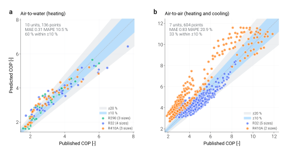
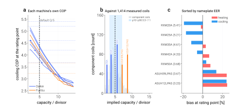

==========
Validation
==========

A physics-based model is only useful if its first-principles answers land close
to the real machines it is meant to describe. This page is that check.

The harder question is whether it keeps landing close when the machine changes.
A model tuned to one unit will match that unit; what tells you something is
whether the same defaults, unchanged, follow a different refrigerant, a
different size, and a different equipment architecture.

.. admonition:: How to read these numbers
    :class: important

    **Nothing here is fitted to anything here.** Every unit is run with the
    library defaults exactly as shipped. The only per-unit inputs are values the
    manufacturer publishes about the machine itself — nameplate capacity,
    refrigerant, and, where the manufacturer publishes them at all, compressor
    displacement and rated air flow. Those have the same status as the
    nameplate: specification, not tuning. Where the evidence for a default came
    from is a separate page, :doc:`defaults`.

    **Points the model could not evaluate are reported, not dropped.** The
    counts below distinguish points attempted from points evaluated, and the
    interactive table shows each unevaluated point with its reason. A point at
    which the model runs but delivers more than 1 % less than the published
    duty (a capacity ceiling) is not scored either, with the reason
    ``capacity_short``: its COP belongs to a different operating point.

.. toctree::
    :hidden:

    defaults
    part-load
    adding-a-catalogue

Parity
======

        air-to-water and air-to-air panels, coloured by refrigerant and sized
        by nominal capacity, with ±10 % and ±20 % bands. Units on hold are
        hollow grey rings.
    :align: center
    :width: 100%

    Predicted against published COP. Colour is refrigerant, marker size is
    nominal capacity. A model quietly tuned to one unit would show one tight
    cluster on the diagonal and the rest scattered. The statistics on each
    panel are those of the adopted units; the two units on hold are drawn as
    hollow grey rings and not scored.

.. list-table:: Coverage
    :header-rows: 1
    :widths: 30 70

    * - Dimension
      - Span
    * - Families
      - Air-to-water (``AirSourceHeatPumpBoiler``), air-to-air
        (``AirSourceHeatPump``)
    * - Refrigerants
      - R32, R410A, R290
    * - Nominal capacity
      - 2.0 – 16.0 kW, a factor of eight
    * - Manufacturers
      - Panasonic, Samsung, Daikin, Fujitsu
    * - Points
      - 757 attempted, 723 evaluated
    * - Modes
      - Heating and cooling
    * - Source temperature
      - −20 to +40 °C
    * - Sink temperature
      - 15 to 65 °C leaving water / indoor dry bulb

Per-unit results
================

.. raw:: html

   

   
   

Sort by any column, filter by unit, refrigerant or mode. The numbers come from
``validation/results/``, which the parity harness writes.

Reading the residuals
=====================

There is no single headline number: the two families answer different
questions, and the set mixes rating standards (EN 14511 and AHRI 210/240) that
define COP differently, so each family is reported on its own and nothing is
pooled across standards. The two held catalogues are run and written but never
enter a headline. The compressor efficiencies are the shipped
``BITZER-three-C3-absolute-N-2026-10-06`` fits with their range and
validity-domain guards (:doc:`defaults`), applied here unchanged, inside the
compressor operating envelope (:doc:`/developer/reference-operating-limits`).

**17 air-to-water points are not evaluated, all of them R32.** Nine (outdoor
−15 to −7 °C, leaving water 55 to 60 °C) stay above the R32 discharge limit of
150 °C even with the discharge-temperature control: at that pressure ratio the
default efficiency map's isentropic efficiency is near 0.4, and holding the
limit would take a wetter suction than the quality of 0.9 the model allows
(``discharge_temp_above_max``). Two, at 65 °C leaving water, condense above
the 65 °C condensing limit of R32 (``condensing_temp_above_max``). The other
six run, but only at a duty more than 1 % below the published one (the largest
the operating envelope allows); their COP belongs to a smaller operating point
and is not compared with the catalogue's full-load COP (``capacity_short``).
Other air-to-water points are evaluated under the control, with wet suction
or reduced superheat.

**17 air-to-air heating points are not evaluated, 16 of them on the held
Fujitsu grids.** All lie at or below 0 °C outdoor, where the frost and defrost
adjustment (:doc:`/models/ashp`) lowers the mean heating capacity to 0.77–0.86
of the frost-free capacity. The Fujitsu heating grid is published at maximum
capacity (③ below), and at those points the mean the model can deliver falls
more than 1 % short of the published duty (``capacity_short``); the one Daikin
point is the smallest unit at 0 °C.

.. list-table::
    :header-rows: 1
    :widths: 34 12 12 12 30

    * - Group
      - COP MAPE
      - Bias
      - Evaluated
      - What it is
    * - Air-to-water, 10 units
      - 10.6 %
      - +6.4 %
      - 136 / 153
      - Optimistic on average; the bias sits at +2 °C outdoor
    * - Air-to-air, Daikin, 5 units
      - 8.7 %
      - −5.9 %
      - 359 / 360
      - EN 14511; heating centred, cooling low
    * - Daikin cooling
      - 11.6 %
      - −11.4 %
      - 180 / 180
      - Pessimistic, growing with outdoor temperature
    * - Daikin heating
      - 5.8 %
      - −0.5 %
      - 179 / 180
      - Centred; frost and defrost adjusted at and below 0 °C
    * - Daikin heating at or below −7 °C
      - 7.1 %
      - +6.3 %
      - 60 / 60
      - Centred at −10 °C, optimistic at −15 °C
    * - Air-to-air, Fujitsu, 2 units
      - 28.9 %
      - **+28.0 %**
      - 228 / 244
      - Held: AHRI 210/240, COP boundary not stated — a uniform offset

The biases are stated here, not corrected. **Air-to-air cooling runs low**,
from −7 % at 20 °C to −14 % at 40 °C outdoor, and the dry indoor coil (see
`Cooling and latent load`_) is not the cause: the cooling rows with no latent
load (sensible heat ratio 0.95 or above) are the most pessimistic, at −19 %,
and those with the most latent load the least, at −5 %. The dry-coil
idealisation pushes the other way (② below). What the low rows share is the
most efficient hardware: at the rating point the smallest Daikin units, with
the highest nameplate EER, sit 18 to 20 % low (①). **Air-to-air heating is
centred once frost is accounted for.** With the frost and defrost adjustment
(the EnergyPlus DX heating-coil model, its constants unchanged;
:doc:`/models/ashp`) the bias is −7.8 % at 0 °C, −5.1 % at −5 °C, +0.3 % at
−10 °C and +12.3 % at −15 °C outdoor, against 0 to −3 % at 6 and 10 °C, where
the coil does not frost. Without the adjustment the same rows ran +17 % from 0
to −10 °C and +28 % at −15 °C. **Air-to-water runs high at
+2 °C outdoor** (+22 % over its 30 points, +2 % over the other 123), the condition at
which an outdoor coil frosts most and a declared COP carries defrost.

A bias equal to the error is the signature of a systematic cause, so the
Fujitsu result was checked before being published rather than after.

.. admonition:: The offset is three things, not one
    :class: important

    An earlier version of this page attributed the whole gap to hardware
    efficiency. That was one of three causes presented as the explanation, and
    this is the correction. Comparing each machine at its own **nominal**
    rating point -- no latent load, no forced maximum output, the cleanest
    comparison available -- separates them.

    **① Residual hardware efficiency (~20 points).** At the nominal heating
    rating point Daikin lands between −2 and +8 % and Fujitsu at +24 %;
    at the cooling rating point Daikin spans −20 to +1 %, falling with
    nameplate EER, and Fujitsu +12 to +22 %. That part is
    real and it is the defaults' responsibility: the two product lines are
    built to different efficiency targets and a rule written per kilowatt
    cannot tell which one it is looking at.

    **② Dehumidification, cooling half.** TMHP's indoor coil is a dry sensible
    exchanger. A real machine removing moisture must hold its coil below the
    dew point, far colder than a sensible-only coil needs to move the same
    total heat — and a colder coil means more lift and less COP. At its rating
    point the Fujitsu removes 34 % of its duty as latent heat (SHR 0.66)
    against the Daikin's 2 % (SHR 0.98). Within the Daikin set alone, the bias
    of the 180 cooling points correlates with their sensible heat ratio at
    *r* = −0.81: the more latent load, the more optimistic the model.

    **③ Maximum-capacity tables, heating half.** Fujitsu's heating grid is
    published at maximum capacity, with the compressor pinned at full speed
    where its efficiency is worst. The harness asks for that same duty and the
    model meets it at about half the available speed range. Different operating
    point; the comparison flatters the model.

    Only ① is a property of the defaults. ② is a stated model boundary and ③ is
    a property of the source document.

.. admonition:: Where each machine sits in the measured band
    :class: note

    Backing the conductance out of each machine's own rating point — "if the
    whole residual were conductance, how much would it be?" — places each one
    against the population the default came from.

    .. list-table::
        :header-rows: 1
        :widths: 34 22 22 22

        * - Unit
          - Nameplate EER
          - Implied rule
          - In the band?
        * - FTXM20A / RXM20A
          - 5.41
          - none in Q/2–Q/16
          - **outside** (high end)
        * - FTXM25A / RXM25A
          - 5.21
          - none in Q/2–Q/16
          - **outside** (high end)
        * - FTXM35A / RXM35A
          - 4.61
          - none in Q/2–Q/16
          - **outside** (high end)
        * - FTXM42A / RXM42A
          - 4.20
          - Q/3.4
          - inside, at the high end
        * - FTXM50A / RXM50A
          - 3.68
          - Q/5.3
          - inside
        * - ASUH09LPAS
          - 3.67
          - Q/6.9
          - inside, at the low end
        * - ASUH12LPAS
          - 3.23
          - Q/8.4
          - **outside** (low end)

    The band is **Q/3.3 to Q/7.1** at p10–p90 of 1,414 component coils, on the
    nameplate-capacity basis, and the default ``Q/5.0`` sits inside it. The
    machines now split at both ends. The three most efficient Daikin units
    would need more conductance than 90 % of the component population — more
    than even ``Q/2`` gives, so no conductance alone closes their cooling
    gap — while the larger ASUH12LPAS behaves like a machine with less coil
    per kilowatt than 90 % of it and ASUH09LPAS sits just inside that edge
    (Q/6.87 against Q/7.08). A median default under-predicts the first group
    and over-predicts the second, which is the residual pattern above.

    .. note::

        The band must be quoted on the same basis as the rule. Component
        catalogues report conductance per unit of *coil* duty; the rule is
        written against the *nameplate*, and the two differ by ``1 + 1/EER``
        = 1.307. An earlier version of this page carried the median across but
        not the band, which made the default look better placed in its own
        population than it is.

        placed against the 1,414-coil measured band, and model bias at each
        machine's rating point sorted by nameplate EER.
    :align: center
    :width: 100%

    Reproduce with ``uv run python -m validation.analysis.residual_decomposition``
    and ``uv run python -m scripts.validation.residual_figure``.

.. admonition:: Why the default was not moved
    :class: note

    Moving the conductance away from ``Q/5`` would improve the numbers on this
    page for the machines at one end of the band at the cost of the other. It
    was not done. The value was derived from
    the catalogue population before any parity result existed, and changing it
    afterwards to improve a parity plot is calibration wearing validation's
    clothes — the exact thing this harness is built to prevent. The spread is
    reported instead.

Three smaller patterns, also named rather than left for a reader to find:

**The air-to-water set is the tighter one.** Those units publish compressor
displacement, which no air-to-air unit in the set does — neither Daikin nor
Fujitsu prints one, and a search of five data books, three service manuals and
two specification sheets found no displacement for any of them. So the
air-to-air panel is also a test of the library's *default* displacement rather
than of a specification input.

**Both air-to-air refrigerants are present for a reason.** Daikin's
pair-application range is entirely R-32. Without the Fujitsu R-410A units that
panel would say nothing about whether the physics carries across working
fluids. It is worth being explicit that the offset above is *not* a refrigerant
effect: the three R-410A air-to-water units sit at 9.7 to 12.6 % MAPE,
inside the 6.3 to 18.0 % spread of the air-to-water set.

**The one air-to-water outlier turns out to be the same story.** The 16 kW R32
unit runs +18.0 % optimistic. Neither of its published inputs explains it:
substituting its 12 kW sibling's rated air flow moves the bias by 1.5 points,
and dropping its published displacement for the library default by 3.0.
What explains it is the catalogue itself. At every one of the fifteen
conditions, the 16 kW machine's *published* COP is 8 to 22 % below the 9 kW
machine's from the same product line:

.. list-table::
    :header-rows: 1
    :widths: 26 18 18 18 20

    * - Condition
      - 9 kW
      - 12 kW
      - 16 kW
      - 16 kW / 9 kW
    * - −7 °C / 45 °C
      - 2.54
      - 2.39
      - 2.04
      - 0.80
    * - +2 °C / 55 °C
      - 2.54
      - 2.42
      - 2.07
      - 0.82
    * - +25 °C / 45 °C
      - 5.99
      - 5.71
      - 5.00
      - 0.84

Efficiency is not constant per kilowatt as you go up a product line, and a rule
written per kilowatt cannot know that. The model treats the three units as
near-identical machines at different sizes, which is what the rules say; the
manufacturer's own data says the largest is about 16 % worse. The residual is
that gap.

This is the Fujitsu finding again at smaller scale and inside a single
manufacturer's range, which is worth noticing: **the limitation is not one
unusual product line, it is capacity-normalised scaling itself.** The defaults
describe a typical machine of a given size; they do not know that a
manufacturer's 16 kW model is built to a different cost target than its 9 kW
model.

**The Samsung high-temperature unit is genuinely outside the model boundary.**
It publishes no displacement and reaches 65 °C leaving water at −10 °C outdoor
air — a pressure ratio around 16, which real machines achieve with vapour
injection and TMHP does not model as a single-stage cycle. Stated rather than
corrected for.

.. note::

    An earlier published figure for the Samsung unit — MAE 0.35, MAPE 10.1 % —
    came from a parameter set written for that machine, including its own
    displacement, conductances and efficiency coefficients. It is not
    comparable to the number here, which is the shipped defaults applied
    without adjustment. Removing that divergence between the published
    validation script and the library default is part of what this work did.
    The deleted ``samsung_ehs_parity.py`` is not a reproduction route; the
    table is kept only as the historical record.

    .. list-table:: Historical Samsung comparison — superseded parameter set
        :header-rows: 1
        :widths: 8 14 12 18 16 16 8 8

        * - ID
          - LWT [°C]
          - T0 [°C]
          - Q_ref,cond [kW]
          - COP target
          - COP predicted
          - AE
          - APE
        * - 1
          - 40
          - −10
          - 13.45
          - 2.30
          - 2.37
          - 0.07
          - 3.0 %
        * - 2
          - 40
          - 2
          - 12.42
          - 3.04
          - 3.83
          - 0.79
          - 25.8 %
        * - 3
          - 40
          - 12
          - 14.65
          - 5.07
          - 4.67
          - 0.40
          - 7.9 %
        * - 4
          - 40
          - 20
          - 15.69
          - 6.48
          - 5.65
          - 0.83
          - 12.8 %
        * - 5
          - 40
          - 30
          - 16.98
          - 7.68
          - 7.43
          - 0.25
          - 3.2 %
        * - 6
          - 50
          - −10
          - 13.89
          - 2.00
          - 1.84
          - 0.16
          - 7.8 %
        * - 7
          - 50
          - 2
          - 13.27
          - 2.56
          - 3.04
          - 0.48
          - 18.9 %
        * - 8
          - 50
          - 12
          - 14.76
          - 3.86
          - 3.71
          - 0.15
          - 3.9 %
        * - 9
          - 50
          - 20
          - 15.97
          - 4.78
          - 4.34
          - 0.44
          - 9.2 %
        * - 10
          - 50
          - 30
          - 17.48
          - 5.95
          - 5.37
          - 0.58
          - 9.8 %
        * - 11
          - 65
          - −10
          - 13.97
          - 1.73
          - 1.42
          - 0.31
          - 17.7 %
        * - 12
          - 65
          - 2
          - 13.71
          - 2.04
          - 2.37
          - 0.33
          - 16.1 %
        * - 13
          - 65
          - 12
          - 16.38
          - 2.84
          - 2.73
          - 0.11
          - 3.7 %
        * - 14
          - 65
          - 20
          - 17.48
          - 3.34
          - 3.17
          - 0.17
          - 5.1 %
        * - 15
          - 65
          - 30
          - 18.84
          - 4.04
          - 3.79
          - 0.25
          - 6.1 %
        * -
          -
          -
          -
          -
          - **Mean**
          - **0.35**
          - **10.1 %**

    LWT is leaving-water temperature and T0 the outdoor (dead-state)
    temperature; AE and APE are the absolute and absolute percentage error.
    That comparison set the tank temperature 2.5 K below LWT up to 60 °C and
    5 K below it above 60 °C.

    Physics-based space-conditioning ASHP/GSHP outputs through commit
    ``c5d673e`` used coil-duty COP (``Q_ref_iu / E_tot``); results on this page
    use final indoor-air delivery with fan heat counted once
    (:doc:`../models/ashp`).

Cooling and latent load
=======================

TMHP's indoor coil is a dry sensible-heat exchanger. Manufacturer cooling
grids publish total capacity, part of which is dehumidification, so a cooling
point with a low sensible heat ratio asks the model to carry a latent duty it
does not compute. Each cooling point in the catalogue files records its
sensible heat ratio for this reason. Heating points have no latent component.

Scope
=====

.. admonition:: What has and has not been benchmarked
    :class: note

    ``AirSourceHeatPumpBoiler`` and ``AirSourceHeatPump`` are benchmarked
    against manufacturer catalogues here. The ground-source and water-source
    families (:class:`~tmhp.ground_source_heat_pump_boiler.GroundSourceHeatPumpBoiler`,
    :class:`~tmhp.water_source_heat_pump_boiler.WaterSourceHeatPumpBoiler`,
    :class:`~tmhp.ground_source_heat_pump.GroundSourceHeatPump`, and the
    subsystem-augmented variants) share the same refrigerant-cycle core and
    pass smoke tests on representative operating points, but have not been
    compared against unit-specific data. The conductance rule derived here is
    for air coils and does not transfer to a water- or brine-coupled face,
    which is different physics.

    Every family's default compressor displacement is the fixed
    42 cm³ per 9 kW of nameplate (:func:`tmhp.compressor_speed.default_displacement`);
    the refrigerant-aware rule of :doc:`defaults` is available as
    :func:`tmhp.compressor_speed.refrigerant_aware_displacement` but is not
    the default.

Reproduce
=========

.. code-block:: bash

    uv sync --locked --all-groups
    scripts/regen-validation.sh                         # every catalogue, the site data and these figures
    uv run python -m validation.parity.run --unit <slug>   # one catalogue

Each unit run records what produced it in
``validation/results/provenance/<slug>.json`` — the commit, any uncommitted
edits, the ``src/tmhp`` and harness tree hashes, the coefficient version, the
Python, CoolProp and platform. The summary refuses units whose records
disagree, and ``validation/results/manifest.json`` carries what they share.
``tests/test_validation_results_current.py`` reruns a fixed sample of points
and fails when the model no longer reproduces them.

Adding a machine is a transcription and nothing else — see
:doc:`adding-a-catalogue`.

Citations
=========

- Jo, H. & Choi, W. *"Thermodynamic Modeling of Refrigerant Cycle in an
  Air-Source Heat Pump Boiler and Performance Validation"*, KJACR (2026, in
  press).
- Samsung Electronics, *EHS Mono HT Quiet R32 Technical Data Book* (2024).
- Panasonic, *Aquarea WH-MXC / WH-WXG / WH-UQ service manuals and compressor
  catalogues* (2025).
- Daikin, *RXM-A engineering data book*, EEDEN24-200.

Full provenance, with checksums, is in ``validation/registry/sources.yaml``.
