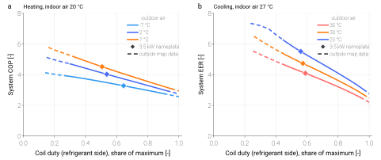
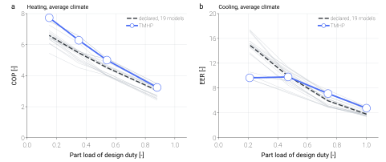

===================
Part-load behaviour
===================

This page exists because the assumption it started from turned out to be wrong,
and the correction changed what the library does.

The assumption was the familiar one: a real inverter heat pump peaks somewhere
around a third of load and falls away below it, so a model whose COP climbs all
the way down must be missing something. The plan was to find the missing
penalty and put it into the compressor efficiency correlations.

.. admonition:: What the certified data actually shows
    :class: important

    Heat Pump Keymark is European third-party certification: an accredited
    laboratory measures to the standard and the declared values are published.
    Reading 18,106 certified records for 9,162 air-to-water models from 169
    manufacturers:

    .. list-table::
        :header-rows: 1
        :widths: 12 14 12 14 16 16 16

        * - Point
          - Outdoor air
          - Part load
          - COP p10
          - p25
          - **median**
          - p75
        * - A
          - −7 °C
          - 0.88
          - 2.61
          - 2.78
          - **2.99**
          - 3.18
        * - B
          - +2 °C
          - 0.54
          - 4.13
          - 4.35
          - **4.53**
          - 4.78
        * - C
          - +7 °C
          - 0.35
          - 5.37
          - 5.74
          - **6.16**
          - 6.56
        * - D
          - +12 °C
          - 0.15
          - 6.40
          - 7.19
          - **7.88**
          - 8.51

    Declared COP rises monotonically from A to D. **97.3 %** of models declare a
    higher COP at the lightest test point than at the next one up, and 96.9 %
    rise at every single step. The roll-over is not there.

    Low-temperature application, average climate. Reproduce with
    ``uv run python -m validation.extraction.keymark_declared``.

The reason is straightforward once stated: EN 14825 lowers the flow temperature
as it lowers the load — 34/30/27/24 °C from A to D for underfloor heating — so
the lift falls together with the duty. The heat exchangers also become large
relative to the duty. Both effects push COP up. (This is also why "W35" and
"W55" name an *application* and not a fixed flow temperature; reading them as
fixed would put three of the four points at the wrong boundary condition.)

So the goal changed: not to manufacture a roll-over, but to carry the low-speed
loss that is genuinely measured, at the size it is measured, and to say plainly
what is not modelled. One part of that loss is not settled by compressor data:
the low-speed shape of the rotary types, where two sources disagree, was chosen
on the certified trajectory below -- its shape and its level, with the fixed
control power of a real unit in the model (:ref:`fixed-control-power`,
:doc:`defaults`) -- so for the rotary types neither the shape nor the level of
that trajectory is a check.

Two different curves
====================

.. figure:: ../_static/validation_part_load.svg
    :alt: Left, system COP against the heat delivered as a share of the
        maximum at the same temperatures, for three conditions, from the
        compressor's top speed (left) to its speed floor (right). Each curve
        rises from the top speed to a peak and falls again towards the floor,
        and a diamond on each marks where the 9 kW nameplate duty falls. Right,
        the EN 14825 test-point trajectory against the certified Keymark band.
    :align: center
    :width: 100%

    **(a)** Load falls, temperatures held; the horizontal axis is the heat
    delivered over the maximum the same machine delivers at those temperatures,
    and the diamonds mark the 9 kW nameplate. **(b)** Load and flow temperature
    fall together, as the certification standard specifies, over the design
    heating demand. These are not the same question and they do not have the
    same answer.

Panel (a) — fixed temperatures
------------------------------

Hold the source and sink where they are and move the load over the machine's
whole speed range, from the compressor's speed floor (15 rev/s) to its top speed
(120 rev/s). The horizontal axis is the heat the machine delivers as a share of
what it delivers *at the same temperatures at its top speed* (``Q_max [W]``).
That is a different denominator from the 9 kW nameplate, and at these conditions
the two are far apart: the nameplate is a label attached to one rating point,
not a ceiling. A diamond on each curve marks where 9 kW falls. An earlier
version of this figure stopped at the nameplate and so showed only the part of
each curve at or below the 9 kW duty. With the shipped compressor efficiencies
(the default ``rotary_twin_inverter`` type) the 9 kW air-to-water model covers
these ranges:

.. list-table::
    :header-rows: 1
    :widths: 28 24 24 24

    * - Air / water
      - Minimum capacity (15 rev/s)
      - Maximum capacity (120 rev/s)
      - 9 kW as a share of the maximum
    * - +7 °C / 35 °C
      - 2.07 kW
      - 16.17 kW
      - 56 %
    * - +7 °C / 45 °C
      - 2.01 kW
      - 15.83 kW
      - 57 %
    * - −7 °C / 45 °C
      - 1.33 kW
      - 9.53 kW
      - 94 %

Frost and defrost are on, as shipped, so the heat is the mean over the frost
and defrost cycle (:ref:`ashpb-frost`). The maximum is the heat of the top speed;
asking for more returns the same point. At −7 °C the maximum is 9.53 kW against
15.83 kW at +7 °C and the same water temperature, so there the nameplate is
nearly the maximum.

.. list-table::
    :header-rows: 1
    :widths: 16 10 30 18 18 8

    * - Air / water
      - Peak COP
      - Peak at
      - COP at maximum (change from peak)
      - COP at minimum (change from peak)
      - COP at 9 kW
    * - +7 °C / 35 °C
      - 4.63
      - 32 % of maximum, 57 % of nameplate, 33 rev/s
      - 3.68 (−20.6 %)
      - 4.18 (−9.9 %)
      - 4.45
    * - +7 °C / 45 °C
      - 3.53
      - 44 % of maximum, 77 % of nameplate, 46 rev/s
      - 3.04 (−13.8 %)
      - 2.98 (−15.6 %)
      - 3.47
    * - −7 °C / 45 °C
      - 2.47
      - 32 % of maximum, 34 % of nameplate, 33 rev/s
      - 2.15 (−13.3 %)
      - 2.19 (−11.4 %)
      - 2.17

Each curve rises from the speed floor to a peak and falls again towards the top
speed: higher COP at an intermediate speed than at either end, with the peak at
about a third of the maximum at 7/35 °C and −7/45 °C and a little under half
at 7/45 °C. The peak positions are grid values (the sweep steps the request by
2 % of the maximum), and on the nameplate axis they sit at different places —
57 %, 77 % and 34 % — because the nameplate is a different fraction of the
maximum at each condition. The COP at the 9 kW duty is 4.0 %, 1.7 % and 12.2 %
below the peak. Both ends fall: from the peak to the top speed COP falls by
20.6 %, 13.8 % and 13.3 %, and from the peak to the speed floor by 9.9 %, 15.6 %
and 11.4 %.

The same numbers on the nameplate axis, the way this page used to give them:
the model loses 6.1 % between the 9 kW duty and the speed floor (which delivers
2.07 kW, 23 % of the nameplate) at 7 °C air / 35 °C water, and 14.1 % at 7/45 °C.
At −7/45 °C it gains 0.9 % (COP 2.17 at the nameplate duty, 2.27 at 75 % of it,
2.19 at the floor, which delivers 1.33 kW, 15 % of the nameplate).

These falls are much smaller than this page gave before, and the peaks sit
lower in load. The machine of before is the same model with the other rotary
speed shape and no control power
(``CompressorSpec("rotary_twin_inverter", rotary_speed_variant="shao_informed")``
and ``E_ctrl=0.0``; :doc:`defaults`). Built that way it loses 16.7 %, 27.0 % and
21.2 % between the 9 kW duty and the speed floor, its peaks are at 44 %, 54 %
and 46 % of the maximum, and its floor is 18.0 %, 27.1 % and 24.5 % below them.
Most of the difference is the speed shape's: with the present shape and no
control power the three changes from the 9 kW duty to the floor are −3.9 %,
−12.7 % and +3.1 %. The fixed control power (15 W, :ref:`fixed-control-power`)
takes the rest, because it is a larger share of the input at the floor than at
the 9 kW duty (the shares are given at the end of this page).

Which water temperature is held matters as much as the denominator. The curves
above hold the *leaving* water, so the water temperature the refrigerant has to
exceed does not move with the load. Holding the *entering* water instead (7 °C
air, water entering at 30 °C at the same flow, which is the 7/35 °C point at the
9 kW duty) lets the rise across the condenser shrink with the load. The peak is
then COP 5.05 at 39 % of the nameplate (22 % of the maximum, 23 rev/s), 13.6 %
above the 9 kW duty against 4.2 % with the leaving water held, and the speed
floor is 9.1 % above the 9 kW duty against 6.1 % below. The entering side is
also what the air-to-air model holds (the indoor air entering the coil), which
is why its curves, further down this page, keep rising much closer to the speed
floor. These rows are in ``validation/data/part_load_figure/entering_water.csv``
and are not drawn.

.. admonition:: Getting the maximum capacity of a machine
    :class: note

    A request above what the machine can deliver is answered at the top speed
    rather than refused. ``AirSourceHeatPumpBoiler.analyze_steady`` then returns
    the heat of the top speed with ``capacity_clamped == "max"`` and
    ``capacity_binding == "compressor"``, that heat as ``Q_max [W]``, and the
    request as ``Q_request [W]``; a larger request gives the same point. Below
    the ceiling ``Q_max [W]`` is NaN, so the maximum at a condition is read from
    a deliberately large request (the figure uses three times the nameplate,
    ``scripts.validation.part_load_figure.maximum_capacity``). When another
    limit binds before the compressor's top speed, ``capacity_binding`` names it
    (``discharge_temperature`` or ``condensing_temperature``, for example) and
    the heat is that limit's. The air-to-air ``AirSourceHeatPump`` has the
    same ceiling as a method: ``max_capacity(T0, T_a_room, mode=...)["Q_max [W]"]``.

The −7/45 °C curve carries the frost and defrost adjustment, which is on by
default (:ref:`ashpb-frost`) and follows the load on the outdoor coil
(:ref:`frost at part load <ashp-frost-load>`). It is at its full size while the
coil carries at least the load its coil-temperature correlation is written for,
a frost-free duty of 6.7 kW at −7 °C, and eases below that; the machine crosses
that duty between 58 % and 60 % of the maximum, which is the bend in the drawn
curve. Without the adjustment (``defrost=False``) the same curve reads COP 2.62
at the nameplate duty (89 rev/s), 2.68 at 75 % of it and 2.19 at the speed floor
(15 % of the nameplate): a peak 2.6 % above the nameplate duty at 67 % of it,
and a floor 16.2 % below the nameplate duty. The adjustment takes 17.0 % of the
COP at the nameplate duty and less than 0.1 % at the floor, so the frosted curve
keeps rising down to 34 % of the nameplate and its floor is 0.9 % above its
nameplate point where the frost-free floor is 16.2 % below.

The fall at the low-load end is the compressor model's: at the floor the
frosted point runs at 15 rev/s and a pressure ratio of 4.7, with isentropic
efficiency 0.683 against 0.755 at the nameplate duty. That is an extrapolation
of a provisional shape -- the rotary data end at 30 rev/s, and the speed shape
below it is the form followed past its data (``efficiency_extrapolated``;
:doc:`defaults`). The default speed floor, 15 rev/s, is half the lowest speed in
those data. On all three curves the compressor runs below 30 rev/s for every
request under 30 % of the maximum (54 %, 53 % and 32 % of the nameplate): the
last eight grid points before the floor and the floor itself are that
extrapolation, and the peaks at 7/35 °C and −7/45 °C, at 33 rev/s, sit just
above its edge. Read the low-load end of these curves accordingly.

Two effects set the frost-free shapes: the heat exchangers grow large relative
to the duty, which raises COP, and the compressor loses efficiency at low
speed, which takes it back. Their balance is measured by
``validation/fixed_boundary_plr/decompose`` on the running cycle (no on-off
averaging below the floor): with the three efficiencies frozen at their rated
values the same model gains 19.7 % between full load and the speed floor (R32,
7 °C air, water entering at 42.5 °C) and with the shipped efficiencies loses
3.7 %, after a peak 5.6 % above full load at 56 % of it; the air-to-air model,
at pressure ratios of 2.4 to 2.7 at full load, keeps +34 to +44 % with the
shipped efficiencies. None of these shapes is prescribed.

Below the floor the curves end: every request there resolves to the same
operating point (see the note below), which is the one point the curve reaches at
its low end. The fall from the peak to the floor is the
compressor efficiencies' -- an earlier page stated that the efficiency
correlations were not the cause of a turn-over, which held for the efficiency
map of then and does not hold now.

.. admonition:: Below the speed floor the model delivers its minimum capacity, and says so
    :class: note

    Once the compressor can go no slower the model cannot follow a smaller
    request. The tank-side condenser is closed on the heat the machine actually
    delivers at that speed rather than on the heat that was asked for, so every
    request below the floor resolves to the same operating point: same speed,
    same delivered capacity, same condensing temperature, same COP. (Closing it
    on the request instead made the condensing temperature follow a request the
    machine could not meet, and the reported COP rose as the request fell.)

    Earlier versions matched a sub-floor request anyway by starving the outdoor coil --
    the operating-point search minimised absolute electrical input, and among
    candidates that all sat at the speed floor the one delivering *less* heat
    also drew less power, so the outdoor fan was driven to its 5 % bound and the
    air-side temperature drop reached 17 K against a catalogue maximum near 8 K.
    That was a model artefact, and it has been removed: the search now compares
    candidates on electrical input per unit of heat delivered and rejects any
    that fall short of the request (:mod:`tmhp._opt_utils`). Below the floor the
    model therefore reports ``capacity_clamped == "min"`` together with the heat
    it actually delivers, which exceeds the request -- the *requested* part-load
    ratio and the *actual* capacity ratio are two different numbers, and the
    output carries both.

    Under the same conditions as before (air 7 °C, water entering at 42.5 °C,
    9 kW R32) the outdoor fan now stays above 52 % of rated flow over the whole
    sweep and the air-side temperature drop stays within 5.35 K; the air-to-air
    sweep stays above 47 % and 6.5 K. A real machine below its modulation floor cycles. The
    sweeps on this page are of the running machine (``Cd_cycling=None``, see
    below), so their sub-floor rows are a continuous-operation
    figure at the minimum capacity, not a part-load COP.
    They are drawn hollow in the figures and excluded from every trend verdict.

    At −7 °C air and 45 °C water the requests below the floor resolve to the
    minimum-capacity point as well (COP 2.19 at the floor, reached at 15 %
    load). They used to fail with ``hx_not_converged``: the outdoor-approach
    search probed only the ends of its range and missed the narrow band of
    approaches the fan can serve, which is now solved from the coil's capacity
    margins at the fan flow limits.

Panel (b) — the certification trajectory
----------------------------------------

This is the curve that has to match. The modelled trajectory rises
monotonically A → D and sits inside the certified band at all four points.
Points A and B carry the frost and defrost adjustment at the load the coil
carries there (:ref:`ashpb-frost`).

.. list-table::
    :header-rows: 1
    :widths: 10 18 16 16 18 22

    * - Point
      - Condition
      - Required load
      - Delivered
      - TMHP COP
      - Keymark median (p10–p90)
    * - A
      - −7 °C / 34 °C
      - 5.28 kW
      - 5.28 kW
      - 2.90
      - 2.99 (2.61–3.35)
    * - B
      - +2 °C / 30 °C
      - 3.24 kW
      - 3.24 kW
      - 4.40
      - 4.53 (4.13–5.01)
    * - C
      - +7 °C / 27 °C
      - 2.10 kW
      - 2.12 kW
      - 5.82
      - 6.16 (5.37–6.82)
    * - D
      - +12 °C / 24 °C
      - 0.90 kW
      - 2.43 kW
      - 8.69
      - 7.88 (6.40–8.97)

The model sits between the 25th percentile and the median at A, B and C, and
between the 75th and the 90th at D: 3.0 %, 2.8 % and 5.6 % below the median at
A, B and C and 10.3 % above it at D. Two other machines, built explicitly, for
comparison. With the other rotary speed shape and no control power
(``rotary_speed_variant="shao_informed"``, ``E_ctrl=0.0``: what this page showed
before) the trajectory reads 2.95 / 4.18 / 5.36 / 8.28, with C 0.1 % below the
10th percentile. With the BITZER quadratic map of the release before the
semi-empirical models, run in the present model with the same 15 W, it reads
3.34 / 4.56 / 5.83 / 7.64, inside the band at all four points.

Three of the four points lie below the speed at which the rotary data start
(30 rev/s): B runs at 26 rev/s and C and D at the 15 rev/s speed floor, and D at
a pressure ratio of 1.6, below the lowest in the data (1.9). The level of the
trajectory at B, C and D is therefore an extrapolation of the speed shape, and
at D of its pressure-ratio term as well.

.. admonition:: Neither the shape nor the level of this trajectory is independent validation for the rotary types
    :class: important

    The default rotary speed shape (``ossorio_anchored``) was chosen between
    two variants on exactly this comparison: the EN 14825 study's 30 cases
    against the certified population, with the fixed control power in the model
    (:ref:`fixed-control-power`; :doc:`defaults`). The compressor data do not
    decide between the two shapes. Two counts were read: the shape check, the
    number of cases whose COP(D)/COP(A) lies inside the certified population's
    p10–p90, and the level check, the number of cases with every point inside
    its p10–p90. With the 15 W in the model the shape check passes in 30 of 30
    cases under both variants and no longer separates them; the level check
    passes in 27 of 30 under the default and in 6 of 30 under the other variant
    (``shao_informed``), and it decided. That the trajectory rises from A to D,
    that its D/A sits in the band and that its four points sit inside the band
    therefore say nothing independent about the rotary types. The catalogue
    parity set and the A−7/W55 gate were not used in the choice.

    On the study's 30 cases the present defaults pass that shape check in 30 and
    the level check (every point inside its p10–p90) in 27. The three cases
    outside are the medium-temperature 9 kW R410A machine at its three design
    loads, below the 10th percentile at C in all three and at B in one. The
    medians of the modelled COP over the 15 low-temperature cases are 2.93 /
    4.41 / 5.87 / 8.75 at A to D against the population medians 2.99 / 4.53 /
    6.16 / 7.88, and over the 15 medium-temperature cases 2.10 / 3.14 / 4.09 /
    6.37 against 2.16 / 3.34 / 4.54 / 6.10. Without the control power the same
    shape passes the level check in 16 of 30 (12 D points above the 90th
    percentile), and the other shape in 9 of 30. The BITZER quadratic map of
    the earlier release, in the present model with the same control power,
    passes the level check in 24 of 30.

Without the frost and defrost adjustment the same trajectory reads 3.37 at A,
above the 90th percentile, and 4.64 at B. With the EnergyPlus adjustment
applied in full at every load — a function of outdoor temperature and humidity
alone — it reads 2.87 at A and 3.77 at B, below the 10th percentile at B: the
unit at B delivers 3.5 kW frost-free, 0.42 of what the adjustment's
coil-temperature correlation is written for, and would be corrected as if it
ran flat out. The adjustment follows the load on the coil
(:ref:`frost at part load <ashp-frost-load>`): at A the unit is at 0.94 of that
load and keeps nearly the whole correction, at B a little over a quarter of
it. No coefficient is adjusted to move any of this; the load term has none.

.. admonition:: One result nobody put in by hand
    :class: note

    Look at the *delivered* column. At points C and D the modelled machine
    cannot modulate down to the required load and delivers more than the test
    point asks for — 2.43 kW where 0.90 kW is required. (At B the 3.24 kW is
    the mean over frosting and defrost of a machine that delivers 3.46 kW
    frost-free; with the larger displacement of before November 2026 B was on
    the speed floor as well.)

    Certified machines do the same thing. 55 % of Keymark records declare a
    *higher* heat output at point D than at point C, which is the signature of
    a machine sitting on its modulation floor. TMHP reproduces that structure
    from the speed floor alone; nothing was added to produce it.

Air-to-air — fixed temperatures
-------------------------------

        air-to-air model against the heat delivered as a share of the maximum at
        the same temperatures, at three outdoor temperatures each, with a diamond
        on each curve where the 3.5 kW nameplate falls.
    :align: center
    :width: 100%

    The 3.5 kW R32 air-to-air model at fixed temperatures, heating (indoor air
    20 °C) and cooling (27 °C), from the top speed (right) to the speed floor
    (left end of each curve). Diamonds mark the 3.5 kW nameplate.

The air-to-air model (``AirSourceHeatPump``, 3.5 kW R32) is swept the same way by
``validation.analysis.ashp_trend``, with the running machine and frost and
defrost off (the sweep isolates what the correlations and heat exchangers do as
the load moves), from the top speed down to below the speed floor. The
horizontal axis is again the heat delivered over the maximum at the same
temperatures (``AirSourceHeatPump.max_capacity``), and the nameplate is the
3.5 kW cooling capacity for both duties.

.. list-table::
    :header-rows: 1
    :widths: 20 14 14 16 12 16 8

    * - Condition
      - Minimum capacity
      - Maximum capacity
      - 3.5 kW as a share of the maximum
      - COP at minimum
      - Peak COP (at share of maximum, speed)
      - COP at maximum
    * - Heating, −7 °C
      - 0.62 kW
      - 4.90 kW
      - 71 %
      - 3.92
      - 4.10 (23 %, 25 rev/s)
      - 2.75
    * - Heating, +2 °C
      - 0.80 kW
      - 6.01 kW
      - 58 %
      - 5.23
      - 5.29 (19 %, 20 rev/s)
      - 2.95
    * - Heating, +7 °C
      - 0.92 kW
      - 6.66 kW
      - 53 %
      - 6.28
      - 6.29 (15 %, 16 rev/s)
      - 3.05
    * - Cooling, 35 °C
      - 1.29 kW
      - 5.89 kW
      - 59 %
      - 6.44
      - 6.44 (22 %, 15 rev/s)
      - 2.45
    * - Cooling, 30 °C
      - 1.30 kW
      - 6.10 kW
      - 57 %
      - 8.50
      - 8.50 (21 %, 15 rev/s)
      - 2.77
    * - Cooling, 25 °C
      - 1.19 kW
      - 6.29 kW
      - 56 %
      - 9.46
      - 9.87 (27 %, 19 rev/s)
      - 3.13

Two of the six curves have no peak above the speed floor: cooling at 35 °C and
30 °C rise at every step as the load falls, all the way to the minimum capacity.
Heating at +7 °C is flat at its low end: its highest COP is one request above
the floor, at 16 rev/s, and 0.14 % above the value at the floor. At 3.5
kW, heating at +7 °C goes from COP 3.05 at the maximum to 4.69 at the nameplate
and 6.28 at the minimum, and cooling at 35 °C from 2.45 to 4.43 and 6.44. The
other three peak above the floor, shallowly: the floor is 4.3 % below the peak
for heating at −7 °C, 1.2 % below at +2 °C and 4.2 % below for cooling at 25 °C.
This is a different shape from the air-to-water curves above, all three of which
fall by 10 to 16 % between the peak and the floor.

As on the air-to-water curves, the low end is outside the rotary data, which
start at 30 rev/s and a pressure ratio of 1.94. In heating the compressor is
below 30 rev/s for every request at or below 26 %, 28 % and 29 % of the maximum
(at −7 °C, +2 °C and +7 °C). In cooling the pressure ratio leaves the data
first: it is under 1.94 for every request at or below 40 % of the maximum at
35 °C, 50 % at 30 °C and 60 % at 25 °C, where the nameplate duty itself runs at
1.81 (2.35 and 2.07 at 35 °C and 30 °C). At 30 °C and 25 °C the low end of the
curve sits on the model's cycle pressure-ratio floor (``PR_cycle_min = 1.5``),
from 28 % and 38 % of the maximum down, and the peak of the 25 °C curve lies
inside that stretch. So the rise of these curves towards the floor, and where each one
peaks, is the model's form followed past its data
(``efficiency_extrapolated``), in cooling as in heating.

Air-to-air — the certification trajectory
-----------------------------------------

        model at the four EN 14825 test points against the part load of the
        design duty, over the 19 declared Keymark air-to-air records drawn as
        thin lines and their median as a dashed line. In heating the model
        rises from A to D above the median. In cooling it is above the median
        at full load and flat between the two lightest points, where the
        declared records keep rising.
    :align: center
    :width: 100%

    The 3.5 kW R32 air-to-air model on the EN 14825 test points, average
    climate: heating (indoor air 20 °C, design duty 0.667 of the nameplate) and
    cooling (27 °C, 0.90). Thin lines are the 19 declared records, the dashed
    line their median.

``validation.analysis.ashp_trend`` also runs the air-to-air model along the
EN 14825 test points, where the load and the outdoor temperature fall together:
A to D at −7, +2, +7 and +12 °C in heating (88 %, 54 %, 35 % and 15 % of the
design duty) and at 35, 30, 25 and 20 °C in cooling (100 %, 74 %, 47 % and
21 %). It runs five units (2.5, 3.5 and 5 kW R32; 2.64 and 3.52 kW R410A) at
three design duties each, 15 cases per duty, as the running machine with frost
and defrost on. The reference
is 19 declared Keymark records from 3 manufacturers, which is a sample and not
a distribution. Two things are therefore scored: that the COP rises at every
step from A to D (the shape), and that its gain over the points the machine
modulates to lies inside the declared minimum to maximum (the gradient). The
level is reported and not scored.

.. list-table::
    :header-rows: 1
    :widths: 14 16 16 13 13 13 15

    * - Duty
      - Shape (rises at every step)
      - Gradient inside the declared range
      - Level at A
      - Level at B
      - Level at C
      - Level at D
    * - Heating
      - 15 of 15
      - 15 of 15
      - +7 %
      - +10 %
      - +14 %
      - +16 %
    * - Cooling
      - 7 of 15
      - 15 of 15
      - +26 %
      - +20 %
      - −3 %
      - −36 %

The level is the median over the 15 cases of the modelled COP over the declared
median at the same point. In heating the model rises at every step in all 15
cases and sits above the declared median at every point; D is on the 15 rev/s
speed floor in all 15 cases and C in 13.

In cooling the shape check fails in 8 of the 15 cases, and at the same step in
each: from C (25 °C) to D (20 °C) the modelled EER falls, by 0.6 to 5.3 %, where
every one of the 19 declared records rises (by 6 to 72 %, median 40 %). The
eight cases are the 2.5 kW R32 unit at all three design duties, the 3.5 kW R32
and the 2.64 kW R410A units at design duties of 0.90 and 1.00 of the nameplate,
and the 3.52 kW R410A unit at 1.00; in the other seven D is 0.1 to 2.0 % above
C. With the earlier defaults (``shao_informed``, ``E_ctrl=0.0``) two cases
failed, by 0.3 and 1.0 %. The six that changed are the fixed control power's
doing and not the speed shape's: built explicitly, the present shape without the
control power passes in 14 of 15 cases, and the other shape with the 12 W in 6.

The reason is where C and D sit. In all 15 cases both run on the cycle
pressure-ratio floor (``PR_cycle_min = 1.5``), D on the 15 rev/s speed floor
and C at 15.5 to 19.4 rev/s, so the two are nearly the same cycle: without the
control power their EER differs by −0.2 to +4.0 %. D draws the smaller input,
so the same 12 W is 8 to 15 % of it against 5 to 12 % at C and 1 to 3 % at A,
and that turns the step.

.. admonition:: Known and not fixed: the cooling trajectory is too flat
    :class: warning

    Against the 19 declared records the modelled cooling EER is 26 % above the
    declared median at A (35 °C, full design load; the 15 cases range from +7
    to +42 %) and 36 % below it at D (20 °C, 21 % load; 33 to 38 % below). The
    model gains a factor of 1.7 to 2.4 from A to D where the declared medians
    gain 3.9. The C and D points sit on the cycle pressure-ratio floor of 1.5
    and below 30 rev/s, outside the rotary data on both counts (pressure ratio
    from 1.94, speed from 30 rev/s). Without the control power the model is
    still 27 to 29 % below the declared median at D, so the 12 W accounts for
    about a quarter of the deficit; how the rest divides between the
    pressure-ratio floor and the extrapolated efficiencies has not been
    separated, and nothing is fitted to it. The gradient check passes because
    it is scored over the points the machine modulates to (A to C) against the
    declared minimum to maximum, which 19 records leave wide.

What is not modelled
====================

.. admonition:: The air-to-water low-load COP is a continuous-operation figure
    :class: warning

    Below its modulation floor a real machine cycles on and off. Every start
    pushes the refrigerant pressures away from equilibrium and re-warms the heat
    exchangers, and the standard accounts for that loss with a degradation
    coefficient applied during seasonal integration. Every air-to-water figure
    on this page shows the running machine (``AirSourceHeatPumpBoiler`` in
    continuous operation, what ``Cd_cycling=None`` returns), so **at light
    load it is optimistic against a machine that cycles**, and the size of that
    optimism is not estimated here.

    Both models now apply the standard's own default below their floor when
    asked for a steady point, and report the mean over the cycling period
    (:mod:`tmhp.cycling`): the air-to-air model (``AirSourceHeatPump``) EN
    14825 ``C_d = 0.25`` in the form written for units delivering to air
    (:doc:`/models/ashp`), the air-to-water model ``C_c = 0.9`` in the form
    written for units delivering to water (:doc:`/models/ashpb`). Those are
    the coefficients the standard prescribes for an untested unit, taken
    unchanged; they are not fitted to anything here, and ``Cd_cycling=None``
    restores continuous operation. A certified part-load COP is declared at
    the capacity the unit runs at, before that degradation, so the comparisons
    with certified values stay with the running machine.

This is not an oversight to be patched with a fitted penalty. Cuevas & Lebrun
make the same point from the hardware side: they observe the low-speed
degradation, attribute it to oil starvation, and note that the manufacturer's
own answer is to switch to on/off operation below 35 Hz rather than keep
modulating. The loss lives in the cycling, and the cycling is what the
running-machine figures leave out.

A second caution concerns the degradation coefficient itself, for anyone
tempted to change one. The published values are not interchangeable: EN 14825
writes ``PLF = 1 − C_d(1 − CR)`` with ``C_d = 0.25``, while Dongellini writes
``f_COP = CR / (1 − C_c + C_c·CR)`` with ``C_c = 0.9``. Carrying a coefficient
from one formulation into the other means something different by it.

Likewise the horizontal axis. EN 14825 divides by the *design heating demand*,
a quantity that does not depend on temperature; Kinab and Dongellini divide by
the full-load capacity at the same temperature, which does. For the machine of
this page that capacity is 18.1 kW at the D point (+12 °C, water 24 °C) against
9.9 kW at the A point (−7 °C, water 34 °C), a factor of 1.8 (1.5 without frost
and defrost), so plotting both on one
axis produces a figure that means nothing. Panel (a) and panel (b) above use
different denominators for exactly this reason, and are labelled accordingly.
Panel (a)'s denominator is the maximum capacity at the same temperatures, which
is not the nameplate either: the nameplate is 56 %, 57 % and 94 % of it at the
three conditions of panel (a), so "full load" on a nameplate axis is not the top
of the machine's range.

The COP has a denominator too, and it changed. ``E_tot [W]`` is the compressor,
the outdoor fan and the fixed control power of the unit
(:ref:`fixed-control-power`): 15 W for the air-to-water model and 12 W for the
air-to-air model, the medians of what certified units declare. That power does
not fall with the load, so its share of the input grows as the load falls. In
panel (a) it is 0.7 %, 0.6 % and 0.4 % of the input at the 9 kW duty and 3.0 %,
2.2 % and 2.5 % at the speed floor; on the trajectory of panel (b) 0.8 % at A
and 5.4 % at D. For the 3.5 kW air-to-air model at fixed temperatures it is 1.1
to 2.4 % at the nameplate duty and 6.1 to 9.6 % at the speed floor over the six
conditions, and on its EN 14825 points up to 3.3 % at A and up to 14.5 % at D in
cooling. ``E_ctrl=0.0`` is the machine without it. What a unit draws while its
compressor is off is not in these figures: they are of the running machine.

Reproduce
=========

.. code-block:: bash

    uv run python -m validation.extraction.keymark_declared     # the certified band
    uv run python -m scripts.validation.part_load_figure        # both panels, and validation/data/part_load_figure/
    uv run python -m validation.analysis.ashp_trend             # air-to-air sweep, validation/data/ashp_part_load_sweep.csv
    uv run python -m scripts.validation.ashp_part_load_figure   # the air-to-air figure
    uv run python -m scripts.validation.ashp_en14825_figure     # the air-to-air trajectory figure
    uv run python -m validation.fixed_boundary_plr.sweep        # internal-state sweep, both models
    uv run python -m validation.fixed_boundary_plr.figure

.. seealso::

    :doc:`defaults`
        The compressor efficiency models and the data behind them.
