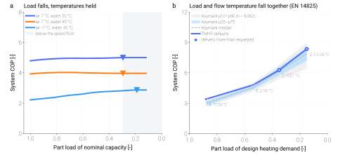

===================
Part-load behaviour
===================

This page exists because the assumption it started from turned out to be wrong,
and the correction changed what the library does.

The assumption was the familiar one: a real inverter heat pump peaks somewhere
around a third of load and falls away below it, so a model whose COP climbs all
the way down must be missing something. The plan was to find the missing
penalty and put it into the compressor efficiency correlations.

.. admonition:: What the certified data actually shows
    :class: important

    Heat Pump Keymark is European third-party certification: an accredited
    laboratory measures to the standard and the declared values are published.
    Reading 18,106 certified records for 9,162 air-to-water models from 169
    manufacturers:

    .. list-table::
        :header-rows: 1
        :widths: 12 14 12 14 16 16 16

        * - Point
          - Outdoor air
          - Part load
          - COP p10
          - p25
          - **median**
          - p75
        * - A
          - −7 °C
          - 0.88
          - 2.61
          - 2.78
          - **2.99**
          - 3.18
        * - B
          - +2 °C
          - 0.54
          - 4.13
          - 4.35
          - **4.53**
          - 4.78
        * - C
          - +7 °C
          - 0.35
          - 5.37
          - 5.74
          - **6.16**
          - 6.56
        * - D
          - +12 °C
          - 0.15
          - 6.40
          - 7.19
          - **7.88**
          - 8.51

    Declared COP rises monotonically from A to D. **97.3 %** of models declare a
    higher COP at the lightest test point than at the next one up, and 96.9 %
    rise at every single step. The roll-over is not there.

    Low-temperature application, average climate. Reproduce with
    ``uv run python -m validation.extraction.keymark_declared``.

The reason is straightforward once stated: EN 14825 lowers the flow temperature
as it lowers the load — 34/30/27/24 °C from A to D for underfloor heating — so
the lift falls together with the duty. The heat exchangers also become large
relative to the duty. Both effects push COP up. (This is also why "W35" and
"W55" name an *application* and not a fixed flow temperature; reading them as
fixed would put three of the four points at the wrong boundary condition.)

So the goal changed: not to manufacture a roll-over, but to carry the low-speed
loss that is genuinely measured, at the size it is measured, and to say plainly
what is not modelled. The low-speed loss of the default compressor maps is that
of one measured R290 scroll between 30 and 110 rev/s (:doc:`defaults`); below
30 rev/s the maps are followed as they are, an extrapolation. The maps were
fitted to those compressor measurements and their axes chosen on them (#218);
the certified trajectory below was used for neither.

Two different curves
====================

        maximum at the same temperatures, for three conditions, from the
        compressor's top speed (left) to its speed floor (right). Each curve
        rises at every step towards the floor, a diamond on each marks where
        the 9 kW nameplate duty falls, and the stretches outside the
        compressor-map data are dashed. Right, the EN 14825 test-point
        trajectory against the certified Keymark band.
    :align: center
    :width: 100%

    **(a)** Load falls, temperatures held; the horizontal axis is the heat
    delivered over the maximum the same machine delivers at those temperatures,
    the diamonds mark the 9 kW nameplate, and dashed stretches lie outside the
    compressor maps' data. **(b)** Load and flow temperature fall together, as
    the certification standard specifies, over the design heating demand. These
    are not the same question and they do not have the same answer.

Panel (a) — fixed temperatures
------------------------------

Hold the source and sink where they are and move the load over the machine's
whole speed range, from the compressor's speed floor (15 rev/s) to its top speed
(120 rev/s). The horizontal axis is the heat the machine delivers as a share of
what it delivers *at the same temperatures at its top speed* (``Q_max [W]``).
That is a different denominator from the 9 kW nameplate: the nameplate is a
label attached to one rating point, not a ceiling. A diamond on each curve marks
where 9 kW falls. An earlier version of this figure stopped at the nameplate and
so showed only the part of each curve at or below the 9 kW duty. With the
shipped compressor maps the 9 kW R32 air-to-water model covers these ranges:

.. list-table::
    :header-rows: 1
    :widths: 28 24 24 24

    * - Air / water
      - Minimum capacity (15 rev/s)
      - Maximum capacity (120 rev/s)
      - 9 kW as a share of the maximum
    * - +7 °C / 35 °C
      - 2.74 kW
      - 17.27 kW
      - 52 %
    * - +7 °C / 45 °C
      - 2.67 kW
      - 17.44 kW
      - 52 %
    * - −7 °C / 45 °C
      - 1.86 kW
      - 11.25 kW
      - 80 %

Frost and defrost are on, as shipped, so the heat is the mean over the frost
and defrost cycle (:ref:`ashpb-frost`). The maximum is the heat of the top speed;
asking for more returns the same point. At −7 °C the maximum is 11.25 kW against
17.44 kW at +7 °C and the same water temperature, so there the nameplate is
closer to the top of the range.

.. list-table::
    :header-rows: 1
    :widths: 22 18 24 18 18

    * - Air / water
      - COP at maximum
      - COP at 9 kW (speed)
      - COP at minimum
      - Change, maximum to minimum
    * - +7 °C / 35 °C
      - 3.35
      - 4.33 (53 rev/s)
      - 4.63
      - +38.1 %
    * - +7 °C / 45 °C
      - 2.84
      - 3.53 (54 rev/s)
      - 3.67
      - +28.9 %
    * - −7 °C / 45 °C
      - 2.03
      - 2.18 (94 rev/s)
      - 2.59
      - +27.6 %

No curve peaks before the floor: at each condition the COP rises at every step
of the sweep from the top speed down to the speed floor and stays flat below it.
Most of the rise at +7 °C lies above the nameplate: from the maximum to the 9 kW
duty COP rises by 29.4 %, 24.2 % and 7.8 % at the three conditions, and from
the 9 kW duty to the speed floor by 6.8 %, 3.8 % and 18.4 %.

The same numbers on the nameplate axis, the way this page used to give them:
the model gains 6.8 % between the 9 kW duty and the speed floor (which delivers
2.74 kW, 30 % of the nameplate) at 7 °C air / 35 °C water, and 3.8 % at 7/45 °C.
At −7/45 °C it gains 18.4 % (COP 2.18 at the nameplate duty, 2.28 at 75 % of it,
2.59 at the floor, which delivers 1.86 kW, 21 % of the nameplate).

The dashed stretches are where the default compressor maps are evaluated
outside their data (``efficiency_extrapolated``; :doc:`defaults`). The measured
R290 scroll behind the maps runs from 30 to 110 rev/s, and on these three curves
the flag is clear from 30–32 % to 92 % of the maximum; both ends of every curve,
the top speed and the last stretch above the speed floor, are the maps followed
past their data. Read the two ends accordingly: the rise towards the floor in
particular is an extrapolation.

Which water temperature is held matters as much as the denominator. The curves
above hold the *leaving* water, so the water temperature the refrigerant has to
exceed does not move with the load. Holding the *entering* water instead (7 °C
air, water entering at 30 °C at the same flow, which is the 7/35 °C point at the
9 kW duty) lets the rise across the condenser shrink with the load. That curve
rises to the speed floor as well, and there reaches COP 5.03, 16.2 % above the
9 kW duty against 6.8 % with the leaving water held. The entering side is also
what the air-to-air model holds (the indoor air entering the coil), which is why
its curves, further down this page, rise further. These rows are in
``validation/data/part_load_figure/entering_water.csv`` and are not drawn.

.. admonition:: Getting the maximum capacity of a machine
    :class: note

    A request above what the machine can deliver is answered at the top speed
    rather than refused. ``AirSourceHeatPumpBoiler.analyze_steady`` then returns
    the heat of the top speed with ``capacity_clamped == "max"`` and
    ``capacity_binding == "compressor"``, that heat as ``Q_max [W]``, and the
    request as ``Q_request [W]``; a larger request gives the same point. Below
    the ceiling ``Q_max [W]`` is NaN, so the maximum at a condition is read from
    a deliberately large request (the figure uses three times the nameplate,
    ``scripts.validation.part_load_figure.maximum_capacity``). When another
    limit binds before the compressor's top speed, ``capacity_binding`` names it
    (``discharge_temperature`` or ``condensing_temperature``, for example) and
    the heat is that limit's. The air-to-air ``AirSourceHeatPump`` has the
    same ceiling as a method: ``max_capacity(T0, T_a_room, mode=...)["Q_max [W]"]``.

The −7/45 °C curve carries the frost and defrost adjustment, which is on by
default (:ref:`ashpb-frost`) and follows the load on the outdoor coil
(:ref:`frost at part load <ashp-frost-load>`): it costs more at a higher load and
eases as the load falls, and that easing is most of the rise below the nameplate
duty. Without it (``defrost=False``) the same curve reads COP 2.64 at the
nameplate duty (76 rev/s), 2.68 at 75 % of it and 2.59 at the speed floor (21 %
of the nameplate): within 2 % of its nameplate-duty value all the way down. The
low-load end is where the compressor maps are extrapolated: at the floor the
frosted point runs at 15 rev/s and a pressure ratio of 4.8, with an overall
efficiency (``eta_cmp_isen`` times ``eta_cmp``) of 0.531 against 0.581 at the
nameplate duty. Its isentropic efficiency is 0.656 against 0.650; what falls is
``eta_cmp``, the share of the electrical input that reaches the gas, 0.810
against 0.894. The maps' data start at 30 rev/s, and below that speed the maps
are followed as they are (``efficiency_extrapolated``; :doc:`defaults`).

Two effects set the frost-free shapes: the heat exchangers grow large relative
to the duty, which raises COP, and the compressor loses efficiency at low
speed, which takes some of it back. Their balance is measured by
``validation/fixed_boundary_plr/decompose`` on the running cycle (no on-off
averaging below the floor): with the three efficiencies frozen at their
full-load values the same model gains 19.8 % between full load and the speed
floor (R32, 7 °C air, water entering at 42.5 °C) and with the shipped
efficiencies gains 11.2 %; the air-to-air model, at pressure ratios of 2.4 to
2.8 at full load, keeps +26 to +35 % with the shipped efficiencies. None of
these shapes is prescribed.

Below the floor the curves end: every request there resolves to the same
operating point (see the note below), which is the one point each curve reaches
at its low end. Above it the compressor maps take back
part of what the heat exchangers give, not all of it, so none of the three
curves turns over before the floor. That is a property of the shipped maps,
not a rule of the model: the type-specific compressor model shipped before
them (#217) lost more at low speed, and with it these curves turned over
above the floor.

.. admonition:: Below the speed floor the model delivers its minimum capacity, and says so
    :class: note

    Once the compressor can go no slower the model cannot follow a smaller
    request. The tank-side condenser is closed on the heat the machine actually
    delivers at that speed rather than on the heat that was asked for, so every
    request below the floor resolves to the same operating point: same speed,
    same delivered capacity, same condensing temperature, same COP. (Closing it
    on the request instead made the condensing temperature follow a request the
    machine could not meet, and the reported COP rose as the request fell.)

    Earlier versions matched a sub-floor request anyway by starving the outdoor coil --
    the operating-point search minimised absolute electrical input, and among
    candidates that all sat at the speed floor the one delivering *less* heat
    also drew less power, so the outdoor fan was driven to its 5 % bound and the
    air-side temperature drop reached 17 K against a catalogue maximum near 8 K.
    That was a model artefact, and it has been removed: the search now compares
    candidates on electrical input per unit of heat delivered and rejects any
    that fall short of the request (:mod:`tmhp._opt_utils`). Below the floor the
    model therefore reports ``capacity_clamped == "min"`` together with the heat
    it actually delivers, which exceeds the request -- the *requested* part-load
    ratio and the *actual* capacity ratio are two different numbers, and the
    output carries both.

    Under the same conditions as before (air 7 °C, water entering at 42.5 °C,
    9 kW R32) the outdoor fan now stays above 58 % of rated flow over the whole
    sweep and the air-side temperature drop stays within 5.26 K; the air-to-air
    sweep stays above 46 % and 6.6 K. A real machine below its modulation floor cycles. The
    sweeps on this page were run before the air-to-water model reported that
    cycling (see below), so their sub-floor rows are a continuous-operation
    figure at the minimum capacity, not a part-load COP.
    In panel (a) they collapse onto the floor point at the low end of each
    curve (the triangle), and they are excluded from every trend verdict.

    At −7 °C air and 45 °C water the requests below the floor resolve to the
    minimum-capacity point as well (COP 2.59 at the floor, which delivers
    1.86 kW, 21 % of the nameplate). They used to fail with ``hx_not_converged``: the outdoor-approach
    search probed only the ends of its range and missed the narrow band of
    approaches the fan can serve, which is now solved from the coil's capacity
    margins at the fan flow limits.

Panel (b) — the certification trajectory
----------------------------------------

This is the curve that has to match. The modelled trajectory rises
monotonically A → D and sits inside the certified band at all four points.
Points A and B carry the frost and defrost adjustment at the load the coil
carries there (:ref:`ashpb-frost`).

.. list-table::
    :header-rows: 1
    :widths: 10 18 16 16 18 22

    * - Point
      - Condition
      - Required load
      - Delivered
      - TMHP COP
      - Keymark median (p10–p90)
    * - A
      - −7 °C / 34 °C
      - 5.28 kW
      - 5.28 kW
      - 2.87
      - 2.99 (2.61–3.35)
    * - B
      - +2 °C / 30 °C
      - 3.24 kW
      - 3.24 kW
      - 4.31
      - 4.53 (4.13–5.01)
    * - C
      - +7 °C / 27 °C
      - 2.10 kW
      - 2.80 kW
      - 5.65
      - 6.16 (5.37–6.82)
    * - D
      - +12 °C / 24 °C
      - 0.90 kW
      - 3.22 kW
      - 7.07
      - 7.88 (6.40–8.97)

The model sits between the 25th percentile and the median at A and between
the 10th and the 25th at B, C and D.

.. admonition:: What the study's 30 cases say
    :class: note

    The EN 14825 study behind :doc:`defaults` runs this trajectory for 30
    cases (capacity, refrigerant, sizing ratio, two applications). Its shape
    check counts the number of cases whose COP(D)/COP(A) lies inside the
    certified population's p10–p90. On the study's 30 cases the present
    defaults pass that shape check in 30 and the level check (every point
    inside its p10–p90) in 30. Neither check, nor the certified population,
    was used to fit the compressor maps or to choose their form (#218).

Without the frost and defrost adjustment the same trajectory reads 3.32 at A,
just under the 90th percentile (3.35), and 4.56 at B. With the EnergyPlus
adjustment applied in full at every load — a function of outdoor temperature
and humidity alone — it reads 2.84 at A and 3.65 at B, below the 10th
percentile at B: the unit at B delivers 3.46 kW frost-free, 0.42 of what the
adjustment's coil-temperature correlation is written for, and would be
corrected as if it ran flat out. The adjustment follows the load on the coil
(:ref:`frost at part load <ashp-frost-load>`): at A the unit is at 0.94 of that
load and keeps nearly the whole correction, at B a little over a quarter of
it. No coefficient is adjusted to move any of this; the load term has none.

.. admonition:: One result nobody put in by hand
    :class: note

    Look at the *delivered* column. At points C and D the modelled machine
    cannot modulate down to the required load and delivers more than the test
    point asks for — 3.22 kW where 0.90 kW is required. (At B the 3.24 kW is
    the mean over frosting and defrost of a machine that delivers 3.46 kW
    frost-free; with the larger displacement of before November 2026 B was on
    the speed floor as well.)

    Certified machines do the same thing. 55 % of Keymark records declare a
    *higher* heat output at point D than at point C, which is the signature of
    a machine sitting on its modulation floor. TMHP reproduces that structure
    from the speed floor alone; nothing was added to produce it.

Air-to-air — fixed temperatures
-------------------------------

.. figure:: ../_static/validation_ashp_part_load.svg
    :alt: System COP (heating, left) and EER (cooling, right) of the 3.5 kW
        air-to-air model against the heat delivered as a share of the maximum at
        the same temperatures, at three outdoor temperatures each, with a diamond
        on each curve where the 3.5 kW nameplate falls and the stretches outside
        the compressor-map data dashed.
    :align: center
    :width: 100%

    The 3.5 kW R32 air-to-air model at fixed temperatures, heating (indoor air
    20 °C) and cooling (27 °C), from the maximum capacity (right) to the speed
    floor (left end of each curve). Diamonds mark the 3.5 kW nameplate; dashed
    stretches lie outside the compressor maps' data.

The air-to-air model (``AirSourceHeatPump``, 3.5 kW R32) is swept the same way by
``validation.analysis.ashp_trend``, with the running machine and frost and
defrost off (the sweep isolates what the correlations and heat exchangers do as
the load moves), from the maximum capacity down to below the speed floor. The
horizontal axis is the refrigerant-side coil duty over its maximum at the same
temperatures (``AirSourceHeatPump.max_capacity``), and the nameplate is the
3.5 kW cooling capacity for both duties. The COP and EER divide the heat the
indoor air carries by the electrical input; that heat differs from the coil duty
by at most 1.3 % over the six curves. The maximum is the top speed's, 120 rev/s,
except in heating at +7 °C: there a coil reaches its largest airflow
first and the ceiling is at 115 rev/s (``capacity_binding == "cycle"``).

.. list-table::
    :header-rows: 1
    :widths: 20 14 14 16 12 12 12

    * - Condition
      - Minimum capacity
      - Maximum capacity
      - 3.5 kW as a share of the maximum
      - COP at minimum
      - COP at 3.5 kW
      - COP at maximum
    * - Heating, −7 °C
      - 0.76 kW
      - 5.43 kW
      - 64 %
      - 4.13
      - 3.28
      - 2.56
    * - Heating, +2 °C
      - 0.98 kW
      - 6.52 kW
      - 54 %
      - 5.12
      - 4.03
      - 2.74
    * - Heating, +7 °C
      - 1.12 kW
      - 6.91 kW
      - 51 %
      - 5.77
      - 4.52
      - 2.94
    * - Cooling, 35 °C
      - 1.50 kW
      - 5.93 kW
      - 59 %
      - 5.54
      - 4.09
      - 2.19
    * - Cooling, 30 °C
      - 1.58 kW
      - 6.10 kW
      - 57 %
      - 6.49
      - 4.73
      - 2.46
    * - Cooling, 25 °C
      - 1.48 kW
      - 6.25 kW
      - 56 %
      - 7.34
      - 5.51
      - 2.76

All six curves rise as the load falls, at every step down to the minimum
capacity; none peaks above the speed floor. From the maximum to the minimum COP
rises by 61 to 97 % in heating and by 153 to 166 % in cooling, against 28 to
38 % for the air-to-water curves above. At 3.5 kW, heating at +7 °C goes from
COP 2.94 at the maximum to 4.52 at the nameplate and 5.77 at the minimum, and
cooling at 35 °C from 2.19 to 4.09 and 5.54. The maps' data cover the middle of
each curve: the flag is clear from 28–32 % to 90–95 % of the maximum in heating
and from 45–46 % to 94–96 % in cooling, so in cooling everything below about
45 % of the maximum, the whole rise to the floor, is extrapolated.

What is not modelled
====================

.. admonition:: The air-to-water low-load COP is a continuous-operation figure
    :class: warning

    Below its modulation floor a real machine cycles on and off. Every start
    pushes the refrigerant pressures away from equilibrium and re-warms the heat
    exchangers, and the standard accounts for that loss with a degradation
    coefficient applied during seasonal integration. Every air-to-water figure
    on this page shows the running machine (``AirSourceHeatPumpBoiler`` in
    continuous operation, what ``Cd_cycling=None`` returns), so **at light
    load it is optimistic against a machine that cycles**, and the size of that
    optimism is not estimated here.

    Both models now apply the standard's own default below their floor when
    asked for a steady point, and report the mean over the cycling period
    (:mod:`tmhp.cycling`): the air-to-air model (``AirSourceHeatPump``) EN
    14825 ``C_d = 0.25`` in the form written for units delivering to air
    (:doc:`/models/ashp`), the air-to-water model ``C_c = 0.9`` in the form
    written for units delivering to water (:doc:`/models/ashpb`). Those are
    the coefficients the standard prescribes for an untested unit, taken
    unchanged; they are not fitted to anything here, and ``Cd_cycling=None``
    restores continuous operation. A certified part-load COP is declared at
    the capacity the unit runs at, before that degradation, so the comparisons
    with certified values stay with the running machine.

This is not an oversight to be patched with a fitted penalty. Cuevas & Lebrun
make the same point from the hardware side: they observe the low-speed
degradation, attribute it to oil starvation, and note that the manufacturer's
own answer is to switch to on/off operation below 35 Hz rather than keep
modulating. The loss lives in the cycling, and the cycling is what the
running-machine figures leave out.

A second caution concerns the degradation coefficient itself, for anyone
tempted to change one. The published values are not interchangeable: EN 14825
writes ``PLF = 1 − C_d(1 − CR)`` with ``C_d = 0.25``, while Dongellini writes
``f_COP = CR / (1 − C_c + C_c·CR)`` with ``C_c = 0.9``. Carrying a coefficient
from one formulation into the other means something different by it.

Likewise the horizontal axis. EN 14825 divides by the *design heating demand*,
a quantity that does not depend on temperature; Kinab and Dongellini divide by
the full-load capacity at the same temperature, which does. The two differ by
roughly a factor of 1.44 over the −7 to +12 °C range, so plotting both on one
axis produces a figure that means nothing. Panel (a) and panel (b) above use
different denominators for exactly this reason, and are labelled accordingly.
Panel (a)'s denominator is the maximum capacity at the same temperatures, which
is not the nameplate either: the nameplate is 52 %, 52 % and 80 % of it at the
three conditions of panel (a), so "full load" on a nameplate axis is not the top
of the machine's range.

Reproduce
=========

.. code-block:: bash

    uv run python -m validation.extraction.keymark_declared     # the certified band
    uv run python -m scripts.validation.part_load_figure        # both panels, and validation/data/part_load_figure/
    uv run python -m validation.analysis.ashp_trend             # air-to-air sweep, validation/data/ashp_part_load_sweep.csv
    uv run python -m scripts.validation.ashp_part_load_figure   # the air-to-air figure
    uv run python -m validation.fixed_boundary_plr.sweep        # internal-state sweep, both models
    uv run python -m validation.fixed_boundary_plr.figure

.. seealso::

    :doc:`defaults`
        The compressor efficiency maps and the data behind them.
