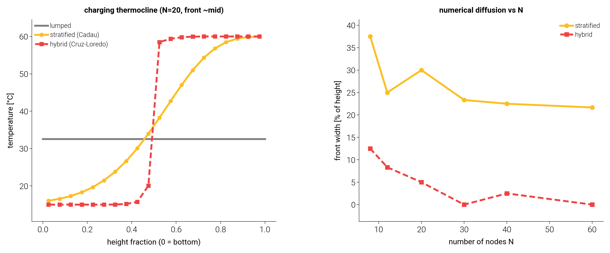
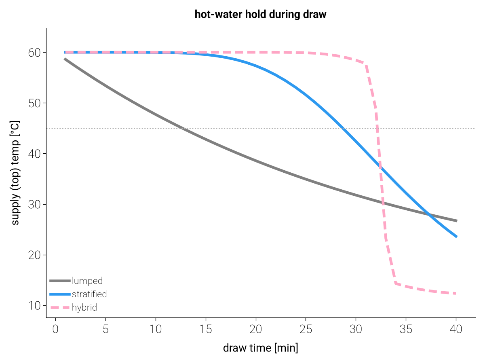

# 탱크 모델 백엔드 — lumped vs 성층(Cadau) vs 하이브리드(Cruz-Loredo)

> tmhp 의 저탕탱크 모델 3종을 구현·비교한다. 단일노드 lumped(기본·경량), 다노드 성층
> smooth(Cadau 2019, MPC 내부모델), 하이브리드 thermocline(De la Cruz-Loredo 2023, 선명한 전선).
> 재현: `.venv/bin/python docs/tank_backends/compare_tank_backends.py`(그림 1·2 와 §2.3 표),
> `.venv/bin/python docs/tank_backends/physics_checks.py`(§2.4 표).

> **하이브리드 백엔드의 상태 (#96 T5 수정 뒤).** 전선이 스텝당 한 노드만 전진해 주입열의
> 7.7–58 % 만 저장하던 결함을 고쳤다(§1.2). 지금은 임의의 dt·노드 수·유량에서
> - 매 스텝 에너지 수지(주입 − 손실 = 저장 증가)가 반올림 오차(상대 1e-12 수준)로 닫히고,
> - 전선이 주입 부피만큼(`V_주입/A`) 정확히 내려가며 한 스텝에 여러 노드를 지나고,
> - 해석해(피스톤 유동 + 열전도)와 비교한 충전 출구 곡선·저장 효율이 맞는다(§2.4).
>
> **검증하지 않은 것**: tmhp 안에서 실측 탱크 자료와 대조한 적이 없다(원 논문의 실험 검증은
> 원 논문 구현에 대한 것이다). 유입구 혼합·제트·벽 경계층(원 논문 §6.1)은 모델에 없고, 전선은
> 하나만 추적한다. 실측 재현이 필요한 연구는 이 한계를 적고 쓴다.

---

## 1. 세 백엔드

| 백엔드 | 모델 | 상태 | 성격 | 역할 |
|---|---|---|---|---|
| **lumped** | 단일노드 완전혼합 | T 하나 | 최저충실·경량 | GSHPB 기본값(`tank_model="lumped"`). 성층 백엔드 코드를 거치지 않는다 |
| **stratified** (`StratifiedTank`) | Cadau 2019 1-D 다노드 유한체적 + 부력 혼합 | T[N] | 상태에 대해 매끄러움(implicit tridiagonal) | MPC 내부모델. GSHPB `tank_model="stratified"`(§4) |
| **hybrid** (`HybridStratifiedTank`) | Cruz-Loredo 2023 hybrid thermocline(보존형) | T[N] + 전선 위치·전선 양쪽 온도 | 비매끄러움(전선 생성·소멸) | 선명한 전선이 필요한 해석. GSHPB `tank_model="hybrid"`(§4) |

### 1.1 표준 다노드 (Cadau)

각 노드 i(0=상단/고온)의 에너지밸런스(Cadau Eq.4): 포트·노드간 **상류이류**(upwind) +
이웃간 **pseudo-conduction** `k(T_{i-1}-T_i)-k(T_i-T_{i+1})` + 외벽손실. **backward-Euler
implicit tridiagonal**로 적분 → 무조건 안정·smooth(MPC 적합). N=1이면 lumped 완전 회복.

- **부력(역전) 혼합.** 매 (하위) 스텝 뒤, 아래 노드가 위 노드보다 0.1 mK 넘게 뜨거우면 두
  노드를 열용량 가중 평균으로 즉시 섞고 위쪽과 다시 비교한다(TRNSYS Type 4/60 의 순간 혼합,
  pool-adjacent-violators 와 같은 결과). 에너지는 그대로, 결과는 위→아래 단조 감소다.
  `inversion_mixing=False` 로 끌 수 있다. 수정 전에는 하단 노드를 3 kW 로 1 h 데우면 하단
  166 °C·상단 40 °C 가 되고 6 h 뒤에도 하단 144 °C 로 역전이 남았다. 지금은 dt·노드 수와
  무관하게 전체가 52.9 °C(에너지 평균)로 섞인다.
- **100 °C 상한.** 모델은 단상 액체다. `q_source` 로 노드가 `T_boil`(기본 100 °C; 가압
  탱크면 올린다)을 넘으면 결과에 `overheat=True`·`T_max` 를 싣고 `TankOverheatWarning` 을
  낸다. 상태는 자르지 않는다(자르면 에너지가 사라진다). 탱크는 열원을 모르므로 열원을 줄이는
  것은 호출자 몫이다.
- **수치 확산**(§2.3). 1차 implicit upwind 는 날카로운 전선을 `D_num = (v·Δz/2)(1 + Co)` 의
  확산처럼 번지게 한다(`v = V̇/A`, 쿠랑 수 `Co = V̇·Δt/V_node`). 전선이 거리 `L` 을 간 뒤의
  퍼짐은 `σ² ≈ L·(Δz + v·Δt)` — **시간 간격이 노드 두께 `v·Δt` 를 하나 더 얹는 것과 같다.**
  예전 문서의 "노드를 늘려도 약 22 % 에서 정체"는 dt 60 s 를 고정한 채 노드만 늘려 `v·Δt` 항이
  남았기 때문이다. `max_courant=1.0` 을 주면 한 스텝을 `Co ≤ 1` 인 같은 크기의 하위 스텝으로
  나눠 퍼짐을 `σ² ≈ L·Δz·(1 + Co_sub)` 로 묶는다(기본은 끔 — 아래 지침).

### 1.2 하이브리드 thermocline (Cruz-Loredo) — 원 논문과의 대조와 수정

**원 논문**(Applied Energy 332:120556, 공개본 Cardiff ORCA 155007)의 구성:

- 표준 다노드 위에 수평 전선 `y_th` 를 두고 피스톤 유동으로 움직인다: `y_th,k+1 = y_th,k − v_th·Δt`,
  `v_th = V̇/A_c`(식 6).
- 강제대류항 `Q_FC,i = c·ρ·V̇·(T_{i+1,k} − T_i)`(식 3)의 상류 온도는 연속 상태가 아니라 **이산
  기준온도** `T_{j,k}` 이고, 전선이 노드의 기준점(노드 중앙 높이) 사이에 있는 동안 그 값을
  고정한다(식 4·5).
- 전선은 충전·방전 양쪽(식 4–6)에 둘 수 있고, 한쪽에서만 선명한 탱크는 반대 방향에서 전선을
  없앤다(식 7: 충전 전용, 식 8: 방전 전용). 논문의 실험 탱크는 보일러의 20 K 온도차 때문에 충전
  성층이 나빠 **방전 전용(식 8)** 으로 검증했다(§5.2).
- 이산 상태는 `Δt = 1 s` 로 갱신했다(§5.1). 실험(785 L, 높이 1.755 m, 20 kW·20 K → 약
  0.24 L/s)에서 전선은 0.5 mm/s 로, 150 mm 노드 하나를 지나는 데 약 300 회의 이산 갱신이
  든다. **한 갱신에 여러 노드를 지나는 경우는 논문이 다루지 않는다.**
- 검증은 층별 온도 RMSE/MAE 와 SoC(저장 에너지 기반)로 했다. 에너지 보존은 논의하지 않는다.

**예전 구현이 벗어난 곳**:

1. 식 3 을 그대로 옮겨, 동결된 상류값으로 아래 노드에 유입하면서 위 노드는 자기 연속 온도로
   유출했다. 둘이 다른 동안 그 차이만큼 에너지가 사라진다 — dt 10 s(쿠랑 0.2)에서도 탱크
   절반 충전 시 저장열이 이상값의 77 %(20 노드, 12 L/min)였다. 즉 문제는 dt 만이 아니었다.
2. 기준온도를 풀어 줄 때 **스텝 시작의** 노드 온도를 썼다. 그래서 한 스텝에 전선이 여러 노드를
   지나도 아래 노드에는 찬 물이 들어갔고, 전선이 스텝당 한 노드밖에 못 갔다. dt 60 s 탱크 절반
   충전에서 고온 영역 25 %(20 노드)/15 %(60 노드)(이상값 50 %), 저장열 58 %/32 %. 12 L/min 1 h
   충전은 dt 600 s 에서 에너지 −92 %, 하단 15 °C 그대로였다.
3. 식 7 을 쓰면서 **대기(유량 0)에도** 전선을 없앴다. 식 7 은 `V̇ = 0` 이면 `y_th` 가 그대로다.
   충전과 방출이 동시에 있으면(급탕 중 충전) 역시 전선을 없앴다.
4. 예전 문서의 "하이브리드는 front 선명도를 위해 충전 중 스텝별 에너지보존을 **의도적으로**
   포기한다(논문도 …)"는 논문에 없는 해석이다. 논문은 보존을 언급하지 않을 뿐이고, SoC 를
   실측과 RMSE 1.4–3.5 % 로 맞춘 것을 보면 저장 에너지를 틀리게 내는 모델로 의도한 것도 아니다.

**지금 구현**(같은 상태를 쓰되 장부를 닫는다):

- 전선이 든 노드를 전선 위(`T_above`)·아래(`T_below` = 논문의 이산 기준온도) 두 구역으로 나눈다.
  노드 온도는 두 구역의 부피 가중 평균이다. 그래서 그 노드에서 아래로 나가는 물은 전선 아래의
  물이고(논문의 의도), 그 물이 위 노드에서 빠진 것으로도 셈해진다.
- 이류는 이 조각상수 기둥을 `V̇·Δt` 만큼 **정확히** 미는 것이다(몇 노드든). 민 기둥을 노드에
  누적 `Σ V·T` 로 보존적으로 재배치하고, 전선만 노드 안의 불연속으로 남긴다.
- 그 위에서 전도(구역 중심 간 거리로 계산), 측벽 손실, `q_source` 를 노드+두 구역에 대해
  implicit 으로 풀고, 역전을 §1.1 과 같은 방법으로 섞는다.
- 전선의 생애(`front=`): `"both"`(기본, 식 4–6) — 전선이 없는 탱크로 순유량이 들어오면 그
  입구(순충전은 상단, 순방출은 하단)에서 생기고, 순유량을 따라 양방향으로 움직이며, 대기 중에는
  그대로 있고(전도만 작용), 탱크를 빠져나가거나 양쪽 온도차가 1 mK 이하가 되거나 부력 혼합으로
  섞이면 없어진다. `"charge"`(식 7)는 순유량이 위로 향하면, `"discharge"`(식 8)는 아래로 향하면
  전선을 없앤다(없앨 때 노드 평균은 그대로라 에너지 보존).
- **물리적 판단.** 방전·대기에서 전선을 없애는 예전 규칙은 타당하지 않다. 정지한 성층은 전도로만
  천천히 무뎌지고, 디퓨저가 좋은 탱크의 방전 전선은 논문 실험처럼 오히려 선명하다. 반대로
  유입구 혼합이 큰 탱크(한쪽 방향만 선명)에서는 그 방향에서 없애는 것이 맞다 — 그 선택이
  `front="charge"/"discharge"` 다.
- 동시 유량: 기둥은 순유량(`충전 − 방출`)만큼만 민다. 겹치는 통과 유량 `min(충전, 방출)·Δt` 는
  같은 끝으로 들어와 나가므로, 양 끝의 입구 노드를 완전혼합 부피로 보고 정확한 지수해
  `T → T_in + (T − T_in)·exp(−V_통과/V_node)` 로 교환한다(표준 모델의 입구 노드 혼합과 같은 가정).
  충전수는 상단 노드와 섞인 뒤 급탕으로, 보충수는 하단 노드와 섞인 뒤 충전 환수로 나간다. 이때는
  입구 노드가 혼합 부피이므로 새 전선을 입구가 아니라 그 노드의 아래(위) 면에서 만든다. 순유량 이동과
  입구 혼합은 각각 정확하지만 번갈아 적용하는 분할 오차가 있어, 노드 부피의 0.1 이하 조각으로 나눈다
  (1 h 동시 충·방출의 저장 에너지 차이가 dt 10 ↔ 3600 s 에서 0.04 % 이하). 결과의 `T_draw_out`·
  `T_charge_out` 이 실제로 나간 물의 유량 평균 온도다. (처음 구현은 겹치는 유량을 포트끼리 바로
  통과시켜, 충·방출 유량이 같으면 상단이 충전수보다 차가워도 탱크가 전혀 데워지지 않았다 — 리뷰에서
  잡아 고쳤다.)
- **열 입력과 유량의 분할.** 이류(정확한 피스톤 이동)와 암시 풀이(전도·손실·열 입력)는 번갈아
  적용하는 연산자 분할이다. 열 입력(`q_source` 또는 잠긴 열교환기, §1.3)이 없으면 한 스텝의 이류를
  모두 한 뒤 암시 풀이를 한 번 한다(예전 그대로, 결과 동일). 열 입력이 있으면 가열과 유량이 동시에
  작용하므로 **노드 한 부피 이하 조각으로 번갈아** 적용한다. 그러지 않으면 한 스텝에 탱크 부피만큼
  방출할 때 그 스텝의 열이 들어가기 전에 가열되지 않은 보충수가 먼저 밀려 나간다 — 6 kW 균등 가열,
  200 L 탱크, 12 L/min 방출, dt 1,000 s 두 스텝에서 평균 방출 온도 18.6 °C·끝 평균 22.2 °C 였다
  (dt 10 s 기준 20.3 °C·18.6 °C; 지금 20.2 °C·18.9 °C).
- **남은 한계.** 전선은 하나만 추적한다. 전선이 이미 있을 때 생긴 두 번째 경계(예: 충전 온도가
  바뀜)와 전선 주변에 전도로 생긴 완만한 기울기는 노드 재배치로 표준 모델처럼 번진다. 노드 안의
  물리적 전도 퍼짐(`√(2αt)`, 1 h 에 약 2 cm)은 두 구역 사이 전도로만 표현되므로, 노드가
  그보다 크면 실제보다 약간 선명하다(§2.4 표 A 의 dt 10 s 출구 RMSE 1.2–1.5 K 가 이것이다).

### 1.3 두 백엔드의 공통 계약

| 항목 | `StratifiedTank` | `HybridStratifiedTank` |
|---|---|---|
| 생성자 | `(n_nodes, volume [m³], height [m], *, k_eff [W/m/K], ua [W/K], rho, cp, inversion_mixing=True, max_courant=None, T_boil=100)` | `(n_nodes, volume, height, *, k_eff, ua, rho, cp, front="both", T_boil=100)` |
| 노드 번호 | 0 = 상단, N−1 = 하단 | 같음 |
| 열손실 | 측벽 `UA/N` 를 노드마다 `UA_i·(T_i − T_amb)`. 상·하판 손실은 따로 없다(측벽 UA 에 넣어 준다) | 같음(전선 노드는 두 구역에 부피 비로 나눔) |
| 충전 포트 | `charge_flow` [m³/s] 가 `T_charge` 로 상단 유입, 하단 유출(HP 환수) | 같음 |
| 급탕 포트 | `draw_flow` 가 상단에서 나가고 `T_makeup` 이 하단으로 유입 | 같음 |
| 열원 | `q_source` [W]: 스칼라 = 상단 노드, 길이 N 배열 = 노드별. 노드 온도와 무관하게 들어간다 | 같음(수정으로 추가) |
| 잠긴 열교환기 | `hx_ua` [W/K](스칼라 = 균등 분배, 길이 N 배열 = 노드별), `T_hx` [°C], `q_hx` [W]. 노드 i 는 `k·UA_i·(T_hx − T_i)⁺` 를 받는다(`T_i` 는 (하위) 스텝 끝 온도). `T_hx` 만: `k = 1`. `T_hx` + `q_hx`: 합이 `q_hx` 가 되게 `k` 를 푼다. `q_hx` 만: `k = 1` 로 `q_hx` 를 넘기는 `T_hx` 를 푼다 | 같음(전선 노드는 두 구역이 각자 온도로 받는다) |
| 미리 보기 | `preview(dt, …)`: `step` 과 같은 결과를 돌려주되 탱크를 진행시키지 않고 경고도 내지 않는다 | 같음 |
| 반환 | `T`, `T_top`, `T_outlet`(노드 값), `T_draw_out`, `T_charge_out`(실제 유출수의 유량 평균), `Q_loss` [W], `T_max`, `overheat`, `mixed`, `substeps`, 열교환기의 `q_hx`(노드별 [W]), `Q_hx`(합), `hx_scale`(`k`), `T_hx`, `T_hx_heated_max`(열교환기가 데운 물 가운데 가장 뜨거운 것), `hx_limited` | 왼쪽에서 `substeps` 대신 `y_th`(전선 높이 [m] 또는 `None`) |
| 에너지 수지 | `ΔE = dt·[ρc(V̇_c·T_charge + V̇_d·T_makeup − V̇_d·T_draw_out − V̇_c·T_charge_out) + Σq + Q_hx − Q_loss]` 가 반올림 오차로 닫힌다 | 같음 |

`StratifiedTank` 에서 혼합·하위 스텝이 없으면 `T_draw_out == T_top`, `T_charge_out == T_outlet`
이다(예전 계약 그대로). 혼합이 상단·하단 노드를 바꾸면 수지를 닫는 값은 `T_draw_out`/
`T_charge_out` 쪽이다.

**잠긴 열교환기**(응축 코일처럼 한 온도로 유지되는 교환기). `q_source` 는 정해 준 열을 노드 온도와
무관하게 넣지만, 코일은 자기보다 찬 물만 데운다. 그래서

- `T_hx` 이상인 노드는 열을 받지 않고(식지도 않는다), 데워진 노드는 그 풀이의 끝에 `T_hx` 를 넘지
  않는다(`T_hx_heated_max ≤ T_hx`). 한쪽 방향 항이 구간별 선형이라 활성 집합 반복(M 행렬의
  반평활 뉴턴법, 유한 번에 끝남)으로 푼다.
- `q_hx` 를 주면 노드 사이 분배는 `UA_i·(T_hx − T_i)⁺` 에 비례한 채 합만 맞춘다. 노드를 `T_hx` 까지
  올려도 그 열을 못 받으면 받을 수 있는 만큼만 넣고 `hx_limited=True`, `Q_hx` 에 실제 값을 싣는다.
- 탱크 아래쪽 코일은 데운 물이 부력으로 올라가야 열을 계속 넘길 수 있다. 열교환기 스텝에서 역전
  혼합이 일어나면 그 스텝을 `C_node/UA_i` 의 절반 이하 하위 스텝(최대 48)으로 다시 풀어, 넘길 수
  있는 열이 dt 에 좌우되지 않게 한다(하단 노드 코일 3 kW·1 h 가 dt 60 s 와 3,600 s 에서 같은 결과).

---

## 2. 결과

### 2.1 충전 thermocline — numerical diffusion (그림 1)

차가운 탱크(15°C)를 60°C, 7.2 L/min, dt 60 s 로 14 스텝(탱크의 50.4 %) 충전한 프로파일(좌,
N=20): lumped 는 평탄(혼합온도 한 값), stratified 는 **번진 S-curve**, hybrid 는 **계단**(전선이
든 노드 하나만 중간값). 전이대 폭(25–75 % 사이에 든 노드 수 / N; 우):

| N | stratified | hybrid (수정 전) | hybrid |
|---|---|---|---|
| 8 | 37.5% | 25.0% | 12.5% |
| 12 | 25.0% | 16.7% | 8.3% |
| 20 | 30.0% | 15.0% | 5.0% |
| 30 | 23.3% | 6.7% | 0.0% |
| 40 | 22.5% | 7.5% | 2.5% |
| 60 | 21.7% | 3.3% | 0.0% |

하이브리드의 폭은 전선이 든 노드 하나가 25–75 % 사이에 들면 `1/N`, 아니면 0 이다. 수정 전
하이브리드 그림은 전선이 높이 약 0.70(N=20; 이상값 0.50)에 머문 프로파일이었고, 그 "선명도"는
에너지를 잃은 결과였다(저장열/주입열 58 %). 지금은 전선이 0.50 에 있고 저장열 = 주입열이다.
stratified 의 정체는 §2.3 의 dt 항 때문이다.

### 2.2 방출 — 온수 공급 유지(성층 유연성, 그림 2)

완충(60°C 균일) 후 하단 냉수 makeup(12°C, 6 L/min)으로 연속 방출하며 **공급(상단)온도** 추적.
45°C 이상 유지 시간:

| 백엔드 | 45°C 이상 유지 |
|---|---|
| lumped | 12.0 분 |
| stratified | 28.0 분 |
| hybrid (수정 전 — 방출 중 전선을 없애 stratified 와 같았다) | 28.0 분 |
| hybrid | 32.0 분 |

탱크 한 부피를 내보내는 데 33.3 분이 걸리므로 피스톤 유동의 이상값은 33.3 분이다. hybrid 는
하단에서 생긴 방전 전선이 그대로 올라와 31 분까지 58 °C 이상을 내고 급강한다(그 직전의 완만한
하강은 전선 주변 전도). stratified 는 2.3배, hybrid 는 2.7배 긴 온수 윈도우를 준다.

### 2.3 성층 백엔드의 수치 확산 — dt·노드 수·유량 (표 C)

15 °C 탱크를 60 °C 로 탱크 높이 절반(`L = 0.6 m`)까지 충전한 시점의 10–90 %
전이 폭(탱크 높이 %). "예측"은 `2.563·√(L·(Δz + v·h) + 2αt)`(`h` = (하위) 스텝, `α` = 물의
열확산율). `> 100` 은 전이대가 탱크 밖까지 퍼진 것이다. 200 L, 높이 1.2 m.

| 유량 [L/min] | dt [s] | N | Co | 폭 | 예측 | 폭, `max_courant=1` | 예측 |
|---|---|---|---|---|---|---|---|
| 3.33 | 10 | 10 | 0.03 | 59 | 58 | 59 | 58 |
| 3.33 | 10 | 20 | 0.06 | 42 | 42 | 42 | 42 |
| 3.33 | 10 | 60 | 0.17 | 26 | 26 | 26 | 26 |
| 3.33 | 60 | 10 | 0.17 | 62 | 62 | 62 | 62 |
| 3.33 | 60 | 20 | 0.33 | 47 | 47 | 47 | 47 |
| 3.33 | 60 | 60 | 1.00 | 33 | 33 | 33 | 33 |
| 3.33 | 300 | 10 | 0.83 | 76 | 78 | 76 | 78 |
| 3.33 | 300 | 20 | 1.67 | 65 | 66 | 55 | 55 |
| 3.33 | 300 | 60 | 5.00 | 56 | 58 | 33 | 33 |
| 3.33 | 600 | 10 | 1.67 | > 100 | 94 | 76 | 78 |
| 3.33 | 600 | 20 | 3.33 | 80 | 84 | 55 | 55 |
| 3.33 | 600 | 60 | 10.00 | 74 | 78 | 33 | 33 |
| 10.00 | 10 | 10 | 0.08 | 60 | 60 | 60 | 60 |
| 10.00 | 10 | 20 | 0.17 | 44 | 44 | 44 | 44 |
| 10.00 | 10 | 60 | 0.50 | 29 | 29 | 29 | 29 |
| 10.00 | 60 | 10 | 0.50 | 69 | 70 | 69 | 70 |
| 10.00 | 60 | 20 | 1.00 | 57 | 57 | 57 | 57 |
| 10.00 | 60 | 60 | 3.00 | 46 | 47 | 33 | 33 |
| 10.00 | 300 | 10 | 2.50 | > 100 | > 100 | 76 | 78 |
| 10.00 | 300 | 20 | 5.00 | > 100 | 99 | 57 | 57 |
| 10.00 | 300 | 60 | 15.00 | 87 | 94 | 33 | 33 |
| 10.00 | 600 | 10 | 5.00 | > 100 | > 100 | 79 | 81 |
| 10.00 | 600 | 20 | 10.00 | > 100 | > 100 | 57 | 57 |
| 10.00 | 600 | 60 | 30.00 | > 100 | > 100 | 33 | 33 |

측정과 예측이 0–7 %p 안에서 맞는다(차이는 전이대가 탱크 끝에 닿는 경우). 실제 물의 열전도
퍼짐은 이 조건에서 폭 3–5 % 로, 위 값의 대부분은 수치 확산이다.

**성층 선명도에 맞춘 dt·N 고르기.**

1. 원하는 10–90 % 폭 `w`(탱크 높이 비)와 전선이 갈 거리 `L` 을 정한다. 필요한 조건은
   `Δz + v·Δt ≤ (w·H / 2.563)² / L` 이다. 왼쪽 두 항은 대등하다 — **쿠랑 수 `Co = v·Δt/Δz` 가
   1 을 넘으면 노드를 늘려도 dt 항이 남아 효과가 없다.**
2. 그래서 먼저 `Co ≤ 1`(`V̇·Δt ≤ V_node`)이 되게 dt 를 고르고, 그다음 노드 수로 폭을 맞춘다.
   `Co ≤ 1` 이면 폭 ≈ `2.563·√(2·L·Δz)` 다. 예: 1.2 m 탱크에서 높이 절반을 간 전선을 폭 20 %
   로 보려면 `Δz ≤ (w·H/2.563)²/(2L)` = 7.3 mm, 즉 N ≈ 160 이다. 이 정도 선명도가 필요하면
   하이브리드를 쓴다.
3. 시뮬레이션 dt 를 줄일 수 없으면(예: 시간 단위 연간 계산) `max_courant=1.0` 을 켠다. 에너지
   보존은 그대로이고, 비용은 하위 스텝 수(`⌈Co⌉`)만큼의 삼중대각 풀이다(N=60, dt 600 s,
   12 L/min 에서 36 회).
4. **MPC 내부모델로 쓸 때는 `max_courant` 를 끈다.** 하위 스텝 수가 유량에 따라 정수로 바뀌므로
   결과가 유량에 대해 불연속이 된다(쿠랑 수가 정수를 넘는 순간 값이 뛴다). 기본값이 꺼짐인 이유다.
   이때는 dt 를 `Co ≤ 1` 이 되게 고르는 것으로 같은 효과를 낸다.

### 2.4 물리 점검 — 해석해 대조와 시나리오

재현: `.venv/bin/python docs/tank_backends/physics_checks.py`(200 L, 높이 1.2 m, `k_eff` = 물).
"전" 값은 같은 스크립트를 수정 전 커밋 `f9a5828` 에서 돌린 것이다.

**A. 표준 충전 시험**: 20 °C 탱크에 60 °C 물을 7.2 L/min(τ = V/V̇ = 1,667 s)으로 t* = t/τ = 2
까지. 해석해는 피스톤 유동 + 물의 축방향 열전도(Pe ≈ 6,000). η 는 첫 스텝 끝 `t_e ≥ τ` 의
저장 에너지 / 최대 저장 가능 에너지(괄호는 같은 시각의 해석해), t*₁₀·t*₉₀ 는 출구가 10 %·90 %
를 처음 넘은 스텝 끝 시각, RMSE 는 스텝 평균 출구 온도의 해석해 대비 오차. 잔차는 매 스텝
`|ΔE − Σ플럭스| / E_max` 의 최댓값.

| 백엔드 | dt [s] | N | 잔차 [%] | η(t_e) [해석해] | t*₁₀ | t*₉₀ | RMSE [K] |
|---|---|---|---|---|---|---|---|
| 해석해 | – | – | – | 0.993 (t*=1) | 0.977 | 1.024 | – |
| stratified | 10 | 20 | 3e-12 | 0.907 [0.994] | 0.714 | 1.320 | 6.0 |
| stratified | 60 | 20 | 1e-12 | 0.887 [0.996] | 0.684 | 1.440 | 6.8 |
| stratified | 600 | 20 | 1e-13 | 0.786 [1.000] | 0.720 | 2.160 | 8.4 |
| stratified | 600 | 60 | 1e-13 | 0.797 [1.000] | 0.720 | 2.160 | 8.2 |
| stratified `max_courant=1` | 600 | 20 | 6e-14 | 0.911 [1.000] | 1.080 | 1.800 | 4.6 |
| stratified `max_courant=1` | 600 | 60 | 2e-12 | 0.959 [1.000] | 1.080 | 1.800 | 2.5 |
| hybrid (수정 전) | 10 | 20 | 19 | 0.822 [0.994] | 0.978 | 1.458 | 8.3 |
| hybrid (수정 전) | 60 | 20 | 68 | 0.586 [0.996] | 1.368 | — | 20.1 |
| hybrid (수정 전) | 600 | 20 | 190 | 0.132 [1.000] | — | — | 28.5 |
| hybrid | 10 | 10 | 5e-12 | 0.997 [0.994] | 1.002 | 1.008 | 1.5 |
| hybrid | 10 | 20 | 4e-13 | 0.994 [0.994] | 1.002 | 1.008 | 1.4 |
| hybrid | 10 | 60 | 1e-12 | 0.987 [0.994] | 0.948 | 1.056 | 1.2 |
| hybrid | 60 | 20 | 6e-13 | 0.995 [0.996] | 1.008 | 1.044 | 0.6 |
| hybrid | 600 | 20 | 2e-13 | 1.000 [1.000] | 1.080 | 1.440 | 0.01 |
| hybrid | 600 | 60 | 1e-13 | 1.000 [1.000] | 1.080 | 1.440 | 0.01 |

(— 는 t* = 2 까지 출구가 그 수준에 닿지 않음. dt 600 s 의 t* 값은 스텝 끝 시각의 해상도다.)
dt 10 s·N 60 하이브리드의 이른 돌파(0.948)는 전선 앞의 전도 기울기가 재배치로 번진 것이다(§1.2
남은 한계).

**B. 시나리오**(N=20, `ua` = 2 W/K). 잔차는 매 스텝 최댓값, 단조성은 매 스텝 `T[i+1] ≤ T[i]`.

| 시나리오 | 백엔드 | dt [s] | 잔차 [%] 전 → 후 | 단조 전 → 후 | 끝 상단/하단 [°C] 전 → 후 |
|---|---|---|---|---|---|
| 방전(60 °C, 보충 20 °C, 1.5 τ) | stratified | 600 | 4e-13 → 4e-13 | 예 → 예 | 32.2/20.0 → 32.2/20.0 |
| | hybrid | 60 | 4e-13 → 5e-13 | 예 → 예 | 22.3/20.0 → 20.0/20.0 |
| | hybrid | 600 | 4e-13 → 6e-14 | 예 → 예 | 32.2/20.0 → 20.0/20.0 |
| 절반 충전 후 대기 6 h | hybrid | 60 | 21 → 4e-12 | 예 → 예 | 57.6/20.0 → 58.0/20.0 |
| | hybrid | 600 | 32 → 7e-14 | 예 → 예 | 38.6/20.0 → 57.9/20.0 |
| 충전 0.5 τ → 방출 0.25 τ → 충전 0.5 τ | hybrid | 600 | 63 → 3e-14 | 예 → 예 | 55.5/20.0 → 59.9/20.0 |
| 충전 중 동시 방출(0.5 V̇) | hybrid | 600 | 1e-13 → 3e-13 | 예 → 예 | 59.9/22.7 → 59.9/20.0 |
| 하단 히터 3 kW 1 h → 대기 6 h | stratified | 60·600 | 1e-13 → 1e-12 | **아니오 → 예** | 38.8/169.9 → 51.0/51.0 |
| | hybrid | 60·600 | (열원 없음) → 7e-12 | – → 예 | – → 51.0/51.0 |

---

## 3. 언제 무엇을

| 상황 | 백엔드 |
|---|---|
| 단순 시뮬·탱크 내부동특성 무관 | **lumped**(기본) |
| MPC 내부예측모델(매끄러움·미분가능 필요) | **stratified**, `max_courant` 끔, dt 는 `Co ≤ 1` 이 되게 |
| 성층을 보는 플랜트 계산, dt 를 줄일 수 없음 | **stratified** + `max_courant=1.0`, 또는 **hybrid** |
| 선명한 충·방전 전선(급탕 공급온도 유지, 저장 효율) | **hybrid**(`front` 는 탱크의 유입구 혼합에 맞게) |
| GSHPB 동적 해석에서 성층 탱크 | `tank_model="stratified"`(하위 스텝 켬) 또는 `"hybrid"`. 응축 코일이 찬 하부 물을 만나는 효과(응축온도 하강)는 코일 접근 온도차가 작을수록, 전선이 선명할수록(hybrid) 크게 나타난다(§4) |

geolink×tmhp 결합 MPC 연구(G3)가 의도한 "hybrid 를 plant, stratified 를 MPC 내부모델"
구성은 이제 에너지 보존 면에서는 쓸 수 있다. 다만 plant 를 실측 대신 쓸 때는 맨 위 상태 상자의
"검증하지 않은 것"을 결과에 적는다. 수정 전 하이브리드로 만든 결과는 다시 돌려야 한다.

---

## 4. 보일러와의 연결

`GroundSourceHeatPumpBoiler(tank_model=…, n_tank_nodes=…, condenser_node=…)` 의 `tank_model` 은
`"lumped"`(기본) · `"stratified"` · `"hybrid"` 를 받는다. 다노드 두 모드는 항상 만수 탱크만
다루고 서브시스템(`stc`/`pv`/`uv`)을 받지 않는다.

- `"stratified"` 는 `StratifiedTank(n, V_tank_full, H, ua=UA_tank_wall, max_courant=1.0)` 를 만든다
  (플랜트 계산이므로 하위 스텝을 켠다 — §2.3 지침 3). `"hybrid"` 는
  `HybridStratifiedTank(n, V_tank_full, H, ua=UA_tank_wall)`(`front="both"`)다.
- **응축기는 탱크에 잠긴 코일이다.** `UA_tank_hx` 를 노드에 균등하게 나누거나
  (`condenser_node=None`) 한 노드에 모은다(0 = 상단). 코일은 압축기가 도는 동안만 열을 넘기므로,
  매 스텝 탱크에 `step(dt, draw_flow, T_makeup, T_amb, hx_ua=f·UA_i, q_hx=Q_ref_tank)` 를 한 번 부른다
  (`f` 는 그 행의 가동률, `Q_ref_tank` 는 스텝 평균 응축열). 탱크가 그 열을 넘기는 열교환기 온도
  `T_end`(가동이 끝나는 응축온도)를 풀고, 노드 i 는 `f·UA_i·(T_end − T_i)⁺` 를 받는다 — 냉매만큼
  뜨거운 노드는 받지 않고, 데워진 노드는 `T_end` 를 넘지 않는다(§1.3).
- **사이클이 보는 탱크 온도.** 사이클 모델은 탱크 온도 `T` 하나를 받아 `T + Q/UA_tank_hx` 에서
  응축한다. 다노드 탱크에서 코일이 `Q` 를 넘기는 데 필요한 응축온도는 `Σ UA_i·(L − T_i)⁺ = Q` 를
  만족하는 수위 `L` 이므로, 사이클에는 `L − Q/UA_tank_hx` 를 준다(사이클이 정확히 `L` 에서 응축).
  찬 물이 아래에 있고 위쪽이 냉매보다 뜨거우면 찬 노드만 열을 받으므로 `L` 은 평균온도 기준
  (`T_평균 + Q/UA`)보다 낮다. 완전 혼합이면 둘이 같다.
- **`L` 은 가동 구간의 평균이다.** 스텝의 전력은 가동 중 응축온도가 지나간 길을 따라 쓴 전력이고,
  1차까지는 그 길의 평균 응축온도에서의 전력이다 — 가동이 끝나는 온도에서의 전력이 아니다. lumped
  탱크가 가동 구간의 평균 탱크 온도에서 사이클을 푸는 것과 같다. `L` = 서모스탯 모델이 주는 가동 중
  평균 탱크 온도 + (코일 수위 − 탱크 평균)의 가동 구간 평균이고, 뒤 항은 스텝 시작 상태에서 코일을
  `Q` 로 돌려 본 시험 스텝(`preview`)의 시작·중간·끝에서 읽어 심프슨 공식으로 평균한다
  (`NODAL_RUN_INTERVALS`). 결과의 `T_ref_cond_sat_l` 이 이 평균이고, `T_ref_cond_sat_l_peak` 는 그
  스텝에서 가장 높았던 응축온도(물이 데워지는 가동이면 끝나는 수위)다 — 데워진 물이 넘지 않는 것은
  이 값이다. 예전에는 한 스텝에 탱크가 코일 접근 온도차보다 많이 데워지면 스텝 끝 수위를 썼다
  (스텝 끝 물 온도보다 낮은 응축온도로는 탱크 스텝이 열을 넘길 수 없어서). 그래서 긴 스텝이 실제보다
  뜨거운 응축기의 전력을 냈다: 균등 코일, 55 → 65 °C, 급탕 없음에서 dt 60 s 0.348 kWh, 600 s
  0.364 kWh(+4.7 %; 지금 0.348 / 0.347, lumped 와 같다).
- **응축 한계에서는 붙든다.** `T_end` 는 응축 한계(`정지 온도 + hp_capacity/UA_tank_hx`, 한계가 없으면
  끓는점)를 넘지 않는다. 그 스텝의 열을 넘기려면 더 높아야 하면 압축기가 코일 주변 물을 정지 온도에
  붙든 것으로 본다: 그 스텝의 열을 정지 온도보다 찬 코일 노드에만 넣고 어느 노드도 그 온도를 넘겨
  데우지 않는다(`step(…, hx_ua=UA_i, T_hx=정지 온도, q_hx=Q)`). 다 받지 못하면 그 행의
  `runtime_fraction`·열·전력을 들어간 만큼으로 줄이고 `hp_stop_reason` 에 한계를 적는다. 서모스탯
  호출은 유지되고, 다음 스텝에서 같은 운전으로 이어진다(새 기동으로 세지 않는다 — 예전에는 스텝이
  길면 기동 횟수가 늘었다: 상단 코일·급탕에서 60 s 1회, 600 s 2–3회).
- **코일 정지와 설정 상한이 같이 닿으면 서모스탯 정지다.** 요청한 상한이 포락선 정지 온도보다 높으면
  상한이 그 온도로 내려오므로(R32 기본값: 65 → 60 °C), 탱크 전체에 걸친 코일은 평균이 상한에 닿는
  순간 코일 수위도 한계에 닿는다. 그때는 호출이 끝나고 하한까지 식은 뒤 다시 켠다(lumped 와 같음;
  평균이 상한의 0.5 K 안이면 이렇게 본다, `NODAL_SETPOINT_TIE_K`). 유지로 처리하면 평균이 닿을 수 없는
  상한 바로 밑에 묶여, 급탕이 이어지는 내내 응축 한계에서 돈다.
- **유지 열은 어느 순간에도 명판 용량을 넘지 않는다.** 정지 온도에 닿은 뒤의 유지 열을 스텝 평균으로만
  잡으면, 찬 전선이 스텝 중간에 코일에 닿을 때 "앞 구간은 조금, 뒤 구간은 용량의 몇 배"인 유지를
  평균해 버린다(60 s 스텝에서는 그때 상단이 식는다). 그래서 유지 구간을 8등분해(`NODAL_HOLD_INTERVALS`)
  누적 열을 읽고, 명판 용량을 넘기 시작하는 구간부터는 전부하로 돌며 코일 물이 식는 것으로 본다.
- **시험 스텝의 급탕.** 코일 수위를 읽는 시험 스텝은 그 스텝이 실제로 뽑을 만큼 뽑는다. 혼합 밸브는
  상단이 식을수록 탱크 물을 더 쓰므로, 스텝 시작 상단 온도로 잡은 급탕은 찬 전선이 상단에 닿는
  동안에는 너무 작다(시험 스텝의 코일 물이 덜 식어 응축온도가 높게 나온다).
- **제어 온도는 노드 평균이다**(`T_tank_w [°C]`). lumped 와 같은 스텝 내 서모스탯 풀이를 그대로
  쓰되, 급탕 열은 평균이 아니라 상단 노드 온도에서 평가한다(스텝 시작의 상단 − 평균만큼 올려서).
  평균과 상단이 모두 혼합 설정 온도 위면 lumped 와 같고, 급탕으로 평균이 설정 아래로 내려갔지만
  상단이 아직 뜨거운 탱크에서만 달라진다 — lumped 식은 그때 미지근한 물을 내보내는 것으로 쳐서
  평균이 오른다고 보지만 실제 평균은 내려간다.
  가동·정지 시각과 공급 열량이 lumped 와 맞는다(아래 표). 평균으로 제어하므로 코일이
  상단까지 닿으면 상단 노드가 상한 설정보다 높을 수 있다(아래 표의 +4 K). 상단 노드 기준 제어는
  검토했으나 채택하지 않았다 — 스텝 내 서모스탯 풀이가 단일 노드 에너지 모델이어서 상단 노드가
  하한에 닿는 시각(전선 도착)을 풀 수 없고, 평균과의 차이를 상수로 두는 근사는 성층이 풀리는
  가열 중에 탱크를 덜 채운 채 멈춘다.
- **급탕.** 혼합 밸브는 스텝 동안 상단에서 실제로 나간 물의 온도(`T_draw_out`)에 맞춘다(유량을
  1 mK 수렴까지, 최대 6회 반복). 결과의 `T_tank_w_out`·`T_mix_w_out`·`Q_tank_w_out`·`X_tank_w_out`
  이 그 온도를 쓰고, `Q_tank_loss` 는 탱크 스텝의 벽 손실이다. 그래서
  `Σ Q_ref_tank·dt = C_tank·ΔT_tank_w + Σ ρc·dV_tank_w_out·(T_tank_w_out − T_tank_w_in)·dt + Σ Q_tank_loss·dt`
  가 결과 표만으로 닫힌다(아래 표의 잔차).
- **한 노드.** `"stratified"` 의 `n_tank_nodes=1` 은 완전 혼합 탱크라 lumped 와 같은 사이클·같은
  궤적을 준다(급탕만 하위 스텝으로 풀려 0.05 K 이내). `"hybrid"` 의 한 노드는 피스톤 유동이다.

**24 h 시험 시나리오**(R32, 2×1 보어홀 100 m, 100 L 탱크, 8 kW, `UA_tank_hx` 1,600 W/K(기본: 용량/5 K),
설정 55–60 °C(R32 의 포락선 정지 온도로 내려온 상한), 시작 56 °C, 3.6 L/min 급탕 6 h).
재현: `.venv/bin/python docs/tank_backends/gshpb_tank_backends.py 3600 600 60`.

| 구성 | dt [s] | Q_ref_tank [kWh] | E_cmp [kWh] | 평균온도 범위 [°C] | 최고 노드 [°C] | 급탕 최저 [°C] | 수지 잔차 |
|---|---|---|---|---|---|---|---|
| lumped | 3600 | 38.67 | 11.68 | 55.2–59.7 | 59.7 | 40.0 | 1e-16 |
| stratified, N=1 | 3600 | 38.67 | 11.68 | 55.2–59.7 | 59.7 | 40.0 | 1e-17 |
| stratified, N=10 | 3600 | 38.67 | 11.68 | 55.2–59.7 | 63.4 | 40.0 | 2e-15 |
| hybrid, N=10 | 3600 | 38.67 | 11.68 | 55.2–59.7 | 63.4 | 40.0 | 1e-15 |
| stratified, N=8, 상단 코일 | 3600 | 33.89 | 10.79 | 20.7–55.7 | 60.0 | 40.0 | 8e-10 |
| stratified, N=8, 하단 코일 | 3600 | 38.67 | 11.68 | 55.2–59.7 | 59.7 | 40.0 | 3e-16 |
| hybrid, N=8, 하단 코일 | 3600 | 38.67 | 11.68 | 55.2–59.7 | 59.7 | 40.0 | 2e-15 |
| lumped | 600 | 38.68 | 11.65 | 55.1–60.0 | 60.0 | 40.0 | 5e-16 |
| stratified, N=1 | 600 | 38.68 | 11.65 | 55.1–60.0 | 60.0 | 40.0 | 8e-16 |
| stratified, N=10 | 600 | 38.68 | 11.62 | 55.1–60.0 | 64.0 | 40.0 | 3e-15 |
| hybrid, N=10 | 600 | 38.68 | 11.60 | 55.1–60.0 | 64.0 | 40.0 | 1e-15 |
| stratified, N=8, 상단 코일 | 600 | 33.89 | 10.77 | 20.7–56.0 | 60.0 | 40.0 | 6e-10 |
| stratified, N=8, 하단 코일 | 600 | 38.68 | 11.45 | 55.1–60.0 | 60.0 | 40.0 | 6e-15 |
| hybrid, N=8, 하단 코일 | 600 | 38.67 | 11.10 | 55.1–60.0 | 60.0 | 40.0 | 4e-16 |
| lumped | 60 | 38.68 | 11.65 | 55.0–60.0 | 60.0 | 40.0 | 2e-17 |
| stratified, N=1 | 60 | 38.68 | 11.65 | 55.0–60.0 | 60.0 | 40.0 | 5e-16 |
| stratified, N=10 | 60 | 38.68 | 11.50 | 55.0–60.0 | 64.0 | 40.0 | 2e-14 |
| hybrid, N=10 | 60 | 38.68 | 11.44 | 55.0–60.0 | 64.2 | 40.0 | 1e-14 |
| stratified, N=8, 상단 코일 | 60 | 33.89 | 10.77 | 20.7–56.0 | 60.0 | 40.0 | 3e-15 |
| stratified, N=8, 하단 코일 | 60 | 38.91 | 11.08 | 55.1–60.0 | 60.0 | 40.0 | 4e-09 |
| hybrid, N=8, 하단 코일 | 60 | 38.91 | 10.04 | 55.0–60.0 | 60.2 | 40.0 | 4e-09 |

(이 표는 기본값이 바뀐 뒤 — 접근 온도차 16 → 5 K, R32 응축 상한 65 °C — 다시 만든 것이다. 예전 표는
`UA_tank_hx` 500 W/K·설정 55–65 °C 기준이었다.)

수정 전(응축열을 노드 온도와 무관하게 `q_source` 로 넣음)에는 같은 시나리오에서 균등 분배의
최고 노드가 97.9 °C(그때 사이클 응축온도 76.9 °C — 냉매보다 21 K 뜨거운 물을 데웠다), 상단 코일
(`condenser_node=0`)은 370 °C 였다.

- 균등 코일은 모든 노드가 `L` 아래에 있는 동안 `L = T_평균 + Q/UA` 라 사이클이 lumped 와 같다.
  접근 온도차가 5 K 인 지금은 급탕으로 아래가 식으면 위쪽 노드가 `L` 위에 남아 응축온도가 내려간다
  (dt 60 s 에서 `E_cmp` 가 lumped 보다 1.3 %(stratified)·1.8 %(hybrid) 적다). 이득은 접근 온도차가
  작고 전선이 선명할수록 크다 — R134a, `UA_tank_hx` 3,000 W/K, 6 L/min 방출, dt 300 s 에서 hybrid 의
  응축온도는 46.5 °C 로 평균온도 기준(55.3 °C)보다 8.8 K 낮았다(stratified 는 2.5 K).
- 상단 코일은 자기 아래 물을 데울 수 없다. 상단 노드가 정지 온도(60 °C)에 닿으면 그 온도에 붙들고
  (`hp_stop_reason = "condensing_limit"`, 실패 아님), 탱크 평균은 급탕에 따라 급수 온도 쪽으로
  내려간다. 세 스텝 크기의 열·전력이 같다(33.89 kWh, 10.77–10.79 kWh; 예전 dt 3,600 s 는 33.71 /
  10.70 kWh, 상단 62.6 °C, 급탕 최저 39.3 °C).
- 하단 코일은 데운 물이 부력으로 올라가 탱크 전체를 데운다(역전 혼합 + 열교환기 하위 스텝).
  급탕으로 들어온 찬 물이 코일 주변에 있는 동안에는 낮은 온도에서 응축하므로 `E_cmp` 가 lumped 보다
  적다: dt 60 s 에서 5 %(stratified)·14 %(hybrid, 전선이 선명), dt 600 s 에서 2 %·5 %. 찬 물이 코일
  노드를 지나는 시간이 스텝보다 짧아서 긴 스텝은 그 이득을 다 잡지 못한다(스텝 크기 의존이 남는
  곳: 60 s 대비 600 s 의 `E_cmp` +3 %·+11 %). dt 3,600 s 에서는 한 스텝이 급탕 한 시간을 통째로 덮어
  차이가 평균돼 사라진다 — 성층 효과를 보려면 `Co ≤ 1` 수준의 dt 를 쓴다.
- **스텝 크기.** 균등·상단 코일은 dt 60 s 와 600 s 가 열 2 %, 전력 5 % 안에서 맞는다(R290 기본, 55 °C
  시작 1–6 h: 균등 코일 급탕 없음 전력 0.348 / 0.347 kWh, 급탕 6 h 3.510 / 3.565 kWh, 상단 코일 6 L/min
  상수 급탕 1 h 열 5.93 / 6.05 kWh·전력 1.90 / 1.95 kWh — 예전 1.91 / 2.12 kWh). 남는 것은 노드 모델의
  시간 해상도다: 급탕의 찬 전선이 긴 스텝에서 더 빨리 번져(상류 차분, §2.3) 상단 코일의 유지 열이
  먼저 늘어난다(위 1 h 의 열 +2 %; 탱크 하위 스텝을 20배 잘게 하면 0.3 %).
- **남은 한계.** 저장 엑서지 `Xst_tank` 는 아직 평균온도로 계산한다(성층 탱크의 저장 엑서지는
  그보다 크다). 서브시스템과 부분 충수는 다노드 모드에서 지원하지 않는다. WSHPB·ASHPB 에는
  `tank_model` 선택자가 없다.

---

## 부록 — 정본 자산

| 자산 | 역할 |
|---|---|
| `tmhp.stratified_tank.StratifiedTank` | Cadau smooth 다노드(charge+draw+q_source, 역전 혼합, 선택적 하위 스텝) |
| `tmhp.stratified_tank.mix_inversions` | 에너지 보존 순간 역전 혼합(두 백엔드 공통) |
| `tmhp.hybrid_tank.HybridStratifiedTank` | Cruz-Loredo hybrid thermocline(보존형) |
| `GroundSourceHeatPumpBoiler(tank_model=...)` | lumped/stratified/hybrid 선택자(응축 코일, §4) |
| `tests/test_stratified_tank.py`·`test_hybrid_tank.py`·`test_tank_heat_exchanger.py`·`test_tank_backend.py` | 격리·통합 검증(154개) |
| `tests/invariants/test_known_defects.py` T4 | 응축온도보다 뜨거운 노드를 데우지 않음 |
| `tests/invariants/test_known_defects.py` T5 | 하이브리드 충전 저장률(0.95–1.01) |
| `docs/tank_backends/compare_tank_backends.py` | 그림 1·2 와 §2.1–2.3 수치 재현 |
| `docs/tank_backends/physics_checks.py` | §2.4 해석해 대조·시나리오 표 재현 |

출처: Cadau et al. 2019, Energies 12:4275 · De la Cruz-Loredo et al. 2023, Applied Energy
332:120556(공개본: Cardiff ORCA 155007).
